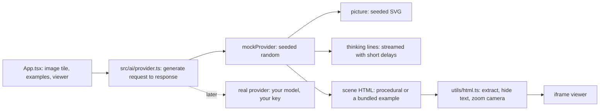
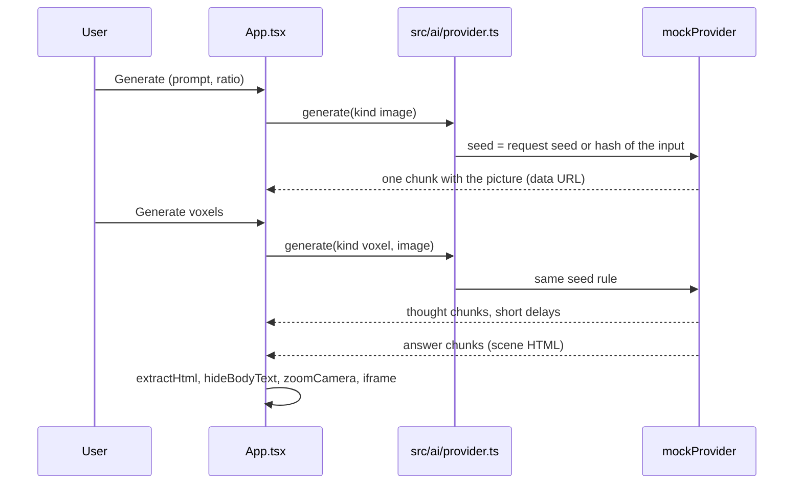

# Image to Voxel Art · phase 1 of 3 · planned
> Make a picture (or upload one) and turn it into a 3D voxel-art scene you can orbit, then download it. No AI for now: a repeatable mock makes the pictures and scenes.

> **This plan is ready to build.** File and folder names below are the layout of the new app; nothing here depends on any other project's files. Build from this plan alone.

| who reads | what | where |
|---|---|---|
| **Audience (users)** | Anyone who wants a quick 3D block version of a picture, and a good test of 'a generator returns HTML that runs' (the result is generated HTML, shown in an iframe). | this page: What is it, What you get, Look, Motion |
| **Stakeholders** | decide scope, answer questions | Decisions and open questions, Phases at a glance |
| **Builders (dev)** | stack: React + TypeScript + Vite only, no server, no key, no network call; one seam `src/ai/provider.ts` with a seeded mock; three.js code is generated at run time; pnpm only | `PHASES.md` and the grey DEV blocks (switch to Dev) |

<!-- dev -->
## Build recipe (read this first)
1. **Read in this order:** this README (the Build prompt below is the full spec), then `PHASES.md`. Nothing else is needed.
2. **Where it is built:** `run_test/image-to-voxel/`. The 3 example scenes of the reference app are listed in the plan; write them as procedural scenes (see the scene template), nothing is copied in from outside.
3. **Stack (pnpm ONLY, never npm, npx or yarn):** react ^19.2, react-dom ^19.2; dev: typescript ~5.8, vite ^6.2, `@vitejs/plugin-react` ^5, vitest ^3, `@types/node` ^22. NO AI package, NO Express, NO server file. Use exactly these ranges and commit `pnpm-lock.yaml`. Styling: Tailwind through its CDN script (as the reference does) or a pinned local Tailwind 3; the look below is in Tailwind terms.
4. **Planned files, ONE owner each** (see File tree in BUILD_PROMPT.md). builder-1 owns the shell and `src/ai/`, builder-2 owns the screen side. Nobody edits a file the other owns.
5. **Build only the phase you are asked for.** Phase 1 = mock seam + picture tile; phase 2 = Voxelize + viewer + examples; phase 3 = download + checks.
6. **Do not invent** features, files, endpoints or numbers the plan does not name. No AI call, no key, no `.env`, no proxy, no key dialog: not now (see D-03).
7. **This plan IS the planning.** Do not write a new plan or placeholder screens; each task delivers working code.
8. **Builder self-check before reporting:** `pnpm exec tsc --noEmit`, `pnpm test`, `pnpm build`, start the app, open it, read the browser console (0 errors), run the *Done when* steps of the phase. Report every difference from this plan.
9. **The lead verifies before it claims:** re-run `tsc --noEmit`, `pnpm test`, `pnpm build`, `git grep` for AI leftovers, open the page, state only what these show, and list every deviation.
<!-- /dev -->

## What is it
You either type a subject and the app makes a picture of it, or you upload your own image. Then you press Voxelize and the app builds a single-page three.js scene of coloured blocks, while a few "thinking" lines stream by. The scene shows inside the page, and you can download it as one `.html` file. Three ready-made examples let you try it at once.

**There is no AI in this version.** The pictures, the thinking lines and the scenes come from a built-in generator that uses a seeded random number: the same input always gives the same result, so tests repeat. It has the same answer shape a real AI call would have, so a real one can be plugged in later without changing the screen.

**For:** Anyone who wants a quick 3D block version of a picture, and a good test of 'a generator returns HTML that runs' (the result is generated HTML, shown in an iframe).

## What you get (feature catalog)
| id | feature | what you see or do | phase | status |
|---|---|---|---|---|
| F1 | Make an image | type a subject, pick an aspect ratio, optionally tidy the prompt (isolated object on a plain background); the built-in generator draws a repeatable picture | [1. Mock and image](PHASES.md) | planned |
| F2 | Upload an image | use your own picture instead | [1. Mock and image](PHASES.md) | planned |
| F3 | Voxelize | the built-in generator returns a three.js voxel scene for the image; fake "thinking" lines stream while you wait | [2. Voxelize and view](PHASES.md) | planned |
| F4 | See the scene | the scene runs inside the page (iframe); camera framing is adjusted and stray body text hidden | [2. Voxelize and view](PHASES.md) | planned |
| F5 | Examples | 3 ready scenes with their pictures | [2. Voxelize and view](PHASES.md) | planned |
| F6 | Download | save the scene as `voxel-scene-<time>.html` | [3. Download and verify](PHASES.md) | planned |

## Parts and how they connect

## Look and feel
- **Bold, black-and-white, poster style.** White page, thick black outlines, hard square corners (no rounding), and flat black "offset" shadows under every tile and button, like paper cut-outs. Big heavy capital title. One red used only for errors.
- **Layout:** one centred column. Title and tagline on top; a row of 4 square tiles (3 examples and a "Generate" tile); a panel that opens under the row for making or uploading a picture; a big square viewer; three wide buttons under it.
- Tiles lift up a little on hover and press down when clicked. The chosen tile is slightly larger. Full numbers (colours, sizes) are in the grey Build prompt.
- Real from the reference code: all of the above. The look was read from the code, not from a screenshot, so spacing may differ by a pixel or two.

## Motion and animation
- Tiles lift on hover and press down on click (0.2 s). The panel under the tiles slides in (0.3 s). The example pictures pulse grey while they load. The hint text in the prompt box changes every 3 s.
- While Voxelize runs the viewer is covered by a white screen that shows the request and the streamed thinking headlines, with animated dots. Nothing else moves. The scene itself is a live 3D page; what you can do inside it comes from the generated code (mouse orbit).

## Team: who does what
| who | does | tasks |
|---|---|---|
| builder-1 | shell and `src/ai/` files only (no file is owned twice) | T01, T02, T05, T09 |
| builder-2 | screen side files only | T03, T04, T06, T07, T08 |
| qa-reviewer | checks every phase in a real browser or build; writes pass/fail, never builds | T10 |

You (the owner) answer the open questions and judge each phase; Claude edits this plan when you ask (see Share and change).

## Quality bar (what 'professional' means here)
- No AI in the product: no model name, key, `.env`, proxy or AI package in `src/`, `package.json` or `dist/`; the page makes no request except the three.js script it shows scenes with
- A failed or empty answer shows a red message, never a blank page
- Same seed and same input give the same picture, thinking lines and scene (byte for byte)
- The downloaded `.html` opens by itself, with the scene visible and no leftover text on top
- `pnpm build`, `pnpm test` and `tsc --noEmit` pass; 0 console errors on load and on every example
- Text contrast at least 4.5:1 (the reference's light-grey hint text is below that: use `#4b5563` instead, see Q3); tap targets at least 40 px (buttons are 48 px and 56 px tall); works at 390 px width with no sideways scroll; keyboard focus visible on every button
- Reduced motion: with `prefers-reduced-motion` the lift, slide and dots stop (the fake thinking lines still appear, just without animation)
- 3D budget (guessed): an example scene runs at 30 fps or more on a normal laptop

## Real or guessed
**Real (from the reference app's source, about 1500 lines):** package versions of the front end, aspect ratios, file types, sample prompts, the 0.8 camera zoom, the 3 s hint timer, all Tailwind classes (so colours, sizes, shadows, borders), button labels, error texts, the 3 example scenes (334-415 lines each). The model names and both prompt texts are real too but are NOT used now: they sit in the block "Reference prompts for the later real provider" in the Build prompt.
**New in this plan (so guessed):** the whole mock generator (`src/ai/`), the seed rule, the fake thinking lines, the procedural scene template, local example thumbnails. **Not in the reference app:** the 3 example pictures (`example1-3.png`), any screenshot, any test file. Guessed items are marked "guessed" in the tables below.

## Decisions and open questions
| id | what | answer / default | state |
|---|---|---|---|
| D-01 | Output format | one self-contained HTML page with three.js, so it can be downloaded and opened anywhere | agreed |
| D-02 | One seam | the screen only ever calls `generate(request)` from `src/ai/provider.ts`; nothing else knows who answers | agreed |
| D-03 | No AI for now | mock provider (seeded random, same input gives same output, same answer shape as a real call); no key, no server, no proxy. Bring-your-own key + base URL comes later (Phase 4, LATER) | agreed |
| Q1 | Keep the 3 bundled examples? | default: yes; they also feed the mock scene pick | open |
| Q3 | Light-grey hint text fails contrast (about 2.5:1) | default: darken to `#4b5563` | open |
| Q5 | LATER: build the Bring-your-own-model dialog (Phase 4)? | default: not now | open |

## Phases at a glance
**1. Mock and image** (planned), **2. Voxelize and view** (planned), **3. Download and verify** (planned) → [full phase page](PHASES.md). Phase 4 "Bring your own model" is LATER and not part of the current build.

## Share and change
- **Share:** press *Copy link* in the plan viewer; one link = one page.
- **Change something:** press *Ask Claude* on the page and write your wish. Claude edits THIS file (and the phase page if scope moves), so `git diff docs/` shows what the plan changed.
- Status words: planning = still being written or missing facts · planned = split into tasks, **nothing built yet** · in progress · review · done.

<!-- dev -->
## Build prompt (give this to the builder)
The full prompt is one page: **[BUILD_PROMPT.md](BUILD_PROMPT.md)**. Give the builder that page plus this README. It holds, in this order: Goal and audience; Stack and scripts; File tree with one owner per file; The provider seam and the mock (request and response shapes, seed rule, thinking lines, picture and scene generators); Behaviour rules B1-B15; Data and state shapes; Look (hex tokens, fonts, sizes); Motion table; exact Content; Helper rules; Edge cases; Out of scope; Done-when with 8 checkable steps; and the dev block "Reference prompts for the later real provider (not used now)".

## Requirements (EARS)
| id | requirement | source |
|---|---|---|
| R1 | The product shall contain no AI call, key, `.env`, proxy or AI package; every answer shall come through `generate(request)` in `src/ai/provider.ts`. | decision D-03 |
| R2 | The mock shall be deterministic: the same request and seed shall give the same response, chunk by chunk. | guessed (new) |
| R3 | When the user presses Generate with a non-empty prompt, the app shall call `generate` with kind `image` and the chosen aspect ratio and show the returned picture. | real (shape), mock (source) |
| R4 | While "Optimise Scene" is on, the request shall carry `optimise: true` and the mock shall change its picture to an isolated object on a plain background. | real (idea) |
| R5 | When a file of type png, jpeg, webp, heic or heif is dropped or chosen, the app shall show it as the picture; other types shall give the error text. | real |
| R6 | When the user presses Generate voxels, the app shall read the stream from `generate` (kind `voxel`) and show the latest bold thinking headline. | real (flow) |
| R7 | When the stream ends, the app shall extract the HTML, hide listed overlay elements, scale every `camera.position.set` by 0.8 and show it in a sandboxed iframe. | real |
| R8 | The three examples shall open with no generator call. | real |
| R9 | While a call runs, the tiles and buttons shall be disabled and a loading screen shall be shown. | real |
| R10 | If the answer has no usable HTML, the app shall show a red error and not a blank viewer. | guessed (improvement) |
| R11 | When the user presses Download HTML, the app shall save `voxel-scene-<timestamp>.html`. | real |
| R12 | The layout shall work at 390 px width with no sideways scroll. | guessed |
| R13 | Under `prefers-reduced-motion` the lift, slide and dots shall be off. | guessed |
| R14 | When the page address has `?seed=<number>`, that seed shall be used for every request. | guessed (for repeatable tests) |

## Data model
Everything lives in the browser while the page is open; nothing is stored on a server or in the browser storage, and there is no server. Shapes: see "Data and state shapes" and "The provider seam" in the Build prompt.

## Code flow

Order in `App.tsx`: state, hint timer, thumbnail loader, `handleImageGenerate`, `processFile`, drag handlers, `handleExampleClick`, `handleUserTileClick`, `handleVoxelize`, `handleDownload`, JSX (header, tiles, panel, error, viewer, buttons).

## Test plan
No key and no network are needed for C1-C4, C8 and C7's type and build steps. Only the viewer checks (C5, C6) load the three.js script from its CDN.
| check | steps (human-style) | pass when |
|---|---|---|
| C1 provider seam | unit: `generate({kind:'image', prompt:'a dragon', aspectRatio:'1:1', optimise:true})` | one chunk with an image data URL; response shape equals the documented `ProviderChunk` |
| C2 picture tile | open page; click Generate tile; check the 5 ratios; type text; upload a .txt file, then a .png | 5 options, default 1:1; .txt gives the type error; .png shows and the panel closes |
| C3 stream | unit: collect `generate({kind:'voxel', ...})` with `delayMs: 0` | at least 3 thought chunks (with `**bold**` headlines) come before the answer chunks; joined answer chunks make a full HTML page |
| C4 html helpers | unit: text with chatter + `<html>..</html>`; text with only a fence; `camera.position.set(60, 30, 60)` | HTML only; fence body; `camera.position.set(48, 24, 48)` |
| C5 viewer | click each example; click View Image / View Scene | scene in under 3 s each; toggle works; console 0 errors |
| C6 download | open an example; Download HTML; open the file by double click | file name `voxel-scene-<digits>.html`; scene shows, no info text |
| C7 sweep | `tsc --noEmit`, `pnpm test`, `pnpm build`, `git grep` for AI leftovers, 390 px, keyboard Tab through all buttons | all exit 0; grep empty; no scroll; focus ring visible; contrast 4.5:1 or more |
| C8 same seed, same output | unit: call `generate` twice with seed 42 and the same request, for image and voxel; then once with seed 43 | the two seed-42 runs are identical (every chunk, byte for byte); seed 43 differs; no `Math.random` or `Date.now` is used in `src/ai/` |
Negative cases the reviewer must catch: any AI package, key, `.env` or `fetch` to an API in the code; blank iframe on empty answer; two builders editing one file; a leftover `npm` or `npx` in scripts or docs; a mock result that changes between runs.

## Lessons and risks
- The mock must look like the real thing: same chunk shape (`parts` with `text`, `thought`, `inlineData`), so the later real provider needs no screen change.
- Randomness hides bugs: only the seeded generator in `src/ai/rng.ts` may be used; no `Math.random`, no clock, in the mock.
- A real model often wraps code in chatter or a fence; keep `extractHtmlFromText` even though the mock answers cleanly (tests feed it chatter).
- Generated scenes load three.js from a CDN (`unpkg.com/three@0.160.0` in the examples): the viewer needs internet and the iframe `sandbox` must keep `allow-scripts`.
- `camera.position.set` regex only catches the literal form; scenes that set the camera another way are not zoomed (accepted).
- The reference's `animate-in` classes may be inert with the plain CDN script; implement the 300 ms slide yourself.
- Example thumbnails: the reference loads them from a Google address; here they are made locally by the mock picture generator (seeded by the example number), so they work offline.

