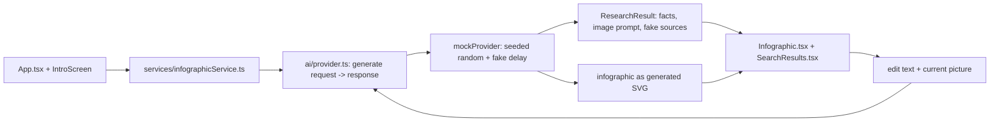

# InfoGenius · phase 1 of 3 · planned
> Type a topic and get an infographic picture with fact and source links, tuned to your audience, style and language. For now every answer is made by a built-in, repeatable fake generator (no AI, no key, no network).

> **This plan is ready to build.** File and folder names below are the layout of the new app; nothing here depends on any other project's files. Build from this plan alone.

| who reads | what | where |
|---|---|---|
| **Audience (users)** | Students, teachers and analysts who want a quick visual explanation with sources. | this page: What is it, What you get, Look, Motion |
| **Stakeholders** | decide scope, answer questions | Decisions and open questions, Phases at a glance |
| **Builders (dev)** | stack: React + TypeScript + Vite, Tailwind classes, lucide-react; no server, no AI: one `generate()` seam with a seeded mock provider; pnpm only | Build recipe, Build prompt, `PHASES.md` and the grey DEV blocks (switch to Dev) |

## What is it
You type a topic and pick three things: who it is for (Elementary, High School, College, Expert), a visual style (8 choices) and a language (10 choices). The app "researches" the topic and writes down a few facts together with source links, then draws one picture (always wide, 16:9) from those facts. **For now nothing is real AI:** a built-in generator picks the facts from a small bundled list and draws the picture itself, and the same input always gives the same output, so tests repeat. The source links are clearly fake `example.com` addresses. While you wait, the facts it found appear one after another, with the same loading screen a real service would need. You can ask for changes to the picture ("make the title bigger"), and every picture stays in a list of this session so you can go back to it. Later a real model can be plugged in behind the same single seam without changing any screen.

**For:** Students, teachers and analysts who want a quick visual explanation with sources.

## What you get (feature catalog)
| id | feature | what you see or do | phase | status |
|---|---|---|---|---|
| F1 | Intro and topic box | an animated intro (about 5.5 s, skippable), then a big topic field with a dark / light switch | [1. Shell and controls](PHASES.md) | planned |
| F2 | Audience, style, language | 4 audiences, 8 styles, 10 languages; the picture is always 16:9 (the original app has no shape choice) | [1. Shell and controls](PHASES.md) | planned |
| F3 | Research with sources | the mock research returns up to 5 facts and a list of fake source links (same topic = same result) | [2. Research and draw](PHASES.md) | planned |
| F4 | Infographic image | a generated SVG picture (seeded colours, title, bullet facts, a look per style) drawn from the research result | [2. Research and draw](PHASES.md) | planned |
| F5 | Live loading | an animated screen with two step messages and the found facts rotating; the waits are fake delays so this screen is built and tested | [2. Research and draw](PHASES.md) | planned |
| F6 | Edit the picture | type a change and get a new re-seeded variation labelled with your text; full-screen view with zoom, download | [3. Edit, history, verify](PHASES.md) | planned |
| F7 | History and error panel | all pictures of the session in a grid; a red message panel when the generator fails (a test switch can force a failure) | [3. Edit, history, verify](PHASES.md) | planned |

## Parts and how they connect

The one seam is `generate(request) -> response` in `src/ai/provider.ts`. The UI never knows which provider answers; a real one can replace `mockProvider` later (see Later below).

## Look and feel
Dark by default (a sun / moon button switches), deep blue-black background with a faint dot grid and a soft indigo glow at the top; cyan is the main accent, amber and purple are small highlights. Big friendly headline "Visualize The Unknown.", one large rounded search card holding the topic field and three small selector tiles, one bright button "INITIATE". Pictures sit in a rounded frame with cyan corner marks.
- **Fonts:** Space Grotesk (headings, buttons), Inter (body), Cinzel (the italic fact quotes while loading). All from Google Fonts.
- **Palette (Tailwind default values of the classes the app uses):** page dark `#020617` (slate-950) / light `#f8fafc` (slate-50); card dark `#0f172a` (slate-900) / light `#ffffff`; border `rgba(255,255,255,.10)` dark / `#e2e8f0` light; text `#ffffff` / `#0f172a`; muted `#94a3b8` / `#475569`; accent cyan `#22d3ee` dark / `#0891b2` light; button gradient `#0891b2` to `#2563eb`; indigo `#4f46e5`; amber `#fbbf24`; error panel red.
- **Sizes:** header 64 px (80 px from 768 px); content max 72 rem (search) / 80 rem (history); card radius 24 px, tiles 16 px, picture frame 16 px; headline 30 px (phone) to 96 px (desktop).
- **Phone (390 px):** tiles stack under the topic field, the button is full width, the header shows only the logo and the theme button.

## Motion and animation
| name | what | time | easing |
|---|---|---|---|
| intro | globe spins, data dots stream out, a small graphic card forms, then title and button appear | switches at 1.2 s, 4.0 s, 5.5 s | linear spin 10 s; fades 1 s |
| loading core | rings turn (20 s, 10 s, 8 s), centre pulses, words and icons fly into the middle | 2.5 s loop per item | ease-in |
| fact rotation | next fact slides up and fades in | every 3.5 s, fade 0.5 s | default |
| progress bar | width grows with the step: step 1 = 30%, step 2 = 50% | 1 s | ease-out |
| result | picture fades and zooms in | 0.7 s | default |
| fullscreen zoom | scale 0.5 to 4 in steps of 0.5 | 0.2 s | ease-out |
| **reduced motion** | no loops (rings, spin, fly-in); the fade stays | rule | rule |

## Team: who does what
| who | does | tasks |
|---|---|---|
| builder-1 | scaffold, the provider seam, the mock generator and the service (own files only) | T01, T02, T05, T08 |
| builder-2 | all screens and components (own files only) | T03, T04, T06, T07, T09 |
| qa-reviewer | checks every phase in a real browser or build; writes pass/fail, never builds | T10 |

You (the owner) answer the open questions and judge each phase; Claude edits this plan when you ask (see Share and change).

## Quality bar (what 'professional' means here)
- The picture is drawn only from the facts of the research step, and the source links are shown under it (3 or more); they are labelled as examples, never presented as real
- The same topic, level, style and language always give the same facts, links and picture (seeded, no `Math.random()`, no clock in the output)
- An error shows a red message panel, never a blank page; 0 console errors on a normal run
- An edit adds a new picture; the old one stays in the grid
- Text contrast 4.5:1 in dark and light; tap targets 40 px or more; usable at 390 px width, no sideways scroll; text never under 12 px (the original uses 9-10 px labels, a known weakness)
- Reduced-motion setting turns the looping animations off
- `pnpm build` and `tsc --noEmit` pass; the code makes no network request and holds no key, model name or AI package

## Real or guessed
**Real:** read from the app's actual code (about 2,060 lines): prompt text, labels, colours, fonts, timings, step messages. **Corrections to the first plan:** the original has NO aspect-ratio control (16:9 is fixed; a type exists but is unused); the "verify" step is a stub that always says accurate; the key-picker dialog only works inside Google's AI Studio host. **Changed by the owner (D-05):** the original calls Gemini through an Express proxy; this plan has NO AI, so that whole part is replaced by a seeded mock generator. **Guessed (marked in tables):** the mock facts, the SVG look per style, per-picture sources, the reduced-motion rule, exact installed versions.

## Decisions and open questions
| id | what | answer / default | state |
|---|---|---|---|
| D-01 | Truth first | research step runs BEFORE drawing; the picture uses only those facts (kept as a rule so a real provider can follow it) | agreed |
| D-02 | Key | no key anywhere in this build; nothing to hide, nothing in the browser | agreed |
| D-03 | Shape | 16:9 only, as in the original | agreed |
| D-04 | Free testing | the mock provider IS the default, so QA spends no credits and needs no network | agreed |
| D-05 | No AI for now | no Gemini, no `@google/genai`, no Express proxy, no `.env` key, no Google Search, no key dialog, no no-key fallback. A seeded mock provider answers behind one `generate()` seam; a bring-your-own key + base URL setting comes LATER | agreed (owner) |
| Q1 | Which languages? | default: the 10 of the original | open |
| Q2 | Add a shape choice (9:16, 1:1)? | default: no, out of scope | open |
| Q3 | Later: bring your own model (see below)? | default: not now; decide after phase 3 | open |

## Phases at a glance
**1. Shell and controls** (planned), **2. Research and draw** (planned), **3. Edit, history, verify** (planned) → [full phase page](PHASES.md)

## Later (NOT part of the current build): bring your own model
Idea for a final optional phase 4, only if you say yes (Q3). A settings dialog where the user pastes an **API key + base URL (+ model name)** at runtime, so any provider works, not only Gemini.
- A `realProvider` that implements the same `generate(request) -> response` and is picked instead of `mockProvider` when settings exist; the UI does not change.
- Key, URL and model live in the user's browser only (`localStorage`), are sent per request, and are never committed, baked into the bundle or logged.
- Open: a browser may block calls to some providers (CORS), so a small proxy might be needed; and the reply must be parsed into the same `ResearchResult` shape.

## Share and change
- **Share:** press *Copy link* in the plan viewer; one link = one page.
- **Change something:** press *Ask Claude* on the page and write your wish. Claude edits THIS file (and the phase page if scope moves), so `git diff docs/` shows what the plan changed.
- Status words: planning = still being written or missing facts · planned = split into tasks, **nothing built yet** · in progress · review · done.

<!-- dev -->
## Build recipe (read this first)
1. **Read in this order:** this README, then `PHASES.md`. No other file is needed.
2. **Where it is built:** `run_test/info_genius/`.
3. **Stack, pnpm ONLY (never npm, npx, yarn):** `react` and `react-dom` ^19.2.0, `lucide-react` ^0.553.0; dev: `vite` ^6.2.0, `@vitejs/plugin-react` ^5.0.0, `typescript` ~5.8.2, `@types/node` ^22.14.0, `@types/react` and `@types/react-dom` ^19.2.0 (ranges are real; the reference has no lock file, so install with `pnpm add --save-exact` and report the resolved versions). Tailwind comes from the CDN play script, as in the original. **NOT installed, on purpose (D-05):** `@google/genai`, `express`, `tsx`, `esbuild`, `@types/express`, or any AI or HTTP-client package. No server: `vite` alone serves and builds.
4. **File tree, ONE owner per file:**

| file | what | owner |
|---|---|---|
| `package.json`, `vite.config.ts`, `tsconfig.json`, `.gitignore`, `index.html`, `index.css`, `index.tsx`, `types.ts` | scaffold, types, keyframes (no `.env` files) | builder-1 |
| `src/ai/provider.ts` | the ONE seam: `generate(request) -> response`, `mockProvider` | builder-1 |
| `src/ai/mock/` (`seed.ts`, `facts.ts`, `drawSvg.ts`) | seeded random, bundled fact list, SVG infographic drawing | builder-1 |
| `services/infographicService.ts` | builds requests, calls the seam, parses the response, fake delays | builder-1 |
| `App.tsx` | state, header, form, flow, history | builder-2 |
| `components/IntroScreen.tsx`, `Loading.tsx`, `Infographic.tsx`, `SearchResults.tsx` | one component each | builder-2 |

5. **Build only the asked phase.** Do not invent features or files. This plan IS the planning: write no new plan and no placeholder screens; deliver each file finished.
6. **Do not copy the original's parts:** the Express server, `genaiProxy.ts`, the Gemini service, chat, streaming, images, video routes, `x-client-id`, `BoundedMap`, `verifyInfographicAccuracy`, `fixInfographicImage`, the AI-Studio key dialog.
7. **Builder self-check before reporting:** `pnpm exec tsc --noEmit`, `pnpm build`, open the page and read the console (0 errors), `grep -ri "genai\|gemini\|api_key\|fetch(" src` finds nothing, no `.env*` file exists. List every difference from this plan.
8. **The lead verifies before it claims:** runs the same commands, runs the Test plan below in the browser (offline), reads every builder report, lists every deviation, and says so when a check could not run.

## Build prompt (give this to the builder)
**Goal.** Build 'InfoGenius': enter a topic, pick audience, style and language, get a 16:9 infographic with fact and source links; edit it by text; keep every picture of the session. For students, teachers, analysts. **No AI and no network in this build:** every "research" and "draw" step is answered by a deterministic seeded mock.

**Stack.** React 19 + TypeScript + Vite 6, Tailwind via CDN script with `darkMode: 'class'`, lucide-react icons. No server. pnpm only.

**File tree.** As in the Build recipe.

**The seam (`src/ai/provider.ts`).** One function, one file; the UI and the service only ever call this.
```ts
type Level = ComplexityLevel; // see Data shapes
type GenerateRequest =
  | { kind: 'research'; topic: string; level: Level; style: VisualStyle; language: Language }
  | { kind: 'image';    prompt: string; level: Level; style: VisualStyle; language: Language; topic: string; facts: string[] }
  | { kind: 'edit';     image: string /* data URL */; instruction: string; seedFrom: string; style: VisualStyle };
type GenerateResponse =
  | { kind: 'research'; result: ResearchResult }   // { imagePrompt, facts[], searchResults[{title,url}] }
  | { kind: 'image' | 'edit'; image: string };     // data URL (image/svg+xml;base64 for the mock)
export interface Provider { generate(req: GenerateRequest): Promise<GenerateResponse> }
export const mockProvider: Provider = { generate };
export const provider: Provider = mockProvider;    // the only line a later real provider changes
```
The response shapes are exactly what a real model call would be parsed into, so a real provider can be dropped in without touching any screen.

**The mock (`mockProvider`).**
- **Seed:** `seed = hash32(kind + topic.trim().toLowerCase() + level + style + language [+ instruction])` (e.g. FNV-1a), fed to a small seeded generator (mulberry32). **Never** `Math.random()`, `Date.now()` or the clock inside the output: same input -> byte-identical output. (The picture `id` may use `Date.now()`; it is not part of the output.)
- **Research:** facts come from a small bundled list in `facts.ts`: 12 generic lines per level (Elementary short and simple ... Expert dense), each with `{topic}` filled in, in English for all languages (the language only adds a `[<language>]` tag, no translation). The seed picks 3 to 5 of them in a stable order. Sources: 3 entries titled `Example source: <topic> overview (1..3)` with URLs `https://example.com/<slug>/<n>`; clearly fake. `imagePrompt` = `Create a detailed infographic about <topic>. <level text> <style text>` (the texts from the reference block).
- **Image:** a 1600x900 SVG built as a string by `drawSvg.ts`: background and two accent colours from the seed (hue from the seed, saturation and lightness fixed per style), the topic as title, the facts as bullets, a small footer `MOCK IMAGE · seed <hex>`. Style variations: Default = clean gradient panel; Minimalist = flat 2-3 colours, big empty space; Realistic = soft vignette and shadow; Cartoon = thick outlines, round shapes; Vintage = sepia paper, serif font; Futuristic = dark, neon lines, grid; 3D Render = isometric blocks; Sketch = parchment, wobbly lines. Level changes density (Elementary: big icons, 3 bullets; Expert: small text, 5 bullets). Returned as `data:image/svg+xml;base64,...`.
- **Edit:** re-seed with `seedFrom + instruction`, redraw the same facts with a new colour variation and a visible ribbon `Edit: "<instruction>"`; not an image-processing operation.
- **Fake delays (keep the real step feel):** research resolves after 2.5 s, image after 3.0 s, edit after 3.0 s (constants at the top of `provider.ts`; a `?fast=1` URL flag or `VITE_MOCK_DELAY=0` sets 0 for tests). The step messages and progress bar of B5-B7 run exactly as if a service were slow.
- **Forced failure for tests:** topic text `fail` makes `generate` reject with `Error('Mock failure')`, so the red error panel is testable. No other special inputs.

**Behaviour (rules).**
| id | trigger | result (numbers are real) |
|---|---|---|
| B1 | page opens | intro shows first; at 1.2 s data dots stream, at 4.0 s a graphic card forms, at 5.5 s title "InfoGenius Vision", tagline "Knowledge. Visualized.", button "INITIALIZE SYSTEM" appear (no "Google Search Grounding" badge: there is no search). "Skip Intro" (top right) is always visible. Both go to the main screen. |
| B2 | main opens | defaults: audience High School, style Default, language English, dark mode ON |
| B3 | theme button | toggles class `dark` on `<html>`; Sun icon in dark, Moon in light |
| B4 | submit with empty or blank topic | error "Please enter a topic to visualize."; no `generate` call |
| B5 | submit | form dims (opacity .5, scale .95, blur, no clicks); clears facts and sources; Loading shows step 1, "Researching topic..." |
| B6 | research returns | keep first 5 facts; sources de-duplicated by URL; step 2, "Designing Infographic..."; facts rotate every 3.5 s |
| B7 | image returns | new `GeneratedImage` (id = `Date.now()` string, `prompt` = the topic, level, style, language, sources) is put FIRST in history; loading ends |
| B8 | any failure | message is 'The image generation service is temporarily unavailable. Please try again.' in the red panel |
| B9 | "Enhance" with non-empty text | calls `edit` with the FIRST history image + the text; step 2, `Processing Modification: "<text>"...`; success puts a new image first with the same level/style/language and `prompt` = the text; failure: 'Modification failed. Try a different command.' Button disabled when empty or busy |
| B10 | history has 2+ items | grid "Session Archives" of items 2..n (2 / 3 / 4 columns by width); click moves that item to the front |
| B11 | click the picture or the maximise button | fullscreen overlay; zoom 50%-400% in steps of 50% (buttons + percent label resets to 100%); X closes and resets zoom |
| B12 | download button | saves `infographic-<id>.svg` from the data URL (the mock is SVG; a later real provider may return PNG, then `.png`) |
| B13 | source card | opens in a new tab only if the URL starts with http(s) (else `#`); small label = hostname without `www.`, fallback "External Source"; titles clamp to 2 lines |
| B14 | same inputs twice | identical facts, sources and picture bytes (determinism) |

**Data shapes.** `AspectRatio` = '16:9' | '9:16' | '1:1' (type only, unused); `ComplexityLevel` = Elementary | High School | College | Expert; `VisualStyle` = Default | Minimalist | Realistic | Cartoon | Vintage | Futuristic | 3D Render | Sketch; `Language` = English | Spanish | French | German | Mandarin | Japanese | Hindi | Arabic | Portuguese | Russian; `GeneratedImage` {id, data (data URL), prompt, timestamp, level?, style?, language?, sources? (guessed addition)}; `SearchResultItem` {title, url}; `ResearchResult` {imagePrompt, facts[], searchResults[]}; `GenerateRequest` / `GenerateResponse` as in The seam. Session state only: nothing is stored in `localStorage`; a reload clears history.

**Content (real texts).** Header: "InfoGenius" + gradient "Vision", small caps line "Visual Knowledge Engine". Badge "Explore vast subjects like history, science, and more." Headline "Visualize The Unknown." Lead "Generate diagrams and infographics for any topic." (the original said "powered by Google search grounding"; dropped). Placeholder "What do you want to visualize?" Tiles: Audience (Elementary, High School, College, Expert), Aesthetic (option labels: Standard Scientific=Default, Minimalist, Photorealistic=Realistic, Graphic Novel=Cartoon, Vintage Lithograph=Vintage, Cyberpunk HUD=Futuristic, 3D Isometric=3D Render, Technical Blueprint=Sketch), Language (the 10). Button "INITIATE" with microscope icon, caption "16:9 Format". Loading idle text "Establishing connection...". Flying words HISTORY, SCIENCE, FACTS, DATA. Sources heading "Research Sources" plus a small note "Example links (demo data)". History heading "Session Archives". Edit placeholder "Refine the visual (e.g., 'Make the background stars')...", button "Enhance". Footer line `PROMPT: <prompt>` (truncated, 60% opacity).

**Look and Motion.** As in the two tables above (palette, fonts, sizes, motion). Tailwind `animate-in` classes need a plugin the CDN does not include: define `fade-in`, `zoom-in`, `slide-in-from-bottom` keyframes in `index.css` yourself. Wrap loops in `@media (prefers-reduced-motion: reduce)` (guessed).

**Edge cases.** Empty topic (B4); topic of 300+ characters still accepted (title is shortened in the SVG with an ellipsis, text is XML-escaped); topic with `<`, `&` or quotes must not break the SVG; zero sources (hide the "Research Sources" block); topic `fail` (error panel); double submit while loading ignored; edit with empty text disabled; a very tall result keeps `max-h-[80vh]`, contained; history of 20+ pictures stays smooth (data URLs live in memory only).

**Out of scope.** Any real AI call, API keys, a server, accounts, saving to disk, shape choice, accuracy checker, streaming, chat, video, sharing, other languages for the UI itself (the UI is English; only a language tag changes).

**Done-when.** `pnpm install && pnpm exec tsc --noEmit && pnpm build` exit 0 (`dist/index.html` exists); `pnpm dev` then the Test plan passes at 1280 px and 390 px with the network off; 0 console errors; `grep -ri "genai\|gemini\|api_key" src dist` finds nothing.

### Reference prompts for the later real provider (not used now)
Kept verbatim from the original app so a later `realProvider` can reuse them. **Nothing in this block is built, imported or sent now.** Original models: TEXT `gemini-3-pro-preview` (the original server upgraded it to `gemini-3.1-pro-preview`) with the Google Search tool; IMAGE and EDIT `gemini-3-pro-image-preview` with `responseModalities: ["IMAGE"]`. Image = `candidates[0].content.parts[0].inlineData.data`; the edit call sent `[{inlineData:{mimeType:'image/jpeg', data}}, {text}]` after stripping the `data:image/...;base64,` prefix. Sources came from `candidates[0].groundingMetadata.groundingChunks[].web` (`uri` + `title`).
- Research prompt (exact text, `${...}` filled in): `You are an expert visual researcher. Your goal is to research the topic: "${topic}" and create a plan for an infographic. **IMPORTANT: Use the Google Search tool to find the most accurate, up-to-date information about this topic.** Context: ${levelInstr} ${styleInstr} Language: ${language}. Please provide your response in the following format EXACTLY: FACTS: - [Fact 1] - [Fact 2] - [Fact 3] IMAGE_PROMPT: [A highly detailed image generation prompt describing the visual composition, colors, and layout for the infographic. Do not include citations in the prompt.]`
- Parse: facts = lines after `FACTS:` up to `IMAGE_PROMPT:`, strip leading `- `, drop empties, first 5. Image prompt = text after `IMAGE_PROMPT:`; if missing: `Create a detailed infographic about ${topic}. ${levelInstr} ${styleInstr}`. Sources = `candidates[0].groundingMetadata.groundingChunks[].web` with both `uri` and `title`.
- Level text: Elementary "Target Audience: Elementary School (Ages 6-10). Style: Bright, simple, fun. Use large clear icons and very minimal text labels." / High School "Target Audience: High School. Style: Standard Textbook. Clean lines, clear labels, accurate maps or diagrams. Avoid cartoony elements." / College "Target Audience: University. Style: Academic Journal. High detail, data-rich, precise cross-sections or complex schematics." / Expert "Target Audience: Industry Expert. Style: Technical Blueprint/Schematic. Extremely dense detail, monochrome or technical coloring, precise annotations."
- Style text: Default "Aesthetic: High-quality digital scientific illustration. Clean, modern, highly detailed." / Minimalist "Aesthetic: Bauhaus Minimalist. Flat vector art, limited color palette (2-3 colors), reliance on negative space and simple geometric shapes." / Realistic "Aesthetic: Photorealistic Composite. Cinematic lighting, 8k resolution, highly detailed textures. Looks like a photograph." / Cartoon "Aesthetic: Educational Comic. Vibrant colors, thick outlines, expressive cel-shaded style." / Vintage "Aesthetic: 19th Century Scientific Lithograph. Engraving style, sepia tones, textured paper background, fine hatch lines." / Futuristic "Aesthetic: Cyberpunk HUD. Glowing neon blue/cyan lines on dark background, holographic data visualization, 3D wireframes." / 3D Render "Aesthetic: 3D Isometric Render. Claymorphism or high-gloss plastic texture, studio lighting, soft shadows, looks like a physical model." / Sketch "Aesthetic: Da Vinci Notebook. Ink on parchment sketch, handwritten annotations style, rough but accurate lines."

## Requirements (EARS)
| id | requirement | source |
|---|---|---|
| R1 | When the page opens, the system shall show the intro and allow skipping at any moment. | real |
| R2 | The system shall default to High School, Default style, English, dark mode. | real |
| R3 | When the user submits an empty topic, the system shall show a message and generate nothing. | real |
| R4 | When the user submits a topic, the system shall run the research request before any image request. | real |
| R5 | The system shall show at most 5 facts and de-duplicated source links. | real |
| R6 | While loading, the system shall show the step text and rotate facts every 3.5 s. | real |
| R7 | When an edit is sent, the system shall use the newest picture and keep the older ones in the grid. | real |
| R8 | The system shall contain no AI call, no network request, no API key and no AI package. | owner (D-05) |
| R9 | All generation shall go through the single `generate(request) -> response` seam in `src/ai/provider.ts`. | owner (D-05) |
| R10 | The mock provider shall be the default and shall be deterministic: the same request gives the same response. | owner (D-05) |
| R11 | Where the user prefers reduced motion, looping animations shall stop. | guessed |
| R12 | Each picture shall keep its own source links. | guessed |
| R13 | The mock shall wait the fake delays (research 2.5 s, image 3.0 s, edit 3.0 s) unless a test flag sets them to 0. | guessed |
| R14 | Mock source links shall be clearly fake (`example.com`) and labelled as example links. | guessed |

## Data model
Session only, in `App.tsx` state: `imageHistory: GeneratedImage[]` (newest first, index 0 is shown), `facts: string[]`, `isLoading`, `loadingStep` (0, 1, 2), `loadingMessage`, `error`, `isDarkMode`, `showIntro`, selected level, style, language, topic. Shapes in the Build prompt. The mock holds no state: it is a pure function of the request.

## Code flow
`App.handleGenerate` -> `researchTopic(topic, level, style, language)` -> `provider.generate({kind:'research',...})` -> seeded facts, fake sources, image prompt after the fake delay -> `generateInfographic(...)` -> `provider.generate({kind:'image',...})` -> SVG data URL -> `setImageHistory([new, ...old])`. Edit: `handleEdit(text)` -> `provider.generate({kind:'edit', image: history[0].data, instruction: text, ...})`. No HTTP request happens anywhere; swapping `provider` for a real implementation (Later) changes nothing else.

## Test plan
No key, no network: run it with the network off. Add `?fast=1` for the quick runs; leave the delays on once to check the loading screen.
| task | steps (human-style) | pass when |
|---|---|---|
| T01 build | `pnpm install`, `pnpm exec tsc --noEmit`, `pnpm build` | all exit 0; `dist/index.html` exists; no `server` file |
| T02 no AI | `grep -ri "genai\|gemini\|api_key\|fetch(" src`; open the network tab during a run | no match; zero requests besides the app's own files |
| T03 intro | open page and wait | title at 5.5 s (+/- 0.5 s); Skip works at 0 s |
| T04 controls | change each tile; run; read the result | facts carry the chosen language tag; the picture changes look with the style and density with the level |
| T05 mock run | topic "photosynthesis" (delays on) | loading shows step 1 for about 2.5 s then step 2 for about 3 s; picture + 3 "example" source cards appear; 0 console errors |
| T06 edit | type "make the title bigger"; Enhance | 2 pictures; the new one shows the ribbon `Edit: "make the title bigger"`; grid shows 1 older thumbnail; click it moves it first |
| T07 theme/phone | toggle theme; set width 390 px | contrast at least 4.5:1 on body text; no horizontal scroll; buttons 40 px or higher |
| T08 same seed | run "volcanoes" / High School / Default / English twice (reload between); compare the facts, links and the image data URL | byte-identical; changing only the style or the topic changes the picture |
| T09 failure | topic `fail` | red panel with the unavailable message; page not blank; next normal topic works |
| T10 odd input | topic `<b>&"x"</b>` and a 300-character topic | picture still renders, text escaped, no console error |

## Lessons and risks
- The CDN Tailwind does not know `animate-in`; without own keyframes the "fade/zoom" does nothing.
- `index.html` of the original has an `importmap` pointing to esm.sh for react: drop it, Vite bundles React (two Reacts break hooks).
- Determinism breaks easily: no `Math.random()`, no `Date.now()`, no `Map` order surprises or locale-dependent sorting inside the mock.
- SVG text does not wrap: break the title and bullets into lines yourself; escape `& < > "` in every topic text.
- Keep the seam thin: if a screen imports anything from `src/ai/mock/`, the later real provider cannot drop in.
- Mock facts are filler, not true statements: never present them as researched, keep the "Example links (demo data)" note.
- When a real model is added later its preview names change; keep them as constants in the new provider only.
- 9-10 px label text of the original fails the 12 px bar: use 12 px.

