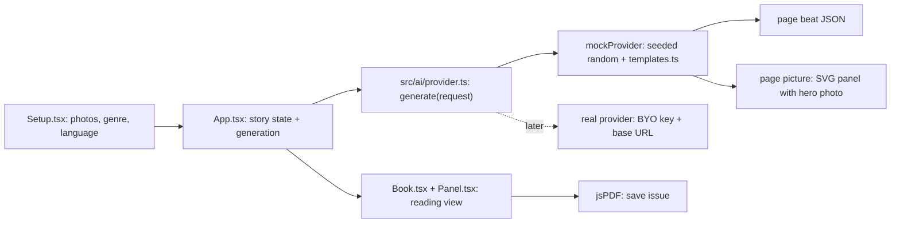

# Infinite Heroes (personalized comic book) · phase 1 of 3 · planned
> Upload a photo of yourself (and a friend) and get a comic book of 10 story pages that stars you, with a choice on page 3 that changes the ending. **No AI for now:** the story and pictures come from a seeded mock generator that behaves like an AI, so a real one can be plugged in later.

> **This plan is ready to build.** File and folder names below are the layout of the new app; nothing here depends on any other project's files. Build from this plan alone.

## Build recipe (read this first)
1. **Read in this order:** this README (top to bottom, then the grey DEV blocks), then `PHASES.md` for your phase.
2. **Built in:** `run_test/personalized_comics/` (a plain Vite project, **no server**).
3. **Stack (pnpm ONLY, never npm/npx/yarn):** React 19, TypeScript 5.8, Vite 6, `jspdf` 3, Tailwind 4 + fonts from pnpm (works offline). **No** Gemini, `@google/genai`, Express, `.env` key, key dialog or network call.
4. **Build only the phase you are asked for.** One owner per file (table in *File tree*); do not edit another task's file.
5. **Do not invent** features or files not named here (no share links, accounts, voice, video, server, real AI). If something is missing, say so.
6. **This plan IS the planning:** no new plan, no placeholder screens. Deliver each file finished: behaviour AND the comic look.
7. **One seam:** the UI calls only `generate(request)` from `src/ai/provider.ts`; nothing else makes story text or pictures. The mock is the default provider.
8. **Builder self-check:** `pnpm exec tsc --noEmit`, `pnpm build`, open the page, 0 console errors. Report every difference from this plan.
9. **The lead verifies before it claims:** run the commands, open the page, read every report, list deviations; say "not run" for anything not run. Everything is checkable offline, with no key.

## What is it
You upload a photo of yourself as the hero, and optionally a friend as the co-star. You pick a genre (Classic Horror, Superhero Action, Dark Sci-Fi, High Fantasy, Neon Noir Detective, Wasteland Apocalypse, Lighthearted Comedy, Teen Drama / Slice of Life, or your own premise) and a language. A **mock generator** (no AI, no network) writes each page (caption, speech, scene) from small built-in story templates and draws it as a coloured comic panel with your photo cropped in, so the same face shows on every page. The cover and first pages appear within moments; the rest are made while you read. On page 3 the story asks a values question (truth or safety?) and your answer changes the later pages. At the end you get a back cover and can save the issue as a PDF.

The mock is seeded: the same input gives the same result, so tests repeat. It returns the exact shape a real AI would, so a real model can be added later without touching the screens.

**For:** someone who wants a personal comic; also a free, repeatable test bed for a long generation pipeline with a visible reading experience.

## What you get (feature catalog)
| id | feature | what you see or do | phase | status |
|---|---|---|---|---|
| F1 | Cast and setup | upload hero (required) and co-star (optional); genre, language, premise, Novel mode | [1](PHASES.md) | planned |
| F2 | Comic book view | closed cover, tap to open, 10 story pages and a back cover as flipping pages | [2](PHASES.md) | planned |
| F3 | Story beats (mock) | caption, speech, scene and focus per page from templates, in the JSON shape a real AI would give | [2](PHASES.md) | planned |
| F4 | Pictures with your face (mock) | each page is a seeded generated panel in genre colours with your photo cropped in | [2](PHASES.md) | planned |
| F5 | Choice page | page 3 offers 2-3 canned values choices; the pick changes later pages | [3](PHASES.md) | planned |
| F6 | Batches and loading | cover + pages 1-2, then 3-5, then 6 after the pick; short fake delays; comic-sound loading cards | [2](PHASES.md) | planned |
| F7 | Save as PDF | export every finished page | [3](PHASES.md) | planned |
| F8 | Provider seam | one `generate(request)` file with the mock; a real provider can replace it later | [1](PHASES.md) | planned |

## Parts and how they connect


## Look and feel
Comic-book style on a dark dotted stage: a white setup card with a thick black border and hard shadow, tilted 1 degree; Bangers titles, Comic Neue text; red/yellow title, blue hero upload, purple co-star upload, green when ready. The book is a 2:3 page (about 750 px tall) with gloss and a cover spine; on a 390 px phone one page shows at a time. Setup leaves with a **POW!** burst, pages flip in 0.8 s, waiting pages pop comic words (POW! BAM! ZAP!); reduced motion turns spin, bounce and pulse off. Exact values: DEV block.

## Team
**builder** writes its own files only (T01-T07); **qa-reviewer** checks each phase in a browser or build and writes pass/fail (T08). You (the owner) answer open questions and judge each phase; Claude edits this plan when you ask.

## Quality bar (what 'professional' means here)
- The start button stays disabled until a hero photo exists.
- A failed picture shows a Retry button, never a blank page.
- A different pick on page 3 gives a different last page.
- The same input and seed give the same text and the same pictures, every run.
- The PDF contains every finished page (12 when all are drawn).
- Readable: contrast 4.5:1; tap targets at least 40 px; works at 390 px wide.
- 0 errors in the browser console; no network request for generation; no key anywhere.
- `pnpm exec tsc --noEmit` and `pnpm build` pass.

## Real or guessed
**Real:** read from the source of the Google AI Studio app 'Infinite Heroes' (about 1930 lines): constants, colours, fonts, timings, genres, tones, languages, response shapes. It has no test file.
**Changed by the owner:** the reference's AI calls, server and key dialog are NOT built. The mock provider, seeds, templates, SVG panels and failure switch are **new and guessed**, as are the retry button, reduced-motion rules, 40 px / 4.5:1 / 390 px targets and mock delays.
**Corrected from the earlier plan:** the tone is not a user choice (picked by the seed from the genre's allowed tones); the premise box only exists for Custom; the choice page is page 3 only.

## Decisions and open questions
| id | what | answer / default | state |
|---|---|---|---|
| D-01 | Page budget | cover + 10 story pages + back cover = 12 faces; batches: cover + 1-2, then 3-5, then 6 after the pick | agreed |
| D-02 | Decision page | page 3 | agreed |
| D-03 | Models | none now; names kept only in [reference_prompts.md](reference_prompts.md) | superseded by D-04 |
| D-04 | No AI for now | all story and pictures come from the seeded `mockProvider`; no Gemini, SDK, server, key or key dialog; BYO key + base URL is LATER | agreed (owner) |
| Q1 | Keep 15 languages and 9 genres? | yes, plain lists in `types.ts`; mock text is English, `language` is passed through for a later real provider | open |
| Q2 | Later: which provider shapes for Bring your own model? | OpenAI-compatible first | open |

## Phases at a glance
**1. Setup** (planned), **2. Story and pictures** (planned), **3. Choices and PDF** (planned); **LATER, not in the current build:** 4. Bring your own model → [full phase page](PHASES.md)

## Later: Bring your own model (NOT part of the current build)
An optional settings dialog where the user pastes an **API key + base URL (+ model name)** at runtime, so any provider works, not only Gemini. It would need:
- a `realProvider` beside `mockProvider` in `provider.ts`, chosen by a Settings switch (mock stays default and fallback);
- the key kept in the browser only (`localStorage`), sent per request, never committed or baked in, with a visible warning;
- the prompts of [reference_prompts.md](reference_prompts.md) adapted per provider, same response shape and clean-up;
- open: browser-direct calls need CORS; otherwise a tiny proxy.

## Share and change
Press *Copy link* to share; press *Ask Claude* to change the plan (Claude edits THIS file, `git diff docs/` shows it). Status words: planning · planned (nothing built yet) · in progress · review · done.

<!-- dev -->
## Build prompt (give this to the builder)

### Goal
Build 'Infinite Heroes': a web app that turns one or two uploaded photos into a 12-face comic book (cover, 10 story pages, back cover) with mock-written beats and mock-drawn pages, one decision on page 3, and a PDF export. **No real AI, no server, no network.** For a general user with a phone or desktop browser.

### Stack
- Node 22, **pnpm only**. `react@^19.2.0`, `react-dom@^19.2.0`, `jspdf@^3.0.3`, `tailwindcss@^4.1.0`, `@fontsource/bangers@^5.1.0`, `@fontsource/comic-neue@^5.1.0` (guessed: replaces the reference's CDN, works offline).
- Dev: `vite@^6.2.0`, `@vitejs/plugin-react@^5.0.0`, `@tailwindcss/vite@^4.1.0`, `typescript@~5.8.2`, `@types/node@^22.14.0`, `@types/react@^19.2.0`, `@types/react-dom@^19.2.0`. Commit the lockfile. **Not installed:** `express`, `@google/genai`, `tsx`, `esbuild`, `dotenv`, `recharts`.
- Scripts: `dev` = `vite` (http://localhost:5173); `build` = `vite build`; `preview` = `vite preview`. tsconfig: ES2022, `jsx: react-jsx`, `moduleResolution: bundler`, `noEmit`. No esm.sh `importmap`.

### File tree (one owner per file)
| file | what | owner task |
|---|---|---|
| `package.json`, `tsconfig.json`, `vite.config.ts`, `.gitignore`, `index.tsx` | project plumbing (`.gitignore` has `node_modules`, `dist`) | T01 |
| `index.html`, `styles.css` | comic CSS (`.comic-btn`, `.comic-scene`, `.book`, `.paper`, `.gloss`, `.panel-*`), CSS vars, font imports | T01 |
| `types.ts` | constants, GENRES, TONES, LANGUAGES, `ComicFace`, `Beat`, `Persona`, `GenRequest`, `GenResponse` | T01 |
| `Setup.tsx` | setup card, uploads, selects, launch, POW burst | T01 |
| `src/ai/provider.ts` | THE SEAM: `generate(request) -> Promise<response>`, seeded PRNG, `mockProvider`, panel drawing, fake delays, failure switch | T02 |
| `src/ai/templates.ts` | bundled story template data per genre/tone (data only) | T02 |
| `App.tsx` | state, request building, generation, batching, choice, PDF | T03 (beats, images), T05 (batches), T06 (choice), T07 (PDF) |
| `Book.tsx`, `Panel.tsx`, `LoadingFX.tsx` | book view, page face, loading card | T04 |

### Behaviour (rules)
| id | trigger | result | numbers |
|---|---|---|---|
| B1 | open the app | setup card over a blurred, tilted book; footer with rotating 'REMIX IDEA' | text changes every 3000 ms |
| B2 | pick a hero photo | preview 80x80 tilted -2 deg, green border, pulsing 'READY'; button turns to REPLACE | `accept="image/*"`; base64 without prefix |
| B3 | no hero | START ADVENTURE disabled and grey | - |
| B4 | genre = Custom | PREMISE textarea appears; empty on start gives `alert("Please enter a custom story premise.")` and stops | h-16 |
| B5 | START | compute run seed; close setup with the POW burst; build the cover face; start the cover picture at once | burst 1 s, book shows at 1100 ms |
| B6 | 1100 ms after START | `await` pages 1-2 (one after the other), then start pages 3-5 without waiting | `INITIAL_PAGES=2`, `generateBatch(3,3)` |
| B7 | tone | picked ONCE at START by the seeded PRNG from the allowed tones: Comedy / Teen = CASUAL, WHOLESOME, QUIPPY; Horror = INNER-MONOLOGUE, OPERATIC; others all 6 | `rng(seed)` |
| B8 | cover button | disabled `PRINTING... n/2` until page 2 has a picture, then 'READ ISSUE #1' (bounces) | `GATE_PAGE=2`; within 5 s |
| B9 | click a sheet | right page = flip forward (only if its picture exists); earlier sheet = go back | `currentSheetIndex` |
| B10 | page 3 shown | 2-3 choice buttons (yellow, blue, red), heading 'What drives you?'; a click stores `resolvedChoice`, hides them, starts the batch of 6 | pages `maxPage+1 .. 11` |
| B11 | page 10 | names the page-3 choice and ends 'TO BE CONTINUED...' | `MAX_STORY_PAGES=10` |
| B12 | page 11 | back cover 'NEXT ISSUE SOON'; buttons DOWNLOAD ISSUE and CREATE NEW ISSUE (reset, clears photos) | `BACK_COVER_PAGE=11` |
| B13 | `generate` throws | fallback beat (B14) or Retry (B15); no dialog, no crash | - |
| B14 | beat fails | `{caption: "It began..." (page 1) or "...", scene: "Generic scene for page N.", focus_char: "hero", choices: []}`; still draws | - |
| B15 | picture fails | **Retry** button instead of blank (guessed) | max 1 retry per click |
| B16 | beat says `friend`, no co-star uploaded | mock draws a seeded sidekick figure once and reuses it | - |
| B17 | DOWNLOAD ISSUE | PDF of every face with a picture, in page order | 480 x 720 pt, `Infinite-Heroes-Issue.pdf` |

### Mock provider (new, guessed; the one place that makes content)
- **Seam:** `src/ai/provider.ts` exports `generate(request: GenRequest): Promise<GenResponse>` and `mockProvider` (the default). The UI imports nothing else for content; a later real provider has the same signature.
- **Requests:** `{kind:'beat', page, genre, tone, language, premise?, richMode, history, coStar, seed}`, `{kind:'image', face:'cover'|'story'|'back_cover', scene, caption?, dialogue?, genre, hero, friend?, pageIndex, seed}`, `{kind:'sidekick', genre, seed}`.
- **Responses:** beat = `Beat` (`{caption?, dialogue?, scene, choices, focus_char}`) already clean (no `Name:` prefix, `choices=[]` unless page 3, valid `focus_char`, words within 15/12, Novel mode 35/30). Image / sidekick = `{imageUrl: 'data:image/png;base64,...'}` (2:3 / 1:1).
- **Seeds:** mulberry32 PRNG fed by a string hash. **Run seed** = hash(genre + language + premise + Novel flag + first 256 chars of the hero base64); per-call seed = hash(run seed + kind + page + page-3 pick). `?seed=123` overrides the run seed. No `Math.random()` / `Date.now()` in content.
- **Beats:** `templates.ts` holds per genre 3 short lines for each arc slot (1 inciting incident; 2-4 rising action; 5-8 twist; 9 climax; 10 final), scene phrases and dialogue lines, tuned per tone (QUIPPY adds a joke tail; Novel mode uses long captions). The PRNG picks one line per slot. Captions never say 'hero' or 'co-star'. With a co-star, `focus_char` is `friend` on about 40% of pages (seeded). Custom genre quotes the premise on pages 1 and 9.
- **Decision page (3):** 2 or 3 (seeded) canned values choices from a pool of 6 sets (for example 'Tell the truth' / 'Keep everyone safe'). The pick is stored in history; pages 4-10 use a per-choice template branch; page 10 contains the pick text and ends 'TO BE CONTINUED...'. Different picks always give different page 10 text.
- **Pictures:** a seeded SVG per page: genre palette (horror red/black, superhero red/blue/yellow, sci-fi teal/violet, fantasy green/gold, noir black/pink/cyan, wasteland orange/brown, comedy yellow/blue, teen pastel), halftone dots, speed lines, seeded shapes, caption box and speech bubble with the text, page number. The hero photo (and co-star when present) is drawn cropped (`preserveAspectRatio="xMidYMid slice"`, rounded clip) so the same face shows on every page. Cover: title 'INFINITE HEROES'; back cover: 'NEXT ISSUE SOON'. SVG is drawn to a canvas and returned as PNG (jsPDF needs PNG/JPEG).
- **Delays (guessed):** beat 150-400 ms, picture 300-800 ms, from the PRNG; `MOCK_DELAY_SCALE` (1 default, 0 in unit checks) keeps batches, loading cards and page-turn visible and testable.
- **Failure switch:** `?fail=page-4` fails that picture once (Retry then works); `?failbeat=page-4` the beat. Nothing else fails. Text is English for every language (Q1).

### Data and state shapes (real, from `types.ts`)
```ts
type Beat = { caption?: string; dialogue?: string; scene: string; choices: string[]; focus_char: 'hero'|'friend'|'other' };
type ComicFace = { id: string; type: 'cover'|'story'|'back_cover'; imageUrl?: string; narrative?: Beat;
  choices: string[]; resolvedChoice?: string; isLoading: boolean; pageIndex?: number; isDecisionPage?: boolean };
type Persona = { base64: string; desc: string };   // desc: "The Main Hero" | "The Sidekick/Rival"
```
Face ids: `cover`, `page-1` ... `page-11`. App state: hero, friend, genre (default first), language (default `en-US`), customPremise, tone, `richMode` (default **true**), faces, `currentSheetIndex`, setup visibility, run seed. Keep refs (`heroRef`, `friendRef`, `historyRef`, a `Set` of pages in flight) so async work sees fresh values and never draws a page twice.

### Look and motion (real values)
- Stage: bg `#222`, `#333` dots (15% radial), 60 px grid. Colours: `#DC2626`, `#FACC15`, `#3B82F6`, `#A855F7`, `#22C55E`, binding `#0A0A0A`. Buttons: 3 px black border, 5 px hard shadow, hover lifts 2 px, press sinks 3 px (0.1 s).
- Page height `min(80vh, 750px)`, width = height x 0.666 (phone `min(80vh, 130vw)`); white frame 12 px; cover full bleed with 14 px spine.
- Setup card: max-w 900 px, white, border 6 px black, shadow 12 px 12 px rgba(0,0,0,.6), rotate 1 deg. Title Bangers 48 px (INFINITE red, HEROES yellow, text-shadow 2 px 2 px black). Upload boxes dashed 4 px (hero blue-300/blue-50, co-star purple-300/purple-50, ready green-500/green-50). START red-600, Bangers 30 px, disabled `#9CA3AF`. Choice buttons yellow-400, blue-500, red-600, Bangers 20 px.
- Page flip 0.8 s cubic-bezier(.645,.045,.355,1) (`.paper` rotates -180 deg at its left edge). Book open 0.5 s. Setup behind: blur 6 px, 70% brightness, 1 s. Knockout exit: scale 1.1, spin 1080 deg, up 200vh, 1 s cubic-bezier(.6,-.28,.74,.05). POW burst 0 to 1.8, 1 s. Comic-pop word .2 to 1.5 to 1.0 over 1.8 s, new word every 600 ms, max 4. Decision buttons fade 0.5 s. Pulse on 'READY' / 'INKING PAGE...'; cover button bounces. Reduced motion (guessed): no spin, bounce, pulse; flip = instant.

### Content (real copy)
- Loading words: POW!, BAM!, ZAP!, KRAK!, SKREEE!, WHOOSH!, THWIP!, BOOM!; sub-line 'INKING PAGE...'.
- Setup labels: '1. THE CAST', 'HERO (REQUIRED)', 'UPLOAD HERO', 'CO-STAR (OPTIONAL)', 'UPLOAD CO-STAR', 'REPLACE', '2. THE STORY', 'GENRE', 'LANGUAGE', 'PREMISE' (placeholder 'Enter your story premise...'), 'NOVEL MODE (Rich Dialogue)', 'START ADVENTURE!' / 'LAUNCHING...'. Our own 2-line notice: photos stay in this browser tab. Footer 'REMIX IDEA:' rotating (Add sounds to panels; Localize to Klingon; Add a villain generator; Print physical copies; Add voice narration; Create a shared universe) and our own credit line.
- Genres (9): Classic Horror, Superhero Action, Dark Sci-Fi, High Fantasy, Neon Noir Detective, Wasteland Apocalypse, Lighthearted Comedy, Teen Drama / Slice of Life, Custom.
- Tones (6): ACTION-HEAVY, INNER-MONOLOGUE, QUIPPY, OPERATIC, CASUAL, WHOLESOME.
- Languages (15): en-US English (US), ar-EG, de-DE, es-MX, fr-FR, hi-IN, id-ID, it-IT, ja-JP, ko-KR, pt-BR, ru-RU, ua-UA (reference code kept), vi-VN, zh-CN, each with its English name.
- Cover button 'PRINTING... n/2' then 'READ ISSUE #1'; heading 'What drives you?'; back cover 'DOWNLOAD ISSUE', 'CREATE NEW ISSUE'; image alt 'Comic panel'.

### Edge cases and error states
- Upload fails: `alert("Hero upload failed")` (co-star: 'Friend upload failed'). Beat fails: fallback beat (B14). Picture fails: Retry (B15). Sidekick fails: `focus_char` becomes `other`.
- Same page requested twice: ignored via the in-flight set. CREATE NEW ISSUE clears faces, history, in-flight set, photos, sheet index.
- Large photos: downscale to 1024 px long side before use (guessed). The mock text is English, so right-to-left languages need no layout change.
- Out of scope: any real AI call, a server, `.env` keys, a key dialog, a no-key mode, accounts, saving or sharing, voice, video, chat, `recharts`. (Bring your own model is LATER only.)

### Done-when (checkable; per phase in PHASES.md)
`pnpm install && pnpm exec tsc --noEmit && pnpm build` exit 0; `grep -ri "genai\|gemini\|api_key\|AIza" src dist package.json` finds nothing and no network request is made for content; the flow, same-seed, choice, PDF and 390 px rows of the Test plan pass with no key.

## Requirements (EARS)
| id | requirement | source |
|---|---|---|
| R1 | The app shall disable START until a hero photo is present; with genre Custom it shall require a premise. | real |
| R2 | START shall make the cover and pages 1-2 first and pages 3-5 after, without blocking the reader. | real |
| R3 | The app shall make no real AI call and no network request for content; all text and pictures come from `generate()` in `src/ai/provider.ts`. | owner decision |
| R4 | Each beat shall use the JSON beat shape and the clean-up rules (`reference_prompts.md`). | real |
| R5 | The mock shall return the same output for the same input and seed. | new |
| R6 | Each page picture shall show the uploaded photo(s) cropped in a 2:3 panel. | real (adapted) |
| R7 | Page 3 shall show 2-3 choices; the pick shall change pages 4-10; page 10 shall cite it and end 'TO BE CONTINUED...'. | real |
| R8 | If a picture fails, the app shall show a Retry control. | guessed |
| R9 | The app shall export a 480 x 720 pt PDF of every finished face. | real |
| R10 | The layout shall work at 390 px; tap targets at least 40 px; contrast 4.5:1; with reduced motion, spin, bounce and pulse are off. | guessed |
| R11 | A real provider with the same `generate()` signature shall be addable without changing any UI file. | new |

## Data model
In memory only: faces, history ref and run seed in `App.tsx` (shapes above). Photos are base64 strings; nothing persists or is sent anywhere.

## Code flow
`Setup` -> `launchStory` (run seed, tone pick by seed, cover face + cover picture) -> after 1100 ms `generateBatch(1,2)` awaited, then `generateBatch(3,3)` -> per page: `generate({kind:'beat'})` -> `updateFaceState(narrative)` -> `generate({kind:'image'})` -> `updateFaceState(imageUrl)` -> `Book` (sheet 0 = cover + page 1; sheet k = page 2k, 2k+1) -> choice click -> `handleChoice` -> `generateBatch(maxPage+1, 6)` -> back cover (page 11) -> `downloadPDF`. Pages inside a batch are made one after the other. `generate` -> `mockProvider` (seeded PRNG + templates + SVG panel -> PNG).

## Test plan
No key and no network for every row.
| task | steps | pass when |
|---|---|---|
| P1-T01 setup | open; press START; add `hero.jpg` | START disabled, then enabled; 'READY'; card has a 6 px black border |
| P1-T02 custom | pick Custom; START with no premise | alert 'Please enter a custom story premise.'; nothing starts |
| P1-T03 seam | run the Done-when grep | only `provider.ts` makes content; no AI word or key; no network request |
| P2-T01 flow | START with a photo | `PRINTING... 0/2` then 'READ ISSUE #1' within 5 s |
| P2-T02 batches | open the book; flip to page 3 | pages 3-5 ready or loading card; flip 0.8 s |
| P2-T03 retry | open with `?fail=page-4` | page 4 shows Retry; Retry draws it |
| P2-T04 face | read pages 2, 5, 8 | the uploaded photo is cropped in each panel |
| P2-T05 seed | twice with the same photo, genre, `?seed=7`; then `?seed=8` | same seed: identical captions and image data URLs; other seed: different text |
| P3-T01 choice | pick A on page 3, repeat with B (same seed) | pages 6-11 appear; page 10 differs and names the pick |
| P3-T02 pdf | DOWNLOAD ISSUE | `Infinite-Heroes-Issue.pdf`; one page per finished face; 480 x 720 pt |
| P3-T03 build | `pnpm install && pnpm exec tsc --noEmit && pnpm build` | exit 0 three times |

## Lessons and risks
- **One seam:** if any file other than `provider.ts` builds story text or art, a real provider cannot be dropped in.
- **Determinism:** no `Math.random()` or `Date.now()` in content; compare PNG data URLs in the test.
- **Stale state:** each beat reads earlier ones, so pages go one after the other; use refs and the in-flight set.
- **Book CSS is fiddly** (3D, `backface-visibility`, sheet z-index `i < current ? i : total - i`): copy values, do not redesign.
- **PDF** holds only finished faces and needs PNG/JPEG, not SVG; enable download after page 11 is drawn (guessed).

## Reference prompts
Exact prompts, model names and the old key/server notes: see [Reference prompts for the later real provider (not used now)](reference_prompts.md).
<!-- /dev -->
