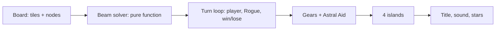

# Clockwork Sanctum · phase 1 of 4 · planned
> A sunny isometric puzzle-chase on four floating sky islands: bounce sunbeams to shatter gargoyles while a shadow rogue stalks you.

> **This plan is ready to build.** File and folder names below are the layout of the new app; nothing here depends on any other project's files. Build from this plan alone.

| who reads | what | where |
|---|---|---|
| **Audience (users)** | Puzzle players; also a good test of game logic (beam solver, turn loop) with unit tests. | What is it, What you get, Look, Motion |
| **Stakeholders** | decide scope, answer questions | Decisions and open questions, Phases at a glance |
| **Builders (dev)** | React 19 + Vite + TypeScript + three.js; no backend; pnpm only | `PHASES.md` and `build_inputs/00_contract.md` |

## Build recipe (read this first)
1. **Read in this order:** this README (`build_inputs/00_contract.md` holds the full Build prompt), then `PHASES.md`.
2. **Where it is built:** `run_test/clockwork-sanctum/`.
3. **Stack, pinned:** React `19.0.1`, Vite `8.3.0` + `@vitejs/plugin-react` `6.1.1`, TypeScript `7.0.2` (all as in the reference `package.json`; if pnpm cannot resolve one, take the nearest published version and report it), three.js `0.134.0` (the reference ships r134; guessed that `three@0.134.0` from pnpm matches). **pnpm ONLY**: `pnpm install`, `pnpm add`, `pnpm exec`; never npm, npx or yarn.
4. **Planned file tree (one owner per file, all owner `builder`; no file is edited by two tasks):** see the *File tree* in the Build prompt (`build_inputs/00_contract.md`).
5. **Build only the asked phase.** Do not add features or files the plan does not name (no backend, no AI model, no save server).
6. **This plan IS the planning.** Do not write a new plan or a placeholder screen. Each task delivers its part finished and working.
7. **Pictures are not in the plan.** The reference has 10 PNG title images that you cannot see. Draw the title screen with CSS and text (see Look); never reference a file that does not exist.
8. **Builder self-check before reporting:** `pnpm exec tsc --noEmit`, `pnpm build`, `pnpm test`, open the page and read the browser console (0 errors), then state each Done-when result.
9. **The lead verifies before it claims:** run the same four checks itself, play island 1 in a browser, say only what was seen, and list every deviation from this plan. A check that could not be run is said so.

## What is it
You are a Knight on a small floating island of sandstone and moss. A golden sunbeam crosses it. You can turn the mirrors, crank brass gears that slide whole rows of the island, and make Stone Gargoyles shatter by lighting them. Every action you take is one step, and after every step a Shadow Rogue creeps one tile closer. If it reaches you, you lose. Shatter every gargoyle and the Rogue is banished in golden light.

Once per island you can call the Mage (Astral Aid): the Rogue freezes in a time-crystal for 2 steps, and the call costs no step. A Rogue standing inside a sunbeam is dazzled and skips its move.

**For:** puzzle players who like short, clever levels (about 4 steps each); also a good test of game logic (pure beam solver, turn loop) with unit tests.

## What you get (feature catalog)
| id | feature | what you see or do | phase | status |
|---|---|---|---|---|
| F1 | Island board | 8 x 8 isometric tile grid, four corner braziers, fixed camera you can orbit | [1. Board and beam](PHASES.md) | planned |
| F2 | Sunbeam | an emitter shoots a beam; mirrors bend it 90 degrees (up to 16 bounces); a gargoyle it touches shatters | [1. Board and beam](PHASES.md) | planned |
| F3 | Turn loop | each action = 1 step, then the Rogue moves 1 tile; win and lose screens; Undo and Retry | [2. Turn loop](PHASES.md) | planned |
| F4 | Gears and Astral Aid | click a crank to slide a whole row or column of the island; Mage freezes the Rogue for 2 steps | [3. Content](PHASES.md) | planned |
| F5 | 4 islands | Sundial Courtyard, Waterwheel Aqueduct, Clockwork Bell-Hammer, Twin-Cog Sky Split | [3. Content](PHASES.md) | planned |
| F6 | Title, sound, stars | title screen, level picker, procedural music and effects with mute, 1-3 star score, hint key | [4. Polish](PHASES.md) | planned |

## Parts and how they connect

## Look and feel
- **Mood:** sunlit toy-box, never dark or sci-fi. Bright blue sky with white clouds, golden sandstone tiles, chartreuse moss cushions, grey-slate cliffs under the island, bronze cogwheels on the left, wooden waterwheels on the right, four fire braziers in the corners.
- **Colours that matter:** sky `#4FA6E8` to `#8FD3FF`; sandstone `#E2AA5A`; moss `#8FD11F`; cliff `#7D8491`; bronze `#8C5B24`; beam core `#FFF9DC`, beam glow `#FFB01E`; prism crystal `#9ADFFF`; water `#149CE6`. Heroes get a coloured tile outline: Knight cyan `#00F0FF`, Mage `#5CE6FF`, Rogue red `#FF2442`, Gargoyle magenta `#FF26D4`.
- **Interface:** gold collector-card panels (gold `#E5A93B`, dark outline `#261C16`, slate `#333B4C`, text `#FFF8E8`), rounded corners, font Trebuchet MS then Nunito. The HUD covers at most 16% of the screen.
- **Title screen:** the words 'Shatter Gargoyles · Outsmart the Rogue', a big PLAY button, a '4 SKY ISLANDS' button, and four small round buttons (music, stars, guide, settings).

## Motion and animation
| name | what | time |
|---|---|---|
| `csAstralPulse` | glow on the Astral Aid button, cyan `#52E8FF` to gold `#FFE57F` | 2.1 s ease-in-out, infinite |
| `csDrawerPop` | a panel pops in (opacity 0 to 1, scale .95 to 1) | 0.22 s cubic-bezier(.22,1,.36,1) |
| `csVictoryPop` | win banner drops in (up 10 px, scale .95 to 1) | 0.28 s cubic-bezier(.22,1,.36,1) |
| `csWelcomeLogoFloat` | title logo bobs up 5 px | 4.4 s ease-in-out, infinite |
| `csPlayPulse` | PLAY button glow breathes | 2.8 s ease-in-out, infinite |
| `csMageHover` | Mage portrait floats 8 px and tilts -1 to 1.5 degrees | 3.5 s ease-in-out, infinite |
| reduced motion | the infinite loops above stop (plan rule, the reference has no such rule) | rule |

## Team: who does what
| who | does | tasks |
|---|---|---|
| builder | writes the code of its own files only (no file is owned twice) | T01 to T13 |
| lead | hands over this plan, runs the checks, reports deviations | verifies each phase |

You (the owner) answer the open questions and judge each phase; Claude edits this plan when you ask (see Share and change).

## Quality bar (what 'professional' means here)
- `pnpm exec tsc --noEmit`, `pnpm build` and `pnpm test` all pass; 0 console errors while playing islands 1 to 4
- Beam solver tests: at least 8 cases (straight, 1 bounce, 2 bounces, 16-bounce cap, blocked by pillar, gargoyle hit, mirror rotation, beam leaves the board)
- Every island is solvable by its recorded solution (4, 5, 4, 3 actions) and a test replays all four
- Rogue moves exactly 1 tile per step along the shortest path, never when frozen or sun-blinded
- Contrast of HUD text 4.5:1 or better; click targets at least 40 x 40 px; no text under 12 px
- Looks right at 1280 x 720 (the reference's target) and stays usable at 390 px wide (guessed target: the reference only has breakpoints at 680, 960 and 1180 px)
- 3D budget: 60 fps on a normal laptop (guessed target), pixel ratio capped at 2 (real)
- `prefers-reduced-motion`: no infinite CSS loops (the reference has none of this)

## Real or guessed
**Real (read from the reference source):** every number in the Build prompt: grid 8 x 8, tile 2.0, beam height 0.82, 16 bounces, camera, palette, fonts, motion times, the four level layouts and solutions, hero numbers, star thresholds, key bindings, texts. **Guessed (marked in the text):** pinned three.js match, test runner, 390 px layout, fps target, Undo depth. **Could not verify:** gargoyle behaviour beyond sleeping and shattering (no attack code was found in the parts read), exact HUD pixel sizes, the 10 title PNGs (binary, not reproducible from text).

## Decisions and open questions
| id | what | answer / default | state |
|---|---|---|---|
| D-01 | Rogue movement | BFS toward the player after every action; skips when frozen or sun-blinded | agreed |
| D-02 | Rewrite in TypeScript modules | engine as `src/engine/*.ts`, not the reference's `public/js` globals | agreed |
| Q1 | Island layouts | default: use the four real layouts in the Build prompt (all solvable) | open |
| Q2 | Title pictures | default: draw with CSS and text; alternative: the person supplies the 10 PNGs | open |
| Q3 | Island 2-4 extras (water, bell-hammer, ferry) are the heavy part | default: build them as in the reference; fallback: ship islands 1 only plus gears (say so) | open |

## Phases at a glance
**1. Board and beam** (planned), **2. Turn loop** (planned), **3. Content** (planned), **4. Polish** (planned) → [full phase page](PHASES.md)

## Share and change
- **Share:** press *Copy link* in the plan viewer; one link = one page.
- **Change something:** press *Ask Claude* on the page and write your wish. Claude edits THIS file (and the phase page if scope moves), so `git diff docs/` shows what the plan changed.
- Status words: planning = still being written or missing facts · planned = split into tasks, **nothing built yet** · in progress · review · done.

## Details for builders
The full build contract (stack, file tree and owners, behaviour rules, data shapes, requirements, code flow, test plan, lessons) is `build_inputs/00_contract.md`; `CONTEXT.txt` hands it to every builder in front of its first prompt.

research: none (reverse-planned from an existing working app whose source was read for every number here: rules, grid, timings, assets, so there was no outside product to look up)
