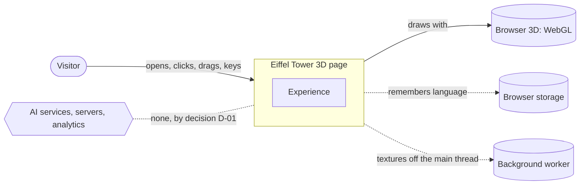
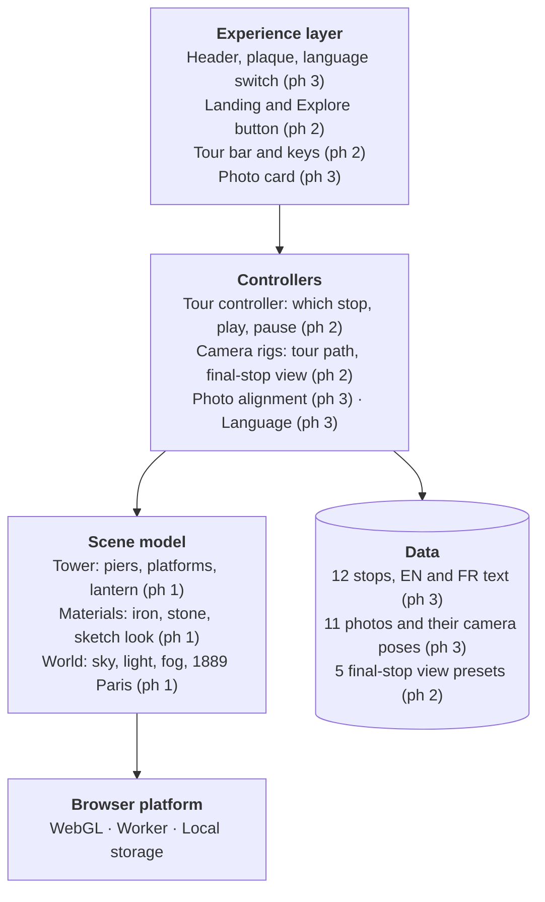
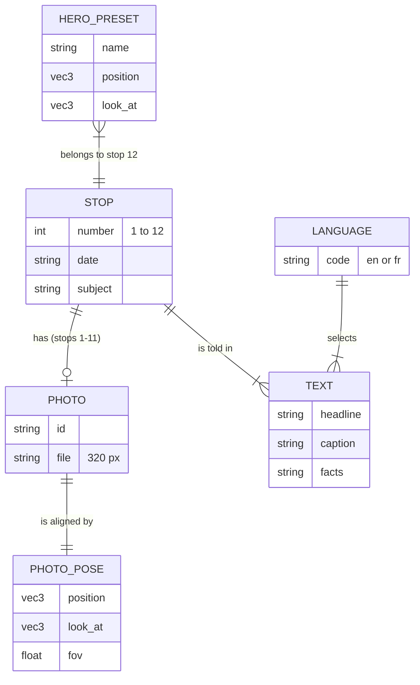
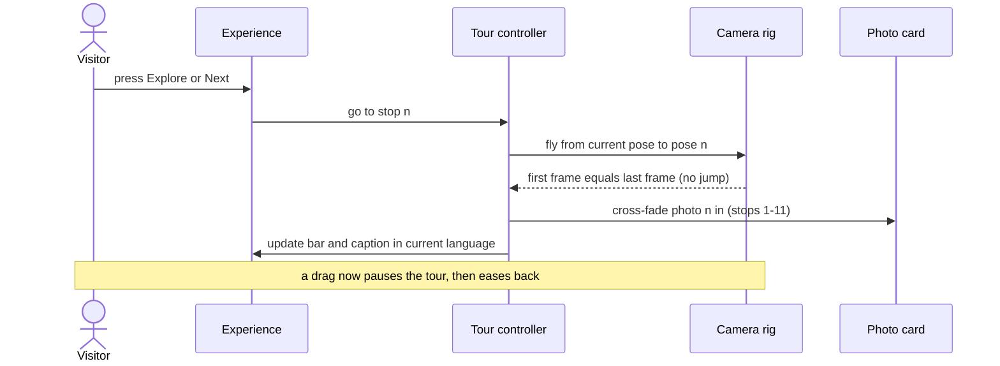
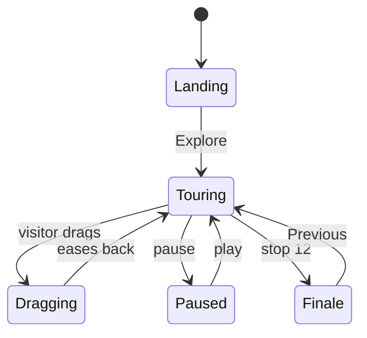

# Architecture · the parts, the data and how they work together
> Use this page to see **what is inside the system, what is not, and where each phase lands**. No code here. Back to the [overview](README.md).

## System context
A single web page. It talks to nobody: everything it needs is shipped with it.



## Components and layers
Five layers; each talks only to the layer below it. The phase in brackets is when it appears.



| layer | what it owns | decided by |
|---|---|---|
| Experience | everything the visitor sees and presses | [Experience](01_experience.md) |
| Controllers | the rules of the visit: the order of stops, when to move, what a drag does, which language | rules R4 to R11 in the build contract |
| Scene model | the 3D tower, its materials, the sky and the city | Q1, Q2 |
| Data | the stops, texts, photo poses, view presets: fixed files, never edited at run time | content supplied |
| Platform | the browser features we rely on | quality bar |

## Data model
No database. The data is a small set of fixed catalogs shipped with the page, plus two values in memory.



A real example of one stop's data (expand the tree; the full sample is [data_samples/stop_example.json](data_samples/stop_example.json)):

```json
{
  "number": 2,
  "id": "1887_05_caissons",
  "photo": { "id": "13", "file": "references/photos/13_320.jpg" },
  "pose": { "position": [18.2, 9.5, 24.0], "lookAt": [0, 40, 0], "fov": 42 },
  "text": {
    "en": { "date": "21 Apr 1887", "headline": "Foundation Caissons" },
    "fr": { "date": "21 avr. 1887", "headline": "Caissons de fondation" }
  },
  "holdSeconds": 2.6
}
```

| in memory | values | kept after reload? |
|---|---|---|
| tour state | landing, touring, paused, dragging, finale; current stop 1 to 12; playing yes or no | no |
| language | English or French | yes (browser storage; `?lang=fr` in the address also works) |

## Key flows
**Press Explore and fly to the next stop** (the heart of the product):



**Tour states** (what can happen at any moment):



## Non-functional targets
| area | target | how it is proven | real / guessed |
|---|---|---|---|
| Errors | 0 console errors across the whole tour, both languages | read in a browser | real |
| Smoothness | under 0.001 m camera difference at every move start and end | per-frame pose log | real |
| Speed | 60 fps laptop target, 30 fps floor while touring | measured and reported | guessed |
| Weight | about 400k triangles at most; pixel ratio capped at 2 | counted | guessed / real |
| Accessibility | contrast 4.5:1, targets 40 px, text 11 px or more, reduced motion honoured | checked on screen | real |
| Phone | usable at 390 px, no sideways scroll | checked at 390 x 844 | guessed |
| Privacy and security | no network calls after load, no keys, no tracking | no AI library in the package list | real |
| Failure | no WebGL shows a plain message; a missing photo shows its text only; a blocked worker falls back to the main thread | each case tried once | guessed |

## Technology choices
| choice | why | alternative we rejected |
|---|---|---|
| Plain JavaScript modules with Vite | small, fast to start, no framework needed for one scene | React: adds weight, no benefit here |
| three.js r186 | the standard for browser 3D; the source app uses it | writing raw WebGL |
| Everything procedural | no model files to license, load or host | loading a ready-made model (out of scope) |
| No backend | nothing to store or secure; works offline | a server for photos and text |

<!-- dev -->
## Component to file map
| component | files | task |
|---|---|---|
| Boot, shell | `startup_orchestrator.js`, `index.html`, `style.css` | T01 |
| Materials | `pbr_worker.js`, `model/materials.js` | T02 |
| Tower | `model/tower_controller.js`, `model/zones/*.js` | T03 |
| World | `world/atmosphere.js`, `world/paris_1889.js` | T04 |
| Camera rigs | `camera/tour_rig.js`, `camera/hero_rig.js` | T05, T06 |
| Experience, tour controller | `ui/museum_header.js`, `ui/landing_intro.js`, `ui/walkthrough_controller.js` | T07 |
| Photo alignment | `portals/photo_portals.js`, `data/photo_cameras_3d.json` | T08 |
| Language and text | `story/stops_en.js`, `story/stops_fr.js`, `story/i18n.js` | T09 |
| Wiring | `app.js` | T10 |

One owner of the camera pose per mode (landing, touring, dragging, finale): mixing a drag, a fly-to and `OrbitControls` damping in one frame is the known source of pops. Full rules, state shapes and edge cases: `build_inputs/00_contract.md`.
<!-- /dev -->
