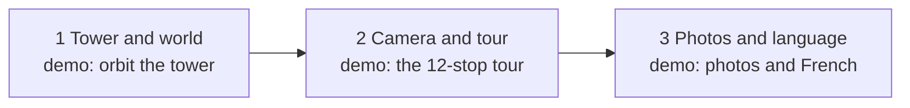

# Phases · Eiffel Tower 3D
> **Use this page to approve the order of delivery.** Each phase ends with something you can open and judge; the next phase starts only after you accept it. Status: phase 1 of 3 · planned · [overview](README.md). Status words: planning = being written · planned = split into tasks, **nothing built yet** · in progress · review · done.

## Roadmap
| # | phase | outcome (one line) | demo you can run | features | needs | size |
|---|---|---|---|---|---|---|
| 1 | [Tower and world](#phase-1) | a lit tower you can orbit | open the page, turn around the tower in daylight | F1, F2 | - | 4 tasks |
| 2 | [Camera and tour](#phase-2) | the 12-stop tour and the final stop | press Explore, watch stops 1 to 12, drag and it recovers | F3, F4 | 1 | 3 tasks |
| 3 | [Photos and language](#phase-3) | photos at each stop and French | stops 1-11 show their photo; EN/FR flips every caption | F5, F6 | 2 | 3 tasks |

**Next up:** phase 1, *Tower and world*. On your go, the team builds the page shell and intro veil, the materials, the tower and the light, then shows you the result.

## Gates (how a phase is accepted)
1. The team runs the acceptance checks below itself and reports **each result as seen**, not as intended.
2. Anything it could not check (for example no 3D in its test browser) is **named**, and you judge it in your own browser.
3. Every difference from this plan is listed.
4. You answer *accept* or *change*; only *accept* opens the next phase.

---

## Phase 1 · Tower and world · planned
**Goal:** a lit, procedural tower you can orbit · **Covers:** F1, F2 · **Needs:** nothing

**What you will be able to do:** open the page, see the intro veil fade, then look at the tower in 1889 daylight and turn around it with the mouse or finger.

**Acceptance (you can check each one):**
- the page loads and the veil fades away in about half a second
- you see 4 piers and 3 platforms and can orbit freely
- nothing glows by itself (the built-in audit reports 0 offenders)
- the browser console shows 0 errors
- the package list has the 3D library at the agreed version and no AI library

**Not in this phase:** the tour, photos, French.

<!-- dev -->
| task | what | owner | needs | reads |
|---|---|---|---|---|
| T01 | shell: `package.json` (pinned, `pnpm add three@0.186.0`, no `@google/genai`), `tsconfig.json`, `vite.config.ts`, `index.html`, `style.css` tokens, `startup_orchestrator.js` boot veil | builder | - | Build recipe, Contract (Stack), Look file 1-3, 8 |
| T02 | `pbr_worker.js` (procedural iron and stone textures) + `model/materials.js` (PBR bank, sketch override) with main-thread fallback | builder | T01 | Contract (R2, Edge cases) |
| T03 | `model/tower_controller.js` + `model/zones/*.js`: 4 piers, platforms at 58, 116, 276 m, lantern 300 m, mast 312 m (simple lattice) | builder | T02 | Contract (R1), README Q1, Look file 4 |
| T04 | `world/atmosphere.js` (sky, fog, lights, shadows, `auditZeroEmissive`) + `world/paris_1889.js` (ground, lawn, low blocks) | builder | T01 | Contract (R3), README Q2, Look file 4 |

**Done when (the lead runs each one):**
- `pnpm install && pnpm exec tsc --noEmit && pnpm build` exit 0
- open the page: 4 piers and 3 platforms are visible and you can orbit; the boot veil fades in 0.45 s; 0 console errors
- `auditZeroEmissive(scene)` in the console returns 0 offenders
- `package.json` pins `three` 0.186.0 and has no `@google/genai`
<!-- /dev -->

---

## Phase 2 · Camera and tour · planned
**Goal:** the 12-stop tour and the final stop · **Covers:** F3, F4 · **Needs:** phase 1

**What you will be able to do:** press **Explore** and watch the camera glide through 12 stops without a jump; use Enter, the arrow keys, Home and End; drag to look around and see it ease back; at stop 12 turn the whole tower yourself and use the 4 detail views.

**Acceptance (you can check each one):**
- stops 1 to 12 play with 0 console errors and the camera never passes through a pier
- no visible jump when a move starts or ends (a pose log shows under 0.001 m)
- dragging mid-move pauses the tour, then it eases back
- Enter, Arrow Right, Arrow Left, Home, End and V each do what the Experience page says
- stop 12 shows the complete tower turning slowly; the 5 view buttons fly to their views

**Not in this phase:** photos and French captions (stops show their title only).

<!-- dev -->
| task | what | owner | needs | reads |
|---|---|---|---|---|
| T05 | `camera/tour_rig.js`: Catmull-Rom helix paths clear of the piers, look-at, zero-jump start and end, drag interruption and recovery | builder | T03, T04 | Contract (R5-R7), Look file 7 |
| T06 | `camera/hero_rig.js`: stop 12 turntable sway, 5 view presets, portrait fov 56 | builder | T05 | Contract (R9), Look file 5 |
| T07 | `ui/museum_header.js`, `ui/landing_intro.js`, `ui/walkthrough_controller.js`: Explore, bar, holds 2.6 s / 4.0 s, keys, `?stop=` clamp | builder | T05 | Contract (R4, R11, Edge cases), Look file 8, Stops file 9 |

**Done when (the lead runs each one):**
- tour stops 1-12 run with 0 console errors and the camera never enters a pier
- a per-frame pose log shows under 0.001 m difference at every move start and end
- dragging mid-move pauses the tour, then eases back in about 0.6 s; Enter, Arrow Right/Left, Home, End and V each work (6 keys)
- stop 12 shows the complete tower turning slowly; the 5 view chips fly to their poses
<!-- /dev -->

---

## Phase 3 · Photos and language · planned
**Goal:** photo placards and English / French · **Covers:** F5, F6 · **Needs:** phase 2

**What you will be able to do:** see the right archival photograph at each of stops 1 to 11, lined up with the 3D view; press EN/FR at any stop and watch every caption flip; use the page comfortably on a phone.

**Acceptance (you can check each one):**
- stops 1 to 11 each show the photo named in the content file; stop 12 shows none
- pressing the language button at stops 1, 6 and 12 changes every caption and label; 0 console errors in both languages
- at 390 x 844 there is no sideways scroll, caption contrast is 4.5:1 or better and buttons are 40 px or more
- with "reduced motion" on, nothing loops forever
- the final build passes and no AI library is in the package list

**Not in this phase:** anything outside the [scope](README.md#scope): backend, audio, VR, extra languages.

<!-- dev -->
| task | what | owner | needs | reads |
|---|---|---|---|---|
| T08 | `portals/photo_portals.js`, `data/photo_cameras_3d.json`, copy the 11 photos from `build_inputs/photos/` | builder | T06, T07 | Contract (R8), README Q3, Look file 6 |
| T09 | `story/stops_en.js`, `stops_fr.js`, `i18n.js`; language toggle and `<html lang>`; every string in both languages | builder | T06, T07 | Contract (R10, Content), Stops file 10, 11 |
| T10 | `app.js` wiring, reduced motion, 390 px layout, contrast pass, final checks | builder | T08, T09 | Quality bar, Contract (Done-when) |

**Done when (the lead runs each one):**
- stops 1-11 show the photo whose id is in the stops file; stop 12 shows none
- toggling language at stops 1, 6 and 12 changes every caption and aria text; 0 console errors in EN and FR
- at 390 x 844 there is no horizontal scroll; caption contrast is 4.5:1 or better; targets are 40 px or more
- with `prefers-reduced-motion` on, 0 infinite animations run (loops stop at 0.01 ms)
- `pnpm exec tsc --noEmit` and `pnpm build` exit 0; `@google/genai` is not in `package.json`

Task rules: every task is 15-30 minutes, one owner (`builder`), reads the parts in its `reads` column (Contract = `build_inputs/00_contract.md`, Look file = `01_look.md`, Stops file = `02_stops_and_text.md`). Statuses move forward only when work really starts.
<!-- /dev -->
