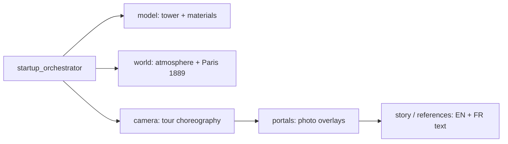

# Eiffel Tower 3D (1889 museum exhibit) · planned
> An interactive 3D museum exhibit of the Eiffel Tower, with a 12-stop guided tour, archival photos and English/French captions.

> **Planning phase only: nothing is built from this plan yet.** File and folder names below are the *planned* layout (taken from the analysed reference app), not files that exist. Test cases in `TestCases/` check the finished reference project or try to build from this plan; they are not the product.

| who reads | what | where |
|---|---|---|
| **Audience (users)** | Visitors who want a calm, museum-style experience in the browser; also a good test of smooth camera work. | this page: What is it, What you get, Look, Motion |
| **Stakeholders** | decide scope, answer questions | Decisions and open questions, Phases at a glance |
| **Builders (dev)** | stack: Vite + plain JavaScript modules + three.js (installed with `pnpm add three`); no React; pnpm only | `PHASES.md` and the grey DEV blocks (switch to Dev) |

## What is it
You see Gustave Eiffel's 1889 tower, built in code (no model files), in a sepia museum look with serif captions. Press EXPLORE and the camera glides through 12 stops. Photo overlays tie to stops. A language toggle swaps every caption between English and French.

**For:** Visitors who want a calm, museum-style experience in the browser; also a good test of smooth camera work.

## What you get (feature catalog)
| id | feature | what you see or do | phase | status |
|---|---|---|---|---|
| F1 | The tower | lattice ironwork, 4 piers, platforms, iron material, sketch/blueprint mode | [1. Build the whole exhibit](PHASES.md) | planned |
| F2 | 1889 Paris around it | city, lighting, no self-glowing materials | [1. Build the whole exhibit](PHASES.md) | planned |
| F3 | Guided tour | 12 stops, smooth curves, no jump at start or end, drag to look around and it recovers smoothly | [1. Build the whole exhibit](PHASES.md) | planned |
| F4 | Hero stop | stop 12 shows a 3D model turntable; framing adapts to desktop and phone | [1. Build the whole exhibit](PHASES.md) | planned |
| F5 | Archival photos | photo overlays tied to stops | [1. Build the whole exhibit](PHASES.md) | planned |
| F6 | English / French | toggle swaps every caption | [1. Build the whole exhibit](PHASES.md) | planned |

## Parts and how they connect


## Look and feel
- **Museum archive look:** sepia / vellum. Tokens in `style.css`: `--bg-museum-canvas #121212`, `--bg-vellum-paper #f2f2f2`, `--accent-on-dark-iron #bdbdbd`, `--accent-on-light-iron #141414`, `--border-plate-subtle #383838`, `--border-vellum-subtle #d4d4d4`, interactive borders `#737373`. Three font roles: `--font-serif` (captions), `--font-sans`, `--font-mono`. Intro card: 'La Tour de 300 Metres, 1887-1889 Archival Exhibit'.

## Motion and animation
| what | how |
|---|---|
| guided tour | 12 stops on Catmull-Rom helix paths that avoid the 4 piers, always looking at the tower, **no pixel jump at the start or end of a move** |
| drag to orbit | interrupts the tour smoothly |
| stop 12 | the complete tower alone (no photo) turning slowly: turntable sway |
| header rule | `museumRuleSweep` 1.8 s ease-in-out infinite (a thin line sweeps across) |
| `prefers-reduced-motion` | the original CSS has a rule for it |

## Team: who does what
| who | does | tasks |
|---|---|---|
| builder | writes the code of its own files only (no file is owned twice) | T01, T02, T03 |

You (the owner) answer the open questions and judge each phase; Claude edits this plan when you ask (see Share and change).

## Quality bar (what 'professional' means here)
- 60 fps on a laptop
- Zero emissive materials, checked by an audit function
- Tour 1-12 runs with 0 console errors; the language toggle swaps every caption
- Works on desktop and phone framing

## Real or guessed
**Real:** read from the app's file tree, metadata and `app.js` header. **Not read:** the rest of the source. The 12-stop tour and 'zero-jump' camera rules are in the original header. The zip was opened and checked: it matches the plan (plain JS, vendored three.js, `@google/genai` only listed as a dependency).

## Decisions and open questions
| id | what | answer / default | state |
|---|---|---|---|
| D-01 | Network | works offline after install; Gemini is a dependency but the exhibit does not use it | agreed |
| Q1 | Keep the Gemini dependency? | drop it, not needed | agreed |

## Phases at a glance
**1. Build the whole exhibit** (planned) → [full phase page](PHASES.md)

## Share and change
- **Share:** press *Copy link* in the plan viewer; one link = one page.
- **Change something:** press *Ask Claude* on the page and write your wish. Claude edits THIS file (and the phase page if scope moves), so `git diff docs/` shows what the plan changed.
- Status words: planning = still being written or missing facts · planned = split into tasks, **nothing built yet** · in progress · review · done.

<!-- dev -->
## Build prompt (give this to the builder)
Build 'Eiffel Tower 3D' (Vite + plain JavaScript modules + three.js with OrbitControls; no React).
- Boot through `startup_orchestrator.js` (`bootPipeline`), then wire the tower model controller, photo-portal system, atmosphere and camera.
- Build the tower in code (lattice ironwork, 4 piers, platforms) with a PBR iron material and a sketch/blueprint mode; generate textures in `pbr_worker.js` off the main thread. 1889 Paris around it. No emissive materials (lighting only), with an audit function that checks it.
- Guided tour of 12 stops: smooth Catmull-Rom helix paths that avoid the piers, always look at the tower, no pixel jump at start or end, drag-to-orbit interrupts smoothly. Stop 12 = hero model with a turntable sway; framing adapts to desktop and phone.
- Photo portals tied to stops; text in `story/` and `references/` in English and French with a language toggle that changes every caption.
- Install three.js with `pnpm add three` (no vendor folder, no CDN). pnpm only. Done = `pnpm build` and `tsc --noEmit` pass, tour runs 1-12 with 0 console errors, 60 fps on a laptop.

## Inputs
`build_inputs/01_tour_stops.md` = the 12 stops with EN + FR text; `build_inputs/photos/` = the 11 archival photos (320 px). Source code is NOT given: build it from this plan.

## Test
Case `pc_eiffel` in `TestCases/test_folders/test_project_check/` unpacks the recorded project (`agent_fixture/store/projects/eiffel-tower-3d.zip`) into the workspace and asks whether it works. Video recording is not used yet.

## Build spec
> Status: REAL (read from the app's file tree, metadata, `app.js` header). Rules below are what to build; no source is included.

#### What it is
A museum-style interactive 3D exhibit of Gustave Eiffel's 1889 tower, "reconstructed from original engineering plates and archival photos". Sepia/archival look, serif captions, EN/FR language toggle, an "EXPLORE" button that starts a guided walkthrough. Intro card: "La Tour de 300 Metres, 1887-1889 Archival Exhibit" and "The 300-Meter Tower, 1887-1889, Champ-de-Mars, Paris".

#### Stack (works offline after `pnpm install`)
Vite + plain JavaScript modules (no React). `three` + `OrbitControls`; install `three` with `pnpm add three`. `@google/genai` is a dependency but the exhibit itself needs no network. Scripts: dev (port 3000), build (`vite build`), lint (`tsc --noEmit`).

#### Files to create (one owner each)
```
index.html  style.css  index.css  app.js  startup_orchestrator.js  pbr_worker.js (PBR texture generation off the main thread)
camera/      choreography + viewport constraints (stage 3)
model/       tower_controller, materials (PBR bank, override materials), floor_textures, walkthrough_pacing (stage 2 build pacing)
world/       atmosphere (lighting, zero-emissive audit), paris_1889 (surrounding city)
portals/     photo_portals (archival photo overlays)
data/ story/ story_and_archive/ references/ thumbnails/ ui/ perf/
```
`app.js` boots via `bootPipeline` in `startup_orchestrator`, then wires TowerModelController, PhotoPortalSystem, atmosphere, camera.

#### Behaviour (each line is a test)
1. Tower is built procedurally (lattice ironwork, 4 piers, platforms), PBR iron material, sketch/blueprint render mode.
2. Camera: orbit controls; guided tour of 12 stops; moves are "zero-jump" (no pixel pop at start/end), follow smooth curves (Catmull-Rom helix paths avoiding the 4 piers), always look at the tower, drag-to-orbit interrupts smoothly.
3. Stop 12 is the unobstructed complete tower as a 3D showcase (no photo) with turntable sway; framing adapts to desktop and mobile.
4. Photo portals show archival photos tied to stops; `references/` and `story/` hold the text (EN + FR).
5. Zero emissive on scene materials (lighting only from lights); audit function checks it.

#### Done
`pnpm build` and `tsc --noEmit` pass; tour runs stops 1-12 with no console error; 60fps on a laptop; language toggle swaps every caption.
<!-- /dev -->
