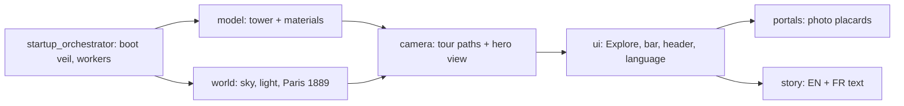

# Eiffel Tower 3D (1889 museum exhibit) · phase 1 of 3 · planned
> A calm, grey-toned 3D museum exhibit of the 1889 Eiffel Tower, built in code, with a 12-stop guided camera tour, archival photos and English/French captions.

> **This plan is ready to build.** File and folder names below are the layout of the new app; nothing here depends on any other project's files. Build from this plan alone.

| who reads | what | where |
|---|---|---|
| **Audience (users)** | Visitors who want a quiet museum-style visit in the browser; also a good test of smooth camera work. | What is it, What you get, Look, Motion |
| **Stakeholders** | decide scope, answer questions | Decisions and open questions, Phases at a glance |
| **Builders (dev)** | Vite + plain JavaScript modules + three.js r186; no React, no backend, no AI; pnpm only | `PHASES.md`, `build_inputs/00_contract.md`, `01_look.md`, `02_stops_and_text.md` |

## Build recipe (read this first)
1. **Read in this order:** this README, `build_inputs/00_contract.md` (stack, file tree, rules, done-checks), `build_inputs/01_look.md` (tokens, light numbers, camera poses, timings), `build_inputs/02_stops_and_text.md` (12 stops, EN/FR strings), then `PHASES.md`. `CONTEXT.txt` already hands you the contract and the look file; open the stops file when your task reads it.
2. **Where it is built:** `run_test/eiffel-tower-3d/`.
3. **Stack, pinned:** Vite `^8.3.0`, TypeScript `^7.0.2`, `@types/node` `^22.14.0`; three.js **r186** (`pnpm add three@0.186.0`; no vendor folder, no CDN). **No AI:** do not install `@google/genai` or any model SDK. **pnpm ONLY:** `pnpm install`, `pnpm add`, `pnpm exec`; never npm, npx, yarn or bun (add no `predev` / `prebuild` hooks that call them).
4. **File tree, one owner per file:** see *File tree* in `build_inputs/00_contract.md` (all owner `builder`; no file is edited by two tasks).
5. **Build only the asked phase.** Do not add files or features the plan does not name (no backend, no key, no `.env`, no analytics).
6. **This plan IS the planning.** Do not write another plan or a placeholder screen; each task delivers its part finished and working.
7. **Do not invent.** Take texts and photo ids from `build_inputs/02_stops_and_text.md` and numbers from `build_inputs/01_look.md`. Where the plan says *guessed*, choose the simplest option and report it. The 11 photos exist in `build_inputs/photos/` (320 px); copy them, never reference a missing file.
8. **Builder self-check before reporting:** `pnpm exec tsc --noEmit`, `pnpm build`, open the page and read the browser console (0 errors), call `auditZeroEmissive`, then state each Done-when result.
9. **The lead verifies before it claims:** run the same checks itself, step through all 12 stops in a browser, say only what was seen, and list every deviation from this plan. A check that could not be run is said so.

## What is it
You see Gustave Eiffel's tower as it stood in 1889, drawn live in the browser from code (no model files). The look is a quiet gallery: black, white and grey panels, serif captions, no brown or sepia tint. Press **Explore** and the camera glides through 12 stops, from Eiffel's design drawing, through the foundations and the rising ironwork, to the finished tower. Most stops show an archival photograph lined up with the 3D tower; the last stop is the complete 3D tower to turn around yourself. A button switches every caption between English and French.

**No AI in this app.** No model calls, no key, no network after install.

**For:** visitors who want a calm, museum-style visit; also a good test of smooth, jump-free camera work.

## What you get (feature catalog)
| id | feature | what you see or do | phase | status |
|---|---|---|---|---|
| F1 | The tower | lattice ironwork, 4 piers, platforms, iron material, sketch/blueprint mode | [1. Tower and world](PHASES.md) | planned |
| F2 | 1889 Paris around it | sky, fog, ground, city, daylight; no self-glowing materials | [1. Tower and world](PHASES.md) | planned |
| F3 | Guided tour | 12 stops on smooth curves, no jump at start or end, drag to look around and it recovers | [2. Camera and tour](PHASES.md) | planned |
| F4 | Hero stop | stop 12: the whole tower to orbit, 4 detail views, framing for desktop and phone | [2. Camera and tour](PHASES.md) | planned |
| F5 | Archival photos | a photo placard at 11 stops, matched to the 3D view | [3. Photos and language](PHASES.md) | planned |
| F6 | English / French | one toggle swaps every caption | [3. Photos and language](PHASES.md) | planned |

## Parts and how they connect

## Look and feel
- **Mood:** a gallery at rest. Dark matte frame and plates (`#121212`, `#1c1c1c`), light paper cards (`#f2f2f2`, `#ffffff`), grey borders (`#383838`, `#737373`). **The UI is neutral grey, not sepia** (zero brown or sepia tints in the UI). Only the sky and fog are a warm light grey (`#e6e2da`).
- **Type:** serif for headlines and captions (Iowan Old Style, Palatino, Georgia), system sans for buttons, mono for the facts line. No web fonts.
- **Shape:** sharp or 2 px corners, soft shadows, no glass blur.
- **Intro:** a boot veil with 'Paris · Champ-de-Mars · 1887-1889' and 'La Tour de 300 Mètres', then the Explore button at the lower left and the plaque 'La Tour de 300 Mètres / 1887-1889 Archival Exhibition' at the top left.
- All tokens, light numbers and breakpoints: `build_inputs/01_look.md`.

## Motion and animation
| name | what | time |
|---|---|---|
| tour move | camera follows a smooth curve around the piers, always looking at the tower; no jump at start or end | per stop; hold 2.6 s with photo, 4.0 s at stop 12 |
| drag to look | dragging interrupts the tour, then the camera recovers smoothly | guessed ~0.6 s |
| photo dissolve | placard cross-fades with the 3D view | 1.3 s (reveal 0.65 s) |
| boot veil | fades out when the scene is ready | 0.45 s |
| `museumRuleSweep` | thin line sweeps across the header rule | 1.8 s ease-in-out, infinite |
| stop 12 | slow turntable sway of the complete tower | ongoing |
| reduced motion | animation and transition durations 0.01 ms, loops once (a rule of the design) | rule |

## Team: who does what
| who | does | tasks |
|---|---|---|
| builder | writes the code of its own files only (no file is owned twice) | T01 to T10 |
| lead | hands over this plan, runs the checks, reports deviations | verifies each phase |

You (the owner) answer the open questions and judge each phase; Claude edits this plan when you ask (see Share and change).

## Quality bar (what 'professional' means here)
- `pnpm exec tsc --noEmit` and `pnpm build` pass; **0 console errors** over the whole tour 1-12, in both languages.
- Zero emissive: `auditZeroEmissive(scene)` reports 0 offenders.
- Text contrast 4.5:1 or better (caption on card, buttons); click targets 40 x 40 px or more; no text under 11 px.
- Usable at 390 px wide (guessed target: the design only specifies breakpoints at 600, 720, 768 and 960 px); no horizontal scroll.
- Reduced motion: loops stop and moves become instant (a rule of the design; how the tour behaves under it is **guessed**).
- Pixel ratio capped at 2 (real). Frame rate: 60 fps on a laptop (**guessed**), never under 30 fps while touring (**guessed floor**); optimisers (shadow and matrix freezing, mesh batching) are **guessed**: build them only if the target is missed. Triangle budget about 400k (**guessed**).

## Real or guessed
**Real (read from source):** the stack, three r186, all tokens, light and camera numbers, hero poses, photo cameras, timings, ids, the 12 stops and their EN/FR text, no `@google/genai` import. **Guessed (marked):** the exact geometry of each tower zone file, the photo-portal code, the performance optimisers, the 400k-triangle budget, the 30 fps floor, reduced-motion behaviour of the tour, 390 px layout, drag-recovery time, French intro subtitle. **Could not verify:** exact curve knots of each tour path (build your own helical path; check it by the no-jump test).

## Decisions and open questions
| id | what | answer / default | state |
|---|---|---|---|
| D-01 | AI | none; no `@google/genai`, no key, no `.env` | agreed |
| D-02 | three.js | `pnpm add three@0.186.0`, no vendor folder | agreed |
| D-03 | UI colour | neutral grey, not sepia | agreed |
| Q1 | Tower detail | default: simple procedural lattice (boxes and tubes) with 4 piers and 3 platforms; a finer 13-zone model is possible but not asked for | open |
| Q2 | Paris 1889 | default: ground, Champ-de-Mars lawn, a few low blocks, fog; fallback: ground and sky only (say so) | open |
| Q3 | Photo matching | default: look-at pose + fov from the table; fallback: photo placard only without 3D alignment | open |

## Phases at a glance
**1. Tower and world** (planned), **2. Camera and tour** (planned), **3. Photos and language** (planned) → [full phase page](PHASES.md)

## Share and change
- **Share:** press *Copy link* in the plan viewer; one link = one page.
- **Change something:** press *Ask Claude* on the page and write your wish. Claude edits THIS file (and the phase page if scope moves), so `git diff docs/` shows what the plan changed.
- Status words: planning = still being written or missing facts · planned = split into tasks, **nothing built yet** · in progress · review · done.

## Details for builders
The full build contract (stack, file tree and owners, behaviour rules R1 to R12, state shapes, edge cases, out of scope, the checkable Done-when list, EARS requirements, data model, code flow, test plan, lessons) is `build_inputs/00_contract.md`. Look and content are in `build_inputs/01_look.md` and `build_inputs/02_stops_and_text.md`. `CONTEXT.txt` hands the contract and the look file to every builder in front of its first prompt.

research: none (reverse-planned from an existing working app whose source was read for every number here: stack, tokens, light and camera values, the 12 stops and their EN/FR texts, so there was no outside product to look up)
