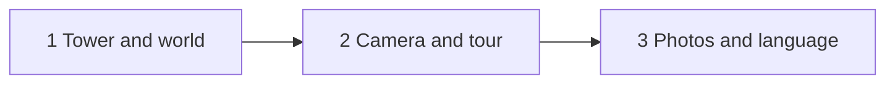

# Eiffel Tower 3D · a quiet 1889 museum exhibit in your browser · phase 1 of 3 · planned
> **Read this page first (2 minutes).** It tells you what you get, in what order, what we need you to decide, and how you will check the result. Pictures: [Experience](01_experience.md). Parts and data: [Architecture](02_architecture.md). Delivery order: [Phases](PHASES.md).

## Executive summary
We will build a calm, grey-toned **3D exhibit of Gustave Eiffel's tower as it stood in 1889**, drawn live in the browser from code (no model files, no account, no server, no AI). A visitor presses **Explore** and the camera glides through **12 stops**: Eiffel's design drawing, the foundations, the rising ironwork, the finished tower. Eleven stops pair the 3D view with an **archival photograph**; the last stop is the complete tower to turn around yourself. One button switches every caption between **English and French**.

Delivery is in **3 phases**, each ends with something you can open and judge. Nothing is built yet: this is the proposal for you to approve or change.

| | |
|---|---|
| **Who it is for** | Visitors who want a quiet, museum-style visit; also a good test of smooth, jump-free camera work |
| **What it is not** | No backend, no login, no analytics, no AI, no audio, no VR (see *Scope*) |
| **Where it runs** | Any modern desktop or phone browser with WebGL; works offline after the first load |
| **What we need from you** | Three small decisions (see *Decisions*), all with a safe default |

## What is it
You see the tower as a gallery piece: black, white and grey panels, serif captions, no brown or sepia tint. The tower stands in a simple 1889 Paris (ground, lawn, a few low blocks, fog, daylight). The tour is the story; the photos are the evidence.

## Scope
| in | out (not in this build) |
|---|---|
| The procedural tower and its 1889 surroundings | Backend, accounts, saving progress |
| 12-stop guided tour, drag to look around, keyboard control | Audio guide, VR, night and dusk looks |
| 11 archival photos matched to the 3D view | Loading ready-made 3D model files |
| English and French captions | Any third language, translation tools |
| Desktop and phone layouts | A debug panel, an archive "light table" room |

## What you get (feature catalog)
| id | feature | what you see or do | phase | real / guessed | status |
|---|---|---|---|---|---|
| F1 | The tower | lattice ironwork, 4 piers, 3 platforms, iron material, a sketch/blueprint look | [1. Tower and world](PHASES.md) | real numbers, guessed detail level | planned |
| F2 | 1889 Paris around it | sky, fog, ground, lawn, low blocks, daylight, nothing self-glowing | [1. Tower and world](PHASES.md) | real light, guessed city | planned |
| F3 | Guided tour | 12 stops on smooth curves, no jump at start or end; drag to look around and it eases back | [2. Camera and tour](PHASES.md) | real | planned |
| F4 | Final stop | the whole tower to orbit, 4 detail views, framing for desktop and phone | [2. Camera and tour](PHASES.md) | real | planned |
| F5 | Archival photos | a photo placard at 11 stops, lined up with the 3D view | [3. Photos and language](PHASES.md) | real photos, guessed alignment | planned |
| F6 | English / French | one toggle swaps every caption and label | [3. Photos and language](PHASES.md) | real text | planned |

## Roadmap (what you can see after each phase)
| phase | outcome | the demo | depends on | size |
|---|---|---|---|---|
| **1. Tower and world** | a lit tower you can orbit | open the page: the veil fades, the tower stands in daylight, you can turn around it | - | 4 tasks |
| **2. Camera and tour** | the 12-stop tour and the final stop | press Explore: the camera flies stop 1 to 12 without a jump; drag, and it recovers | 1 | 3 tasks |
| **3. Photos and language** | photos and French | stops 1-11 show the photo; press EN/FR and every caption flips | 2 | 3 tasks |

Each phase is reviewed by you before the next opens. A phase is "done" only when its acceptance checks (in [Phases](PHASES.md)) were run and seen, not when code exists.

## Decisions and open questions
| id | decision | our default | what changes if you say no | state |
|---|---|---|---|---|
| D-01 | AI in the app | none: no key, no model calls, no network after install | adds a key, a server and cost | agreed |
| D-02 | 3D library | three.js r186, installed (not copied, not from a CDN) | none of the visuals; only how it ships | agreed |
| D-03 | UI colour | neutral grey, no sepia | restyle pass in phase 3 | agreed |
| Q1 | How detailed is the tower? | simple lattice (boxes and tubes), 4 piers, 3 platforms | a finer 13-part model is possible but is a large extra phase | **open** |
| Q2 | How much of Paris 1889? | ground, lawn, a few low blocks, fog; if that is too heavy: ground and sky only (we will say so) | richer city = more work and a slower page | **open** |
| Q3 | Photo-to-3D matching | camera pose and field of view from the data table; if it does not line up: show the photo card without alignment (we will say so) | none | **open** |

## Risks and how we handle them
| risk | likelihood | impact | what we do |
|---|---|---|---|
| Camera "pops" when a tour move meets a user drag | medium | high (looks cheap) | one owner of the camera per mode; a pose log must show under 0.001 m jump at every move start and end |
| Page is slow on a phone | medium | medium | pixel ratio capped; heavy extras built only if the speed target is missed |
| Tower geometry looks too plain | medium | medium | Q1 default is explicit; detail is added only if you ask |
| No 3D in the test browser, so the team cannot see the result | known | high | the team will say plainly what it could not check; you judge the tour in your own browser |
| Photos do not line up with the 3D view | medium | low | Q3 fallback |

## Quality bar: how we will know it is done
- **No errors:** the page console stays at 0 errors across the whole tour in both languages.
- **Look:** neutral grey only; caption text contrast at least 4.5:1; every button at least 40 x 40 px; no text under 11 px.
- **Speed:** 60 frames per second on a laptop is the target and 30 is the floor while touring (both guessed, measured and reported).
- **Phone:** usable at 390 px wide, no sideways scroll.
- **Motion:** with "reduced motion" on, nothing loops forever and moves become instant.
- **Nothing self-glowing:** a built-in audit reports 0 offenders.
- **Honest report:** the builders list every difference from this plan and every check they could not run.

## Real or guessed
**Real (read from the working source):** the stack, all colours, light and camera numbers, hero poses, photo cameras, timings, ids, the 12 stops and their English and French text, and that no AI library is used. **Guessed (marked):** exact tower geometry per zone, the photo-alignment code, speed optimisers, the 400k-triangle budget, the 30 fps floor, tour behaviour under reduced motion, the 390 px layout, drag-recovery time, the French intro subtitle. **Not verifiable:** the exact curve points of each tour path (we build our own helical path and prove it with the no-jump test).

## Share and change
- **Share:** *Copy link* in the plan viewer; one link is one page.
- **Ask for a change:** *Ask Claude* on the page and write your wish. The plan file is edited (and the phase page if scope moves); `git diff docs/` shows exactly what changed.
- **Status words:** planning = being written · planned = split into tasks, nothing built yet · in progress · review = built, waiting for you · done = you accepted it.

<!-- dev -->
## Build recipe
1. **Read in this order:** this README, `build_inputs/00_contract.md` (stack, file tree, rules, done-checks), `build_inputs/01_look.md` (tokens, light numbers, camera poses, timings), `build_inputs/02_stops_and_text.md` (12 stops, EN/FR strings), then `PHASES.md` and `02_architecture.md`. `CONTEXT.txt` already hands you the contract and the look file; open the stops file when your task reads it.
2. **Where it is built:** `run_test/eiffel-tower-3d/`.
3. **Stack, pinned:** Vite **exactly `8.3.5`**, TypeScript `^7.0.2`, `@types/three` **exactly `0.186.0`** (the set that passed a real run); three.js **r186** (`pnpm add three@0.186.0`; no vendor folder, no CDN). **No AI:** do not install `@google/genai` or any model SDK. **pnpm ONLY:** `pnpm install`, `pnpm add`, `pnpm exec`; never npm, npx, yarn or bun (add no `predev` / `prebuild` hooks that call them). Keep the pins above; do not raise them.
4. **File tree, one owner per file:** see *File tree* in `build_inputs/00_contract.md` (all owner `builder`; no file is edited by two tasks).
5. **Build only the asked phase.** Do not add files or features the plan does not name (no backend, no key, no `.env`, no analytics).
6. **This plan IS the planning.** Do not write another plan or a placeholder screen; each task delivers its part finished and working.
7. **Do not invent.** Take texts and photo ids from `build_inputs/02_stops_and_text.md` and numbers from `build_inputs/01_look.md`. Where the plan says *guessed*, choose the simplest option and report it. The 11 photos exist in `build_inputs/photos/` (320 px); copy them, never reference a missing file.
8. **Builder self-check before reporting:** `pnpm exec tsc --noEmit`, `pnpm build`, open the page and read the browser console (0 errors), call `auditZeroEmissive`, then state each Done-when result.
9. **The lead verifies before it claims:** run the same checks itself, step through all 12 stops in a browser, say only what was seen, and list every deviation from this plan. A check that could not be run is said so.

## Team
| who | does | tasks |
|---|---|---|
| builder | writes the code of its own files only (no file is owned twice) | T01 to T10 |
| lead | hands over this plan, runs the checks, reports deviations in the person's words | verifies each phase |

## Reader map
| who reads | what | where |
|---|---|---|
| Stakeholders | decide scope, answer questions | this README, `01_experience.md`, `PHASES.md` (roadmap) |
| Architects | parts, data, flows, targets | `02_architecture.md` |
| Builders | stack, file tree, rules | `PHASES.md` task tables, `build_inputs/00_contract.md`, `01_look.md`, `02_stops_and_text.md` |

`CONTEXT.txt` hands the contract and the look file to every builder in front of its first prompt.

## Research
research: none (reverse-planned from an existing working app whose source was read for every number here: stack, tokens, light and camera values, the 12 stops and their EN/FR texts, so there was no outside product to look up)
<!-- /dev -->
