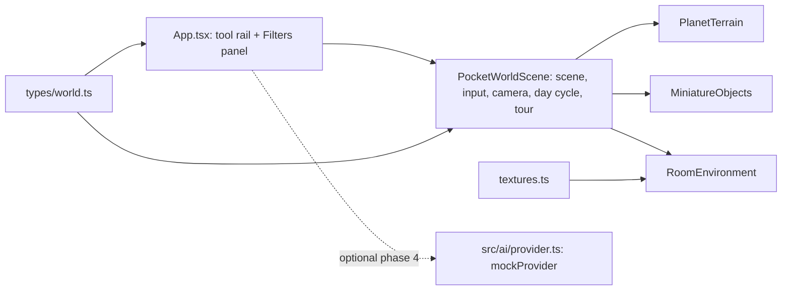

# Pocket World Terrarium · phase 1 of 4 · planned
> A cosy miniature world builder: a low-poly planet in a glass orb on a walnut stand, where you place things and watch a tiny world live.

> **This plan is ready to build.** File and folder names below are the layout of the new app; nothing here depends on any other project's files. Build from this plan alone.

| who reads | what | where |
|---|---|---|
| **Audience (users)** | Anyone who wants a relaxing toy; a good test of a 3D scene with many small objects. | this page: What is it, What you get, Look, Motion |
| **Stakeholders** | decide scope, answer questions | Decisions and open questions, Phases at a glance |
| **Builders (dev)** | React 19 + Vite + TypeScript, three.js, Tailwind 4; pnpm only | Build recipe, `PHASES.md` and `build_inputs/00_contract.md` |

## Build recipe (read this first)
1. **Read in this order:** this README (the Build prompt is `build_inputs/00_contract.md`), then `PHASES.md` for your task.
2. **Where it is built:** `run_test/pocket-world-terrarium/`.
3. **Stack, pinned (from the reference `package.json`):** React `^19.0.1`, Vite `^8.3.0`, `@vitejs/plugin-react` `^6.1.1`, TypeScript `^7.0.2`, `three` `^0.186.1` + `@types/three` `^0.186.0`, `tailwindcss` + `@tailwindcss/vite` `^4.3.3`, `lucide-react` `^0.546.0`. `motion` is listed in the reference but not needed (do not add it unless a task says so). Do not add `@google/genai`, `express`, `dotenv` or `tsx` (no AI, no server).
4. **pnpm ONLY.** `pnpm install`, `pnpm add`, `pnpm exec`, `pnpm dlx`. Never `npm`, `npx` or `yarn` (not in scripts, README or docs you write).
5. **File tree:** the one in *Build prompt*; every file has ONE owner (table in DEV). Edit only your own files.
6. **Build only the phase you were asked for.** Phase 1 = room, orb, planet, camera. Do not add tools, UI or the mock story early.
7. **Do not invent** features, files, tools or numbers the plan does not name. If something is missing, say so.
8. **This plan IS the planning.** No new plan, wireframe or placeholder object (a grey box standing in for a windmill counts as a failure).
9. **Builder self-check before reporting:** `pnpm exec tsc --noEmit` (0 errors), `pnpm build` (exit 0), open `pnpm dev` (port 3000) and read the browser console (0 errors). Report any difference from the brief.
10. **The lead verifies before it claims:** run the same three checks, do the browser steps of the phase *Done when*, state only what they show, and list every deviation. If a check could not be run (for example no GPU in the sandbox), say so.

## What is it
A faceted planet floats inside a glass orb in a sunny room (window, plant, walnut stand). Pick a tool from the rail on the right and click the planet to place a tree, house, windmill, lighthouse and 20 more things, or raise, lower and remove terrain. Villagers and sheep walk around; day turns to twilight to night. A 30-second tour shows it off. The reference app needs no network and no AI; an optional last phase names the planet and writes a short story from a seeded-random mock (no AI for now).

**For:** Anyone who wants a relaxing toy; a good test of a 3D scene with many small objects.

## What you get (feature catalog)
| id | feature | what you see or do | phase | status |
|---|---|---|---|---|
| F1 | Room, orb and planet | room, window, plant, glass orb, walnut stand, faceted planet that spins once on start | [1. World](PHASES.md) | planned |
| F2 | 24 tools | tree, house, windmill, lighthouse, mountain, lake, flower, cloud, villager, sheep, sailboat ... in 5 groups (village, water, nature, weather, sculpt) | [2. Tools](PHASES.md) | planned |
| F3 | Sculpt | raise and lower terrain, remove objects | [2. Tools](PHASES.md) | planned |
| F4 | 4 camera views | orb, surface, orbit, village; the camera glides between them; drag spins the planet, wheel zooms | [2. Tools](PHASES.md) | planned |
| F5 | Day and night | auto cycle, or lock day / twilight / night | [3. Life](PHASES.md) | planned |
| F6 | A living world | villagers and sheep move; population and happiness change with what you build; Grow button; 30 s tour | [3. Life](PHASES.md) | planned |
| F7 | Name and story (optional, NOT in the reference) | a seeded mock picks a planet name and short story from a bundled list (same world, same text) | [4. Mock story (optional)](PHASES.md) | planned |

## Parts and how they connect

## Look and feel
- **Cosy and warm.** Page behind the 3D view `#221d2b` (dark plum). The right rail and panels are warm cream: surface `#faf5ec`, border `#e2d7c5`, text `#382f27`, muted `#594d40`, dark buttons `#382f27` with text `#fcf8f0`, green accent button (Grow) `#d4ebc8`.
- **Fonts:** Fraunces (headings, planet name), Plus Jakarta Sans 400/500/600 (UI), JetBrains Mono (numbers, tabular).
- **Scene:** pale sage-green meadows, snowy faceted peaks, turquoise seas, pastel cottages, a stone well at the village centre, a glass orb (30 cm feel) on a walnut stand with a brass collar, on a chalky windowsill with linen cloth and a jade succulent in a terracotta pot. Each tool has its own pastel colour chip (for example house `#fce4d6`, sailboat `#d6eff7`, tree `#dff0d8`).
- **Layout:** on desktop the 3D view fills the page and a 64 px cream rail with 44 px round-cornered icon buttons sits on the right. On a phone the rail becomes a bottom dock with the same 44 px buttons and a Filters button.

## Motion and animation
| name | what | duration | easing |
|---|---|---|---|
| intro spin | planet turns 360 degrees once on load, then rests and the camera eases out a little | 3 s | linear angle, no easing |
| camera view change | the camera glides to the new view | about 1 s (guessed: exact smoothing factor is in the code, not a fixed time) | exponential approach |
| day cycle (auto) | light, sky, sun and moon move; windows, campfires, lighthouses and fireflies light up at dusk | 71 s per full day (0.014 per second) | smooth blends |
| time lock | Day, Twilight, Night jump to a fixed time (0.22, 0.52, 0.78) | immediate | none |
| tour | 30 second scripted film, cannot be steered | exactly 30 s | smoothstep between shots |
| place / sculpt | small sparkle burst where you click | 0.75 s (sculpt, remove); 1.65 s for another effect (not checked which) | fade-out squared |
| tool button | scale and colour change on press | 150 ms | default ease |
| reduced motion | the intro spin and the tour must be skipped or shortened | n/a | (planned rule, not in the reference) |

## Team: who does what
| who | does | tasks |
|---|---|---|
| builder | writes the code of its own files only (no file is owned twice) | T01 - T11 |

You (the owner) answer the open questions and judge each phase; Claude edits this plan when you ask (see Share and change).

## Quality bar (what 'professional' means here)
- `pnpm exec tsc --noEmit` clean and `pnpm build` exit 0
- 0 console errors and 0 warnings from three.js on load, on every tool click, on a view change
- Every one of the 24 tools places (or does) something visible on one click; none shows a grey placeholder box
- Frame rate: at least 55 fps average over 10 s at 1280x720 with the starting world plus 200 placed objects (reference claims 60; measure with `requestAnimationFrame` counter, say which machine)
- Works with no network (fonts fall back to Georgia / system sans); the mock story is optional; no key, no server
- Text contrast at least 4.5:1 for all UI text (the tooltip uses 9.5 to 11 px text in the reference: use 12 px minimum)
- Tap targets at least 40 px (reference buttons are 44 px); works at 390 px width with the bottom dock and no horizontal scroll
- Keyboard: every rail button has a label (`aria-label`) and `aria-pressed`; Esc closes Filters and stops the tour
- Reduced motion respected (intro spin and tour skipped)
- When WebGL is lost, show the message 'Terrarium Viewport Paused' instead of a blank page

## Real or guessed
**Real (read from the reference app's source: `package.json`, `metadata.json`, `vite.config.ts`, `index.html`, `src/types/world.ts`, `App.tsx`, `PocketWorldScene.ts`, `PlanetTerrain.ts`, `RoomEnvironment.ts`):** the stack and versions, the 24 tool ids and labels and descriptions, groups, colours of the UI, fonts, camera presets, renderer settings, light values, day-cycle bands and speed, Grow, tour timings, sculpt brush numbers, happiness formula, pointer and wheel rules. **The source has no AI call** (it lists `@google/genai` and `express` from the AI Studio template, but no file uses them) and **no test file**. Phase 4 is therefore a new design, marked guessed. Not verified: the look of each of the 24 objects in detail (4,119 lines), exact walking rules of villagers and sheep, and real fps (never run). Mobile behaviour is from the class names only.

## Decisions and open questions
| id | what | answer / default | state |
|---|---|---|---|
| D-01 | AI | no AI for now (seeded mock); LATER: a settings dialog where the user pastes an API key + base URL (+ model name) at runtime, works with any provider, not only Gemini; key stays in the user's browser. The game works with no network | agreed |
| D-02 | `motion` library | skip (listed in the reference but unused in what we read) | agreed |
| D-03 | Planet name | editable text in the Filters panel (default 'Little Meadow') | agreed |
| Q1 | Do you want the mock name and story at all? | default: build it last, skip if unwanted | open |

## Phases at a glance
**1. World** (planned), **2. Tools** (planned), **3. Life** (planned), **4. Mock story (optional)** (planned) → [full phase page](PHASES.md)

## Share and change
- **Share:** press *Copy link* in the plan viewer; one link = one page.
- **Change something:** press *Ask Claude* on the page and write your wish. Claude edits THIS file (and the phase page if scope moves), so `git diff docs/` shows what the plan changed.
- Status words: planning = still being written or missing facts · planned = split into tasks, **nothing built yet** · in progress · review · done.

## Details for builders
The full build contract (stack, file tree and owners, behaviour rules, data shapes, requirements, code flow, test plan, lessons) is `build_inputs/00_contract.md`; `CONTEXT.txt` hands it to every builder in front of its first prompt.

research: none (reverse-planned from an existing working app whose source was read for every number here: the 24 tools, scene, light and camera values, so there was no outside product to look up)
