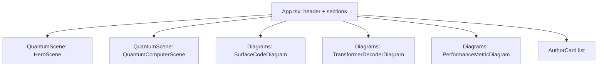

# Research Visualization (quantum error correction) · phase 1 of 3 · planned
> A research paper turned into a calm, scroll-through story page with 3D scenes and three interactive diagrams.

> **This plan is ready to build.** File and folder names below are the layout of the new app; nothing here depends on any other project's files. Build from this plan alone.

| who reads | what | where |
|---|---|---|
| **Audience (users)** | Readers of a paper who prefer a story to a PDF; also the template for 'make any paper into a narrative site'. | What is it, What you get, Look, Motion |
| **Stakeholders** | decide scope, answer questions | Decisions and open questions, Phases at a glance |
| **Builders (dev)** | React 19 + TypeScript + Vite 6, react-three-fiber + drei + three, framer-motion, lucide-react, Tailwind; no server, no AI; pnpm only | Build recipe, `PHASES.md`, grey DEV blocks (switch to Dev) |

## Build recipe (read this first)
1. **Read in this order:** this README (the Build prompt is `build_inputs/00_contract.md`, which `CONTEXT.txt` hands you), `PHASES.md`, then [build_inputs/01_look_3d_content.md](build_inputs/01_look_3d_content.md) (look, 3D scenes, real texts).
2. **Where it is built:** `run_test/research-visualization/`.
3. **Stack, pinned:** `react` / `react-dom` 19.2.0, `@react-three/fiber` 9.4.0, `@react-three/drei` 10.7.7, `three` 0.181.1, `framer-motion` 12.23.24, `lucide-react` 0.553.0, dev: `vite` 6.2.0, `@vitejs/plugin-react` 5.0.0, `typescript` 5.8.2, `@types/node` 22.14.0. Tailwind comes from the CDN script in `index.html` (as in the source), fonts from Google Fonts. **pnpm ONLY** (`pnpm install`, `pnpm exec vite build`); never npm, npx or yarn.
4. **File tree, ONE owner per file** (the single `builder`; no file is edited by two tasks of different owners): `package.json`, `vite.config.ts`, `tsconfig.json`, `index.html`, `index.tsx`, `index.css`, `App.tsx`, `components/QuantumScene.tsx`, `components/Diagrams.tsx`. Nothing else (the source's `types.ts` is unused: leave it out).
5. **Build only the phase you are asked for.** Do not invent sections, features, files or a second page.
6. **This plan IS the planning.** Do not write a new plan, a wireframe or placeholder screens. Each task delivers finished code with the final texts from *Content*.
7. **No AI in this app.** No key, no `.env` file.
8. **Builder self-check before reporting:** `pnpm exec tsc --noEmit`, `pnpm build`, open the page and read the browser console (0 errors), check at 390 px. Report every difference from this plan.
9. **The lead verifies before it claims** (build, console, the click steps in *Test plan*) and lists every deviation. If a check could not be run, say so.

## What is it
Not a tool that takes a topic: it is one finished page that retells a paper on quantum error correction (a neural network, **AlphaQubit**, that decodes a surface code; Nature, Nov 2024). A 3D hero scene opens it. You scroll through sections (The Noise Barrier, The Surface Code, Neural Decoding, Outperforming the Standard, Towards Fault Tolerance, Key Contributors). Three diagrams you can play with: click qubits to inject errors in the surface code, an animated decoder diagram, and a performance chart with three code sizes. Serif type and a gold accent give it a journal feel. There is no AI call and no input.

**For:** Readers of a paper who prefer a story to a PDF; also the template for 'make any paper into a narrative site'.

## What you get (feature catalog)
| id | feature | what you see or do | phase | status |
|---|---|---|---|---|
| F1 | Hero and menu | 3D hero scene, fixed top bar that gets a background after 50 px of scroll, mobile full-screen menu, smooth scroll to sections | [1. Page and story](PHASES.md) | planned |
| F2 | Story sections | six sections in a calm serif style, text fades in | [1. Page and story](PHASES.md) | planned |
| F3 | Surface-code diagram | click a qubit to make an error and see which checks light up | [2. 3D and diagrams](PHASES.md) | planned |
| F4 | Decoder diagram | Syndrome, Transformer, Correction drawn as a 4-step loop | [2. 3D and diagrams](PHASES.md) | planned |
| F5 | Performance chart | two bars (Standard vs AlphaQubit) for code distance 3, 5 or 11 | [2. 3D and diagrams](PHASES.md) | planned |
| F6 | Quantum computer scene | gold 'chandelier' machine, slowly floating, in the Impact section | [2. 3D and diagrams](PHASES.md) | planned |
| F7 | Contributors | six author cards with organisation | [1. Page and story](PHASES.md) | planned |

## Parts and how they connect

## Look and feel
- **Journal feel:** serif headings (Playfair Display, italic accents) with Inter for body text; warm off-white pages, white and stone panels, one **gold** accent, and one dark band (Neural Decoding) so the page has rhythm.
- **Colours:** page `#F9F8F4`, alternate panel `#F5F4F0`, white cards, dark band `#1c1917` (stone-900), gold `#C5A059`, ink `#1a1a1a`.
- **Type:** hero title 48 px on a phone, 72 px tablet, 128 px desktop; section titles 36-48 px; body 18 px; small caps labels 12 px with wide spacing.
- **Corners and shadows:** cards and panels have 12 px rounded corners, a thin stone border and a very soft shadow; pills are fully round.
- **Hero:** the 3D scene sits behind the words at 60% strength under a soft cream wash, so the title stays readable.
- **Gold text rule:** gold is fine on dark. On the light pages, small gold text is too pale to read (2.3:1), so small gold text on light uses a darker gold `#8A6A2C` (4.7:1). Big gold shapes (lines, buttons, dots) keep `#C5A059`.

## Motion and animation
| what | how | time |
|---|---|---|
| sections and author cards | fade up (opacity 0 to 1, 20 px rise) on page load; author cards start 0.1 s apart (0 to 0.5 s) | 0.6 s ease-out |
| header | clear at the top; after 50 px of scroll cream at 90% with blur and a light shadow | 0.3 s |
| hero 3D | floating, wobbling glass-like spheres, a thin gold ring, 1000 stars | continuous |
| surface code | a lit check scales up 10% with a ring; a hit qubit turns dark | 0.3 s / 0.2 s |
| decoder diagram | highlights Syndrome, then Transformer (two scan lines), then Correction, then repeats | one step per 2 s |
| performance bars | spring up when you change the distance; AlphaQubit bar follows 0.1 s later | spring 80/15 |
| **reduced motion** | no float or loops: 3D scene frozen after the first frame, fades only, decoder shows step 4 | rule |

## Team: who does what
| who | does | tasks |
|---|---|---|
| builder | writes the code of its own files only (no file is owned twice) | T01-T10 |
| lead | checks every phase in a real browser or build; writes pass/fail, never builds | T11 |

You (the owner) answer the open questions and judge each phase; Claude edits this plan when you ask (see Share and change).

## Quality bar (what 'professional' means here)
| check | number |
|---|---|
| `pnpm exec tsc --noEmit` and `pnpm build` | both exit 0 |
| browser console, all scrolled sections | 0 errors, 0 warnings from our code |
| width | readable at 390 px, no sideways scroll (`scrollWidth <= 390`) |
| text contrast | at least 4.5:1 for text under 24 px (see *Lessons*: gold and stone-400 on light fail) |
| tap targets | at least 40 x 40 px: menu button, qubits, distance buttons, links |
| 3D budget | two canvases; at least 30 fps on a normal laptop while scrolling; `dpr` capped at 2 |
| reduced motion | honoured as in the Motion table |
| keyboard | menu button, qubits and distance buttons reachable by Tab, visible focus ring; menu button has an `aria-label` |
| build size | main chunk is allowed to be large (three.js); no warning to fix, only report the size |

## Real or guessed
**Real (read from the app's actual code, 748 lines: `App.tsx` 311, `Diagrams.tsx` 273, `QuantumScene.tsx` 145, `index.tsx` 19):** every text, colour, size, timing, the data table, the qubit and check layout, the 3D scene parameters, the pinned versions. My earlier guess ('topic in, charts out, with AI') was wrong: no input, no AI.
**Source bugs found (the plan fixes them, marked "fix"):** `index.css` is EMPTY, so the classes `animate-fade-in-up` and `animate-fade-in` do nothing in the source (nothing fades in); the decoder's 9 syndrome dots are re-rolled with `Math.random()` on every render (they flicker); the mobile menu has no label on its button; the footer line is `stone-600` on `stone-900` (2.3:1).
**Guessed:** the fade-in keyframe values (0.6 s, 20 px), the dark gold `#8A6A2C`, reduced-motion handling, the 30 fps budget. The performance numbers are as written in the source, whose comment says they are the paper's; I could not check them against the paper.

## Decisions and open questions
| id | what | answer / default | state |
|---|---|---|---|
| D-01 | Content source | the paper's text is written into the page; a new paper means new sections, not new code | agreed |
| D-02 | Tailwind | CDN script in `index.html`, as the source does (no build config) | agreed |
| D-03 | Fix the source bugs (empty css, random dots, labels, contrast) | yes, listed under Real or guessed | agreed |
| Q1 | Do you want a generator ('give me a paper, get this page')? | default: no, that is a different, bigger plan | open |
| Q2 | Which paper next? | open | open |
| Q3 | Should 3D scenes run offline? The `Environment` presets (city, studio) download a light map from the internet | default: no, needs internet; fallback is plain lights, see Edge cases | open |

## Phases at a glance
**1. Page and story** (planned), **2. 3D and diagrams** (planned), **3. Verify** (planned) → [full phase page](PHASES.md)

## Share and change
- **Share:** press *Copy link* in the plan viewer; one link = one page.
- **Change something:** press *Ask Claude* on the page and write your wish. Claude edits THIS file (and the phase page if scope moves), so `git diff docs/` shows what the plan changed.
- Status words: planning = still being written or missing facts · planned = split into tasks, **nothing built yet** · in progress · review · done.

## Details for builders
The full build contract (stack, file tree and owners, behaviour rules, data shapes, requirements, code flow, test plan, lessons) is `build_inputs/00_contract.md`; `CONTEXT.txt` hands it to every builder in front of its first prompt.

research: none (reverse-planned from an existing working app whose source was read for every number here: content, diagrams, 3D scenes and timings; the science content is taken from that app, so there was no outside product to look up)
