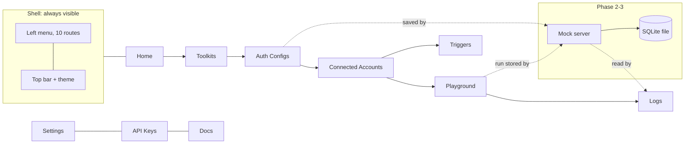

# AgentDeck (Composio-style dashboard) · phase 1 of 1 · planned
> An admin dashboard where a developer connects tools (GitHub, Slack, ...) to AI agents. Looks like the Composio dashboard, renamed AgentDeck.

> **Planning phase only: nothing is built from this plan yet.** File and folder names below are the *planned* layout (taken from the analysed reference app), not files that exist. Test cases in `TestCases/` check the finished reference project or try to build from this plan; they are not the product.

| who reads | what | where |
|---|---|---|
| **Audience (users)** | You and your team, to review the screens before building; builders, who work from the same pages. | this page: What is it, What you get, Look, Motion |
| **Stakeholders** | decide scope, answer questions | Decisions and open questions, Phases at a glance |
| **Builders (dev)** | stack: Vue 3 from a CDN, no build; pnpm only (a Bun + SQLite mock server belongs to later plans, not this build) | `PHASES.md` and the grey DEV blocks (switch to Dev) |

## Build recipe (read this first)
1. **Read in this order:** this README, `PHASES.md`, `02_ux/README.md`, `02_ux/theme.md`, `02_ux/motion.md`, then the screen pages in `02_ux/screens/`.
2. **Where it is built:** `run_test/agentdeck/` (brand AgentDeck).
3. **Start from the kit:** run the harness tool exactly as `proto_init --dir run_test/agentdeck --title "AgentDeck" --accent "#5753c6" --nav '[{"label":"Home","file":"part-1"},{"label":"Toolkits","file":"part-1"},{"label":"Auth Configs","file":"part-1"},{"label":"Connected Accounts","file":"part-1"},{"label":"Triggers","file":"part-2"},{"label":"Playground","file":"part-2"},{"label":"Logs","file":"part-2"},{"label":"Settings","file":"part-3"},{"label":"API Keys","file":"part-3"},{"label":"Docs","file":"part-3"}]'` (a no-build Vue 3 prototype: `index.html`, `css/kit.css`, `js/kit.js`, the 10 routes). The nav text FIXES the file names and the split below; never edit the kit files.
4. **Build only the phase you are asked for.** Phase 1 = look and screens on FAKE data (no server, no SQLite: those are phases 2-3).
5. **Three builders in parallel, one per screens file** (groups below); each edits ONLY its own two files. Do not give one builder many screens: the lead stops waiting after three waits on the same builder.

**File groups (fixed by the nav above, so the work splits evenly):**
| file | owner | screens | also owns |
|---|---|---|---|
| `js/screens/part-1.js` + `css/pages-part-1.css` | builder-1 | Home, Toolkits, Auth Configs, Connected Accounts | the shell and the LIGHT theme overrides (`#fcfcfc`, black buttons, lavender accent) |
| `js/screens/part-2.js` + `css/pages-part-2.css` | builder-2 | Triggers, Playground, Logs | `window.AgentDeck.executions` (Playground writes a row, Logs reads it: both in this file) |
| `js/screens/part-3.js` + `css/pages-part-3.css` | builder-3 | Settings, API Keys, Docs | the DARK theme (`html[data-theme=dark]` tokens, toggle in Settings > Appearance, `localStorage` key `agentdeck-theme`, applied at load) |

6. **Verify** with `proto_check` and the preview, then the *Done when* list of the phase.
7. **Do not invent** screens, files or features the plan does not name. The real dashboard was not captured (only its login page): screens are invented in the plan's style and marked so.
8. **This plan IS the planning.** Do not write a new plan, a separate wireframe or placeholder screens. Each builder delivers its screens FINISHED in one pass: fake data, the theme (light and dark) and the interactions in the screen pages.
9. **Builders self-check before reporting:** `node --check` on their file, the kit's `proto_check`, and every route and link exists in `PROTO.md`. They report any difference from the screen pages.
10. **The lead verifies before it claims.** Run `proto_check` and the preview, open every route, read EVERY builder report, and state only what the checks and reports show. List every deviation from the plan. If a check could not be run, say so.

## What is it
Ten screens with a left menu: set up apps (Toolkits, Auth Configs, Connected Accounts), use them (Triggers, Playground, Logs), and manage (Settings, API Keys, Docs). Light and dark theme, working buttons. First it runs on fake data; then it gets a small mock server with a SQLite file so what you create stays after a restart; then Playground runs are really stored and shown in Logs.

**For:** You and your team, to review the screens before building; builders, who work from the same pages.

## Picture (rough sketch)

## What you get (feature catalog)
| id | feature | what you see or do | phase | status |
|---|---|---|---|---|
| F1 | Shell and menu | left menu with 10 routes, top bar, active route highlighted | [1. Look and screens](PHASES.md) | planned |
| F2 | Light and dark | #fcfcfc light with black buttons and lavender accent; dark choice kept after reload | [1. Look and screens](PHASES.md) | planned |
| F3 | Home | stats + quickstart | [1. Look and screens](PHASES.md) | planned |
| F4 | Toolkits | 12 app cards, search, categories | [1. Look and screens](PHASES.md) | planned |
| F5 | Auth Configs | list, create, detail | [1. Look and screens](PHASES.md) | planned |
| F6 | Connected Accounts | list, connect drawer, reconnect | [1. Look and screens](PHASES.md) | planned |
| F7 | Triggers | switches, create, events | [1. Look and screens](PHASES.md) | planned |
| F8 | Settings | tabs incl. appearance | [1. Look and screens](PHASES.md) | planned |
| F9 | API Keys | create, copy once, revoke | [1. Look and screens](PHASES.md) | planned |
| F10 | Docs | reading page | [1. Look and screens](PHASES.md) | planned |
| F11 | Playground and Logs screens | Run shows a fake response and adds a Logs row | [1. Look and screens](PHASES.md) | planned |
| F12 | Things stay after restart | what you create is saved in a SQLite file by a small mock server | later, not in this build | - |
| F13 | Real stored runs | Playground Run is stored; Logs filters and exports real rows | later, not in this build | - |
| F14 | Phone width | works at 390 px; menu becomes a drawer | later, not in this build | - |

## Parts and how they connect

## Screens
| screen | what it does | page |
|---|---|---|
| Home | 4 stats, 3-step quickstart with code sample | [home](02_ux/screens/home.md) |
| Toolkits | 12 app cards, search, category filter, detail | [toolkits](02_ux/screens/toolkits.md) |
| Auth Configs | how sign-in works per app; create; detail | [auth-configs](02_ux/screens/auth-configs.md) |
| Connected Accounts | accounts per end user; connect in 2 steps; reconnect | [connected-accounts](02_ux/screens/connected-accounts.md) |
| Triggers | on/off switches, create, recent events, replay | [triggers](02_ux/screens/triggers.md) |
| Playground | pick a tool, edit JSON, Run, see the response | [playground](02_ux/screens/playground.md) |
| Logs | every run, newest first; search, filter, export | [logs](02_ux/screens/logs.md) |
| Settings | profile, workspace, members, appearance (dark mode) | [settings](02_ux/screens/settings.md) |
| API Keys | create (shown once), copy, revoke | [api-keys](02_ux/screens/api-keys.md) |
| Docs | 3-column reading page with quickstart and errors | [docs](02_ux/screens/docs.md) |

## Typical walk-through
Home → Create auth config → Connect account → Playground (Run) → Logs (see the run).

Look and feel: [theme](02_ux/theme.md) · animations: [motion](02_ux/motion.md) · all routes in one table: [UX index](02_ux/README.md).

## Look and feel
- **Light (default):** page `#fcfcfc`, black buttons (white text), lavender accent `#b1a9ff` / `#5753c6` for links and highlights. **Dark:** background `#000`, surface `#191919` (set in Settings > Appearance, kept after reload). Code and ids in **IBM Plex Mono**.
- **Shell:** left menu with 10 routes and an active highlight, top bar with the theme switch. Cards, tables, badges, modals, drawers and toasts come from the shared kit (`css/kit.css`, `js/kit.js`), nobody edits them.
- Full tokens, type scale, spacing and component list: [theme](02_ux/theme.md). The look comes from the real login page only; screens are invented in the same style.

## Motion and animation
| where | animation | time |
|---|---|---|
| buttons, nav items, rows | colour fade on hover | 120 ms |
| modal / drawer | fade + 8 px slide up / slide in from right | 160 ms |
| toast | slides in bottom-right, hides after 3 s | 160 ms |
| Home stats and bars | numbers count up once; bars grow from 0 | 600 ms / 300 ms |
| theme switch | colours cross-fade | 150 ms |
| `prefers-reduced-motion` | turns all of it off | rule |

No looping or decorative animation. Source: invented (the capture found none); full list: [motion](02_ux/motion.md). Real motion can replace it if you supply a logged-in capture (Q2).

## Team: who does what
| who | does | tasks |
|---|---|---|
| lookup (one call) | reads the reference and writes the briefs | T00 |
| builder-1 | writes `part-1` (Home, Toolkits, Auth Configs, Connected Accounts) and the shell + light theme; its own files only | T01, T03-T06 |
| builder-2 | writes `part-2` (Triggers, Playground, Logs) and `window.AgentDeck.executions`; its own files only | T07-T09 |
| builder-3 | writes `part-3` (Settings, API Keys, Docs) and the dark theme + toggle; its own files only | T02, T10-T12 |
| qa-reviewer | checks every phase in a real browser or build; writes pass/fail, never builds | T03, T02 |

You (the owner) answer the open questions and judge each phase; Claude edits this plan when you ask (see Share and change).

## Quality bar (what 'professional' means here)
- Every list has search or filter, an empty state and a row that opens a detail view; every button acts (no 'TODO', no 'coming soon')
- Forms validate and show a field error
- Light and dark both pass text contrast 4.5:1
- Works at 390 px (menu becomes a drawer); no horizontal scroll
- 0 console errors on every route; no file owned by two builders
- Honest labels: invented screens are marked invented

## Real or guessed
**Real (from you / the capture):** colours #fcfcfc, black buttons, lavender #b1a9ff / #5753c6, IBM Plex Mono, dark toggle, the name AgentDeck, the list of 10 screens. **Guessed:** everything inside the 10 screens: the capture only saw the login page (the dashboard is behind a login). No Composio logo, text or font files are copied.

## Decisions and open questions
| id | what | answer / default | state |
|---|---|---|---|
| Q1 | How to fill the 10 screens? (a) I invent them from typical agent platforms, (b) you log in once in the connected browser and I capture the real dashboard, (c) you drop screenshots in `ref_notes/` | (a) | open |
| Q2 | Animations: keep the small invented set (`02_ux/motion.md`) or send the real ones? | keep | open |
| D-01 | Name | AgentDeck, original copy, no Composio logo or text | agreed |
| D-02 | Mock data lives inside each screen file in phase 1 | no shared `data.js`; only `window.AgentDeck.executions` is shared | agreed |
| D-03 | a screens file holds 8 screens | split into `main_a/main_b` if it passes 600 lines | open |
| D-04 | Phase 2 backend | Bun + `bun:sqlite`, one file `agentdeck.sqlite`, no auth, seeded from the data model | proposed |

## Phases at a glance
**1. Look and screens** (planned) → [full phase page](PHASES.md)

## Share and change
- **Share:** press *Copy link* in the plan viewer; one link = one page.
- **Change something:** press *Ask Claude* on the page and write your wish. Claude edits THIS file (and the phase page if scope moves), so `git diff docs/` shows what the plan changed.
- Status words: planning = still being written or missing facts · planned = split into tasks, **nothing built yet** · in progress · review · done.

<!-- dev -->
## Packages and owners (no file owned twice)
> Status: draft · Updated: 2026-11-16

| file | owner agent | owns (no one else touches) | tasks |
|---|---|---|---|
| part-1 | builder-1 | `js/screens/part-1.js`, `css/pages-part-1.css` (Home, Toolkits, Auth Configs, Connected Accounts; shell + light theme) | T01, T03-T06 |
| part-2 | builder-2 | `js/screens/part-2.js`, `css/pages-part-2.css` (Triggers, Playground, Logs; `window.AgentDeck.executions`) | T07-T09 |
| part-3 | builder-3 | `js/screens/part-3.js`, `css/pages-part-3.css` (Settings, API Keys, Docs; dark theme + toggle) | T02, T10-T12 |
| research | lookup (ONE call, only if a re-capture is asked) | `_ref/*` | T00 |
| qa | qa-reviewer | nothing (read only) | every task |

Parallel: the three builders run at the same time after the kit exists (disjoint files).

## Requirements (EARS)

| id | requirement | source |
|---|---|---|
| R1 | The app shall show a left sidebar with the 10 routes; the active route is highlighted. | invented (typical) |
| R2 | When the user switches Settings > Appearance to dark, every screen shall use the dark palette in `theme.md` and keep the choice after reload. | user-given |
| R3 | Toolkits shall be a card grid with live search and category chips; a card opens `#/toolkits/<slug>`. | invented |
| R4 | Every list shall have a working search or filter, an empty state, and a row that opens a detail view. | PROTO rule |
| R5 | Every button shall do something (modal, drawer, toast, route). No "TODO" / "coming soon" text. | PROTO rule |
| R6 | Playground shall let the user pick a toolkit + action, edit JSON params, press Run, and see a mock response and a new row in Logs. | invented |
| R7 | Forms shall validate and show `.field-error`. | PROTO rule |
| R8 | The layout shall work at 390px width (sidebar becomes a drawer). | user-given ("exact" site is responsive) |

## Data model (mock)
> Status: draft · Updated: 2026-11-16

Shared shapes so Logs/Playground/Home show consistent names (types in words; no TS in a no-build prototype):
| entity | fields | used by |
|---|---|---|
| Toolkit | slug, name, category, auth ("OAuth 2"/"API key"), actions (n), connected (n), description | Toolkits, Home, Playground |
| AuthConfig | id, toolkit, scheme, name, created, status | Auth Configs |
| ConnectedAccount | id, toolkit, label, user, status (active/expired), created | Connected Accounts, Playground |
| Trigger | id, toolkit, event, target_url, status | Triggers |
| Execution | time, tool (mono `GITHUB_CREATE_ISSUE`), account, status (Success/Failed), ms | Logs, Home (recent), Playground (new row) |
| ApiKey | id, name, prefix (`ad_live_ab12…`), created, last_used | API Keys |

Slugs fixed across screens: github, slack, gmail, notion, linear, google-sheets, hubspot, jira, salesforce, stripe, google-calendar, dropbox.
<!-- dev -->
Cross-screen link: Playground "Run" appends an Execution to a `window.AgentDeck.executions` array that Logs reads (the only shared runtime state; owner: part-2 (builder-2); Home in part-1 only READS it).
<!-- /dev -->

## Code flow
> Status: draft · Updated: 2026-11-16 · Raw generated contract: `04_code_flow_proto_contract.md`

- No build, no npm: `index.html` + `css/kit.css` + `js/kit.js` (Vue 3 CDN). Done by `proto_init`; nobody edits.
- Router: hash routes; `Screens.<Name> = { template, data, computed, methods }` in the owner's file; detail views branch on `$route.parts[1]`.
- Helpers from the kit: `$go(path)`, `$toast(msg)`, `ui-modal`, `ui-drawer`, `ui-badge`, `ui-empty`.
- Styles: each builder adds only its own classes in its own `css/pages-part-N.css`; shell/light-theme overrides in `css/pages-part-1.css`, dark theme in `css/pages-part-3.css`.
- Only runtime link between packages: `window.AgentDeck.executions` (see `03_data_model.md`).
- Check: `proto_check --dir run_test/agentdeck` (<1 s), then `preview`, then the browser steps.

## Test plan (original)
> Status: draft · Updated: 2026-11-16

| task | steps (human-style) | pass when |
|---|---|---|
| P1-T01 theme | open `#/home`; read computed page bg, button bg | page bg rgb(252,252,252), primary button rgb(0,0,0), accent link #5753c6 |
| P1-T02 dark | Settings > Appearance > Dark; reload | bg #000, surface #191919, choice kept (R2) |
| P2-T01 home | open `#/home`; click tab "30 days"; click "Connect" in step 2 | bars change; route becomes `#/connected-accounts` |
| P2-T02 toolkits | type "git" in search; click chip Developer; click first card; clear search | list filters, detail `#/toolkits/github` opens, empty state shows for "zzz" |
| P2-T09 playground | pick GitHub + create issue; Run | response panel fills; Logs has a new top row (R6) |
| P2-T10 logs | filter status=Failed; click a row | only Failed rows; detail drawer opens |
| P3-T01 responsive | resize 390px; open sidebar drawer; visit all routes | no horizontal scroll, drawer works (R8) |
| P3-T02 sweep | `proto_check`, `preview` all routes, `site_audit`, `ref_compare` | 0 console errors, no dead links, score >= Phase 1 value |
(Other P2 screens follow the R4/R5/R7 pattern: search, empty state, detail, buttons act, form validates.)

Negative cases (the evaluator must catch these): a button with no handler; a screen showing "TODO"; two packages editing one file; a hard-coded colour outside tokens.

## Planner notes
Capture facts come from `_ref/composio/REF.md` (copy of key lines in `ref_notes/capture_facts.md`). The login URL carries a session token: never store it. The raw generated contract is kept as `04_code_flow_proto_contract.md` (dev, not for reading).
<!-- /dev -->
