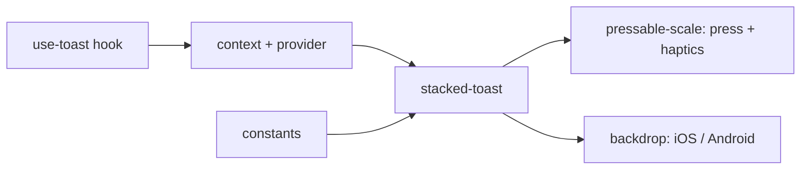

# Stacked toast (Clerk style) · phase 1 of 4 · planned
> Pop-up messages for a phone app that stack, collapse and expand with springy motion, on iOS and Android.

> **Planning phase only: nothing is built from this plan yet.** File and folder names below are the *planned* layout (taken from the analysed reference app), not files that exist. Test cases in `TestCases/` check the finished reference project or try to build from this plan; they are not the product.

| who reads | what | where |
|---|---|---|
| **Audience (users)** | App builders who want a polished toast for Expo / React Native, and want it stable (the original needed 3 fix commits for feel). | this page: What is it, What you get, Look, Motion |
| **Stakeholders** | decide scope, answer questions | Decisions and open questions, Phases at a glance |
| **Builders (dev)** | stack: Expo / React Native, react-native-reanimated, react-native-worklets, pressto, expo-haptics; pnpm only | `PHASES.md` and the grey DEV blocks (switch to Dev) |

## What is it
When your app calls `toast()`, a small message slides in. More messages stack behind it. Tap the stack and it expands to show them all; tap again and it collapses. A soft blurred gradient sits behind the stack, and the phone gives a small vibration when you press. It must not jump when many toasts arrive at once.

**For:** App builders who want a polished toast for Expo / React Native, and want it stable (the original needed 3 fix commits for feel).

## What you get (feature catalog)
| id | feature | what you see or do | phase | status |
|---|---|---|---|---|
| F1 | Show a toast | `toast()` from a hook; 1, 3 or 5 toasts stack with set offsets | [1. Core](PHASES.md) | planned |
| F2 | Stack, expand, collapse | tap to expand, tap again to collapse, spring motion only (no timing curves) | [2. Interaction](PHASES.md) | planned |
| F3 | Blurred gradient backdrop | different native code for iOS and Android | [1. Core](PHASES.md) | planned |
| F4 | Haptics | one vibration per press, never two | [2. Interaction](PHASES.md) | planned |
| F5 | Stable under load | 20 quick `toast()` calls: no jump, no overlap | [3. Stability](PHASES.md) | planned |
| F6 | Status bar | stays visible on both platforms | [3. Stability](PHASES.md) | planned |
| F7 | Library upgrades | a version bump is one task, not a hunt | [4. Maintenance](PHASES.md) | planned |

## Parts and how they connect

## Look and feel
- Stacked toast cards over a **blurred gradient backdrop** (separate iOS and Android code), soft layered shadows (the real project polished the shadows in its last commit), pressable scale on tap. Exact colours and sizes live in `constants.ts` (not captured in this plan: open question to record them from the app).

## Motion and animation
| what | how | rule |
|---|---|---|
| show / stack | toasts offset and scale behind the newest | positions follow the layout table |
| expand / collapse | **spring** animation (the real project moved from timing curves to springs) | no timing curves |
| press | scale + one haptic | one vibration per press, never two |
| many calls | 20 quick `toast()` calls | no jump, no overlap |

## Team: who does what
| who | does | tasks |
|---|---|---|
| builder | writes the code of its own files only (no file is owned twice) | T01, T02, T03, T04, T05, T08 |
| qa-reviewer | checks every phase in a real browser or build; writes pass/fail, never builds | T06, T07 |

You (the owner) answer the open questions and judge each phase; Claude edits this plan when you ask (see Share and change).

## Quality bar (what 'professional' means here)
- 20 rapid calls recorded on video: no jump or overlap
- Haptic fires once per press
- Status bar stays visible on iOS and Android
- Versions pinned; a library bump is one task and the checks are re-run

## Real or guessed
Reverse-planned from a real project that lived 15 months (9 commits). The plan lines are my reading of what would have prevented the later fixes; I did not read the two big fix diffs, so why 'unstable animations' happened is not established.

## Decisions and open questions
| id | what | answer / default | state |
|---|---|---|---|
| D-01 | Platform split | separate `index.tsx` and `index.android.tsx` for the backdrop from day 1 | agreed |
| D-02 | Pin library versions | yes; list the API surface used (reanimated, worklets, pressto, expo-haptics) | agreed |
| Q1 | Do you need web too? | no, phones only (check with `tsc --noEmit`; no device here) | agreed |

## Phases at a glance
**1. Core** (planned), **2. Interaction** (planned), **3. Stability** (planned), **4. Maintenance** (planned) → [full phase page](PHASES.md)

## Share and change
- **Share:** press *Copy link* in the plan viewer; one link = one page.
- **Change something:** press *Ask Claude* on the page and write your wish. Claude edits THIS file (and the phase page if scope moves), so `git diff docs/` shows what the plan changed.
- Status words: planning = still being written or missing facts · planned = split into tasks, **nothing built yet** · in progress · review · done.

<!-- dev -->
## Files (plan)
`stacked-toast-manager/{provider,context,hooks,constants,stacked-toast}.tsx|ts`, `backdrop/{index.tsx,index.android.tsx,use-gradient-height.ts}`, `hooks/use-toast.tsx`, `components/pressable-scale.tsx`.
Pinned API surface: react-native-reanimated (`SharedValue`, springs), react-native-worklets (`scheduleOnRN`, `scheduleOnUI`), pressto (press + haptics), expo-haptics.

<!-- /dev -->
