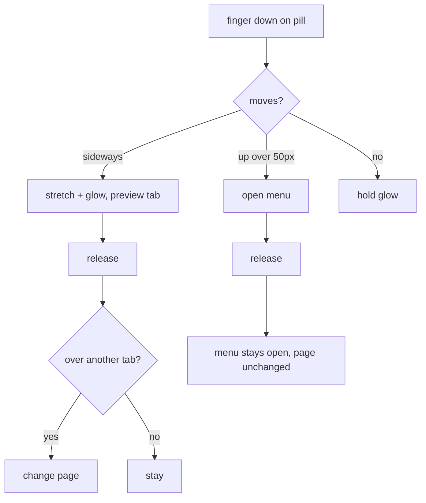

# Linear-style tab bar · phase 1 of 6 · planned
> A floating glass tab bar with a stretching, glowing pill, a search button that grows into a box, and a pull-up menu. Prototype = Vue web page.

> **This plan is ready to build.** File and folder names below are the layout of the new app; nothing here depends on any other project's files. Build from this plan alone.

| who reads | what | where |
|---|---|---|
| **Audience (users)** | App builders who want a tab bar that feels right, and want the gesture rules written down before building (in the real project two of them were found only by using the app and fixed in later commits). | this page: What is it, What you get, Look, Motion |
| **Stakeholders** | decide scope, answer questions | Decisions and open questions, Phases at a glance |
| **Builders (dev)** | stack: Vue 3 web prototype now (native target later: Expo + reanimated); pnpm only | `PHASES.md` and the build inputs in this folder |

## Build recipe
1. **Where:** build in `run_test/tabbar` as a Vue 3 + TypeScript + Vite web prototype (**pnpm only**: `pnpm create vite tabbar --template vue-ts`). Native-only items (vibration, native blur, Android layout) are NOT built.
2. **Files and owners (no file owned twice):** builder A = `src/components/TabBar.vue`, `src/components/TabBarPill.vue`, `src/components/MenuPanel.vue`; builder B = `src/components/SearchBar.vue`, `src/constants.ts`, `src/glass.css`; the lead owns `src/App.vue` (3 pages) and `package.json`. One shared glass style in `glass.css` for pill, search box and menu.
3. **Order:** the 6 phases of PHASES.md; the behaviour rows B-01 to B-07 are the tests.
4. **Verify (the lead, no review agent):** `pnpm build` and `pnpm exec vue-tsc --noEmit` pass; drive the pill with pointer events in a headless browser (drag sideways, drag up more than 50 px, hold) and check each B row; say that 60 fps and the real touch feel were not checked.


## What is it
A pill at the bottom holds 3 tabs. Drag the pill sideways and it stretches and glows, but the page only changes when you let go. Pull it up and a menu opens without changing the page. The search button turns into a search box and back.

**For:** App builders who want a tab bar that feels right, and want the gesture rules written down before building (in the real project two of them were found only by using the app and fixed in later commits).

## Picture (rough sketch)


## What you get (feature catalog)
| id | feature | what you see or do | phase | status |
|---|---|---|---|---|
| F1 | Tabs | tap a tab: it lights up and the page changes (B-01) | [1. Skeleton](PHASES.md) | planned |
| F2 | Stretch and glow | drag sideways: pill stretches, tab under it previews, page changes on release (B-02, B-02b) | [2. Pill gestures](PHASES.md) | planned |
| F3 | Hold glow | hold the pill: glow shows and fades on release, never stuck (B-06) | [2. Pill gestures](PHASES.md) | planned |
| F4 | Search | button grows into a box; the close button shrinks it back (B-04, B-05) | [3. Search](PHASES.md) | planned |
| F5 | Pull-up menu | pull up more than 50 px: menu opens and stays; page unchanged (B-03) | [4. Menu](PHASES.md) | planned |
| F6 | Gradient border | masked gradient border on the glass | [5. Polish](PHASES.md) | planned |
| F7 | Reduced motion | stretch and glow become instant colour changes (B-07) | [6. Perf and cleanup](PHASES.md) | planned |

## Parts and how they connect


## Pill and tabs
Developer comment: in the real project, "page changes while dragging" and "drag up also triggers the menu" were found by using the app and fixed in two later commits (416 and 93 patch lines). We write them down first so they are built right the first time.

| id | When | If | Then | Otherwise | Source | Target |
|---|---|---|---|---|---|---|
| B-01 | you tap a tab | it is not the active one | it lights up and the page changes | nothing happens | invented | web |
| B-02 | you drag the pill sideways | you are still holding | the pill stretches and glows; the tab under it is previewed; the page does NOT change | - | invented (rule found by use in the real history) | web |
| B-02b | you let go | the pill is over another tab | the page changes to that tab | stays on the current tab | same | web |
| B-03 | you drag the pill up | further than 50 px | the menu opens as you pull and stays open when you let go; the page does not change | under 50 px: the pill springs back, no menu | same | web |
| B-06 | you hold the pill still | - | a glow shows and fades when you release | the glow must never stay stuck | same | web |
| B-07 | the device asks for reduced motion | - | stretch and glow become instant colour changes | - | added requirement | web |


## Search
| id | When | If | Then | Otherwise | Source | Target |
|---|---|---|---|---|---|---|
| B-04 | you tap the search button | - | it grows into a box over the tabs; the keyboard does not cover it | - | invented | web |
| B-05 | you tap ✕ | the box is open | the box shrinks back to the button | - | invented | web |


## Not included (on purpose)
- Vibration feedback on press (native-only: reviewed, not prototyped).
- Native blur and worklet threads (web uses CSS blur: `web-approx`).
- Android layout differences (native-only).

## Known issues
- The glass look on web depends on the browser's `backdrop-filter`; older browsers show a flat pill.

## Questions for you
- Should the menu have items, and which? (the real project's menu content is not known to me)
- Is a 50 px pull the number you want?

## Look and feel
- A floating **glass pill** at the bottom (blur + gradient border), 3 tab icons, a notification dot, and a separate round **search** button. One `GlassMaterial` is shared by the pill, the search box and the menu.
- Linear-style. On web the blur is CSS `backdrop-filter` (older browsers show a flat pill: marked `web-approx`).

## Motion and animation
| gesture | animation | rule |
|---|---|---|
| drag the pill sideways | pill stretches and glows; the tab under it is previewed | page changes only on release |
| hold the pill | glow shows, fades on release | never stays stuck |
| pull up more than 50 px | menu opens progressively and stays open | page unchanged; under 50 px springs back |
| tap search | button morphs into an input over the tabs; close shrinks it back | keyboard never covers the bar |
| reduced motion | stretch and glow become instant colour changes | B-07 |

Smooth at 60 fps on a device; native-only items (vibration, native blur) are written down, not built on web.

- **Captured / invented:** what comes from the reference project is marked *real*; everything else (names, colours, sizes, wording) is *invented* by this plan or by you. Never present an invented value as taken from the reference.

## Team: who does what
| who | does | tasks |
|---|---|---|
| builder | writes the code of its own files only (no file is owned twice) | T01, T02, T03, T05, T06, T08 |
| qa-reviewer | checks every phase in a real browser or build; writes pass/fail, never builds | T09 |

You (the owner) answer the open questions and judge each phase; Claude edits this plan when you ask (see Share and change).

## Quality bar (what 'professional' means here)
- Every row of the interaction table passes in a recorded run
- `tsc --noEmit` clean; no unused file or hook
- No JS-thread work inside gesture handlers except plain callbacks (native: `scheduleOnRN`)
- Reduced-motion rule (B-07) holds
- One glass implementation, not three

## Real or guessed
Reverse-planned from a real project: 10 commits in 2 days, 5 of them rework. The interaction table is the lesson: two rules (page must not change while dragging; drag-up must not trigger the menu) were found by use and cost 416 + 93 patch lines. Items marked 'native-only' are written down, not prototyped.

## Research
research: none (reverse-planned from the git history of one real project (10 commits in 2 days); the gesture rules were read from the fixes in that history, so there was no outside product to look up)

## Decisions and open questions
| id | what | answer / default | state |
|---|---|---|---|
| D-01 | Prototype target | Vue web page; native-only items (vibration, native blur) are marked, not built | agreed |
| Q1 | Should the menu have items, and which? | 3 items: Profile, Settings, Help (they only close the menu) | agreed |
| Q2 | Is a 50 px pull the number you want? | 50 px | agreed |

## Phases at a glance
**1. Skeleton** (planned), **2. Pill gestures** (planned), **3. Search** (planned), **4. Menu** (planned), **5. Polish** (planned), **6. Perf and cleanup** (planned) → [full phase page](PHASES.md)

## Share and change
- **Share:** press *Copy link* in the plan viewer; one link = one page.
- **Change something:** press *Ask Claude* on the page and write your wish. Claude edits THIS file (and the phase page if scope moves), so `git diff docs/` shows what the plan changed.
- Status words: planning = still being written or missing facts · planned = split into tasks, **nothing built yet** · in progress · review · done.

<!-- dev -->
## Original brief
> Status: reverse-planned · 2026-11-16
Goal: a floating glass pill tab bar (3 tabs) with a search button that expands to an input, and an upward-drag popup menu; smooth 60fps on device.
Stack (pinned in P1): expo, react-native-reanimated, react-native-gesture-handler, react-native-worklets, expo-blur, expo-linear-gradient, react-native-svg, expo-haptics. TypeScript only.
Non-goals: real navigation content (placeholder screens), Android parity.

#### File tree (decided in P1, never two files for one thing)
```
App.tsx
src/components/TabBar/{index,TabBar,TabBarPill,TabIcon,SearchButton,SearchBar,MenuPanel,GlassMaterial,NotificationDot}.tsx  constants.ts
src/hooks/usePillGestures.ts   src/constants/{theme,layout}.ts   src/components/Screens/PlaceholderScreen.tsx
```
Rules: .tsx/.ts only; one `GlassMaterial` shared by pill, search, menu; a hook file exists only if something imports it.

#### Interaction table (written BEFORE P2; each row = a test)
| gesture | while | on release | must NOT |
|---|---|---|---|
| tap tab | - | route changes | - |
| drag pill sideways | pill stretches + glows, active tab preview moves | route changes to the tab under the pill | route changes while dragging |
| drag pill up > 50px | menu opens progressively | menu stays open | route changes |
| tap search | button morphs into input, tabs fade | - | keyboard covers the bar |
| tap close in search | input collapses back | - | - |
| hold pill | glow visible on glass | glow fades | glow stuck/flashing |

#### Done conditions
1. Every row of the table passes on a device/simulator, recorded by `qa` video.
2. `tsc --noEmit` clean; no unused file/hook (`knip` or manual grep).
3. Perf: no JS-thread work inside gesture handlers except `scheduleOnRN` calls; one liquid-glass implementation.

## Evidence: real commit history
Source: github.com/SchroederNathan/linear-tab-bar, pinned 829f277; commits from `phases.json`. Real history, 10 commits in 2 days. Plan below is reverse-planned (method: `docs/planning/RESEARCH.md` section 3).

| # | date | real commit subject | tag | patch lines | plan item that would have prevented / ordered it |
|---|---|---|---|---|---|
| 1 | 03-23 | Initial commit. Linear style tab bar | feature | 1319 | P1 file tree (see below) |
| 2 | 03-23 | custom drag stretch and glow | feature | 1361 | P2 |
| 3 | 03-23 | search input animation + closing button | feature | 831 | P3 |
| 4 | 03-23 | Fixed hold glow on glass material | rework | 111 | glass acceptance: hold state looks right (P2 step) |
| 5 | 03-24 | custom popup menu animation | feature | 1036 | P4 |
| 6 | 03-24 | dragging the pill doesn't change routed tab until letting go | rework (rule found by use) | 416 | **interaction table** before P2 |
| 7 | 03-24 | when dragging the pill up, the menu triggers | rework (rule found by use) | 93 | interaction table (drag up > 50px = menu) |
| 8 | 03-24 | linear gradient masked border for fake glass | feature/polish | 85 | P5 |
| 9 | 03-24 | remove dead worklets, dedupe glass, memoize gestures | rework (perf) | 664 | perf budget in done-conditions + "one GlassMaterial" rule |
| 10 | 03-24 | simplified file structure, deleted unused keyboard animation | rework (structure) | 2431 | **P1 file tree**: one language, no unused hooks |

Evidence of unplanned structure: commit 1 contains BOTH `TabIcon.js` and `TabIcon.tsx`, and BOTH `useTabBarAnimation.js` and `.ts`, plus a `useKeyboardAnimation.ts` that commit 10 deletes as unused. Dependencies seen in the commit-1/7 patches: expo-blur, expo-linear-gradient, react-native-svg, expo-haptics, react-native-gesture-handler, react-native-reanimated, react-native-worklets.
Rework share: 5 of 10 commits, ~3.7k of ~8.3k patch lines (rough, includes the restructure).
Honest limit: I read the subjects, file lists and two patch heads, not every diff.

Tasks map: B-01 -> T02, B-02/B-02b/B-06 -> T03, B-03 -> T06, B-04/B-05 -> T05, B-07 -> T09. In the Vue version `usePillGestures` becomes a composable using pointer events; `scheduleOnRN` has no web equivalent.
<!-- /dev -->
