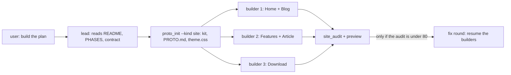

# PingHarbor (clone of a real website) · phase 1 of 3 · planned
> A ditto clone of a real website (an uptime-monitor product site with a blog), renamed PingHarbor, own text, with scroll animation, light and dark theme and every page linked.

> **This plan is ready to build.** Stack: Vue 3 from a CDN, no build step, the harness site kit (`proto_init` kind `site`). The earlier run described under *Evidence* is a reference result only.

## Build recipe (read this first)
1. **Read in this order:** this README, `PHASES.md`, `build_inputs/README.md`, `00_contract.md`, `01_design_system.md`, then the brief of the page you own (`02`-`04`) and its layout (`10`-`14`).
2. **Where it is built:** `run_test/pingharbor/` (brand PingHarbor).
3. **Do not capture the reference site.** Everything measured from it is already in `build_inputs/` (layouts, `20_`/`21_` captures, design system). Reference *pictures* are not included: use the text layouts. Paths like `_ref/...` inside the briefs point to the old store; the same text is in `build_inputs/`.
4. **Start from the kit:** run the harness `proto_init` tool with kind `site` (accent `#10b981`, font DM Sans, dark background `#0e1318`, nav = home, blog, article, features, download). Never edit `index.html`, `css/site.css`, `js/site.js`; brand tokens only in `css/theme.css`.
5. **Three builders in parallel**, one per screens file: `part-1` Home + Blog, `part-2` Features + Article, `part-3` Download. Each edits ONLY its own `js/screens/part-N.js` and `css/pages-part-N.css`.
6. **Verify** with `site_audit` and the preview; the targets are in *Quality bar*.
7. **Do not invent** pages, sections or files the plan does not name. If something is missing, say so instead of guessing.
8. **This plan IS the planning.** Do not write a new plan, a separate wireframe or placeholder pages. Each builder delivers its pages FINISHED in one pass: original copy AND styling (in its own `css/pages-part-N.css`), with the light/dark theme and scroll reveal working.
9. **Builders self-check before reporting:** `node --check` on their file, the kit's `proto_check`, and every `href` / `$go` target is either a route in `PROTO.md` or one of the six blog slugs. They report any difference from their brief.
10. **The lead verifies before it claims.** Run `site_audit` and the preview, read EVERY builder report, and state only what the audit and the reports show (for example 'every link works' only if the audit found no dead link). List every deviation from the briefs. If a check could not be run, say so.

## What is it
The user asked: *'do make ditto clone like https://upwatchr.io/blog for testing and education (rename the brand, write your own text). I want its sections, good animation and the light/dark theme, and the pages properly linked with working navigation.'* The result is a 5-page website (Home, Blog with article pages, Article, Features, Download) built with no build step (Vue 3 from a CDN): a sticky header, a dark footer, a theme that follows the system with a toggle, and content that animates in as you scroll. Brand **PingHarbor** (a small native Windows app that checks your sites on a timer); all text is original and the reference's names and logos are never reused.

**For:** Teams who want a polished marketing-style site fast, and a **test of whether a builder can reproduce a real site from a written plan alone**.

## What you get (feature catalog)
| id | feature | what you see or do | phase | status |
|---|---|---|---|---|
| F1 | Home | hero with an app-window mock (9 sites x 40 heat-map cells), 8-card feature bento, AI-assistant split with chat mock, alert channels, status-page split, 3 how-it-works steps, sister products, download band, latest posts (S1-S9) | [2. Build the pages](PHASES.md) | planned |
| F2 | Blog | list of 6 posts with category, date, author; each card opens its own article view at `#/blog/<slug>`; unknown slug shows 'Article not found' | [2. Build the pages](PHASES.md) | planned |
| F3 | Article | header with back link, chip, meta; 680 px reading column with callout, code block, pull quote; author card; 'Keep reading' 3 cards; CTA band; reading progress bar | [2. Build the pages](PHASES.md) | planned |
| F4 | Features | full features page from the reference features area | [2. Build the pages](PHASES.md) | planned |
| F5 | Download | hero with download button, install and verify steps, what happens next, closing band | [2. Build the pages](PHASES.md) | planned |
| F6 | Header, footer, navigation | sticky 56 px header with logo, links, theme toggle, Download button; dark 4-column footer; mobile menu; EVERY link goes to a real page | [1. Kit and contract](PHASES.md) | planned |
| F7 | Light and dark theme | follows the system; toggle sets `dark-theme`, kept in `localStorage` `theme`, applied before first paint | [1. Kit and contract](PHASES.md) | planned |
| F8 | Scroll animation | reveal-up on cards and headings, live status dots, aurora glow, scan line | [2. Build the pages](PHASES.md) | planned |
| F9 | Checks | site audit (contrast, links, tap targets, page basics) and a preview at the end | [3. Verify and fix](PHASES.md) | planned |

## Parts and how they connect

## Look and feel
Full design system (palette light | dark, type scale, layout, header, footer, theme, motion, tone) is in [01_design_system.md](build_inputs/01_design_system.md). The numbers that matter:
- **Accent:** ONE green, about 5% of pixels (eyebrow, one highlighted word per H2, buttons, dates): `#059669` light / `#10b981` dark; button `#047857` / `#10b981`, label white / `#052e1b`.
- **Surfaces:** page `#ffffff | #0b0d10`; alternate sections `#f7f8fa | #11141a`; card `#ffffff | #14171e`; border `#e5e8ed | #1f242d`; footer is always `#0b0d10`.
- **Text:** headings `#0b1220 | #f5f7fa`; body `#3b4453 | #b6bcc8`; muted `#5d646f | #8a92a0`.
- **Type:** DM Sans 400-700 + mono. Hero H1 72/700 (mobile 40), section H2 48/700 (mobile 32), body 16/1.6, lead 18, eyebrow 12 px uppercase.
- **Layout:** container max 80 rem; prose 42 rem; sections about 96 px vertical (64 mobile); grids collapse to 1 column under 768 px. Radius: pill 999, button 8, card 16, inputs 6-10.
- **Header:** sticky 56 px, page colour at 85% with 8 px blur. **Brand:** 'Ping' in heading colour + 'Harbor' in accent.

## Motion and animation
| what | how | time |
|---|---|---|
| scroll reveal | opacity 0 to 1 and translateY 16 px to 0 when the element enters the screen (IntersectionObserver adds `.is-in`); children stagger 80-120 ms | 0.7 s cubic-bezier(.22,.61,.36,1) |
| live status dots | pulse | 1.6 s ease-out, infinite |
| mock grid rows | flash when a cell changes; new log lines tick in | 1.1 s / 0.3 s |
| background glow | slow drift | 22 s / 28 s, infinite |
| scan line across the mock window | moves across | 3.4 s, infinite |
| button hover | fill change + 4 px accent ring + soft shadow | 0.15 s |
| card hover | rises 2 px + accent border | 0.15 s |
| mobile menu | slides down | 0.3 s ease-out |
| **reduced motion** | no transforms, no loops; opacity fades only. Reveal runs only when JS is on AND the user has no reduced-motion setting | rule |

## Rules that make the clone work
- **Linking (a dead link is a defect):** every link is `<a href="#/route">` or a full https URL; never `href="#"`. A button goes somewhere or does something (`$toast`). Detail pages live inside the same page (`#/blog/<slug>` shows the Blog page's article view; the list and the article are one screen file). Every card, title and 'Read more' opens its own article, and an article links back and to related ones. Details: [00_contract.md](build_inputs/00_contract.md).
- **Own brand and text:** PingHarbor only; never the reference's names, logos or sentences; the reference sentence structure may inspire, not be copied. Mock content is believable and specific (4-8 posts with dates, authors, categories); never lorem ipsum, never TODO.
- **One owner per file:** builder 1 `js/screens/part-1.js` + `css/pages-part-1.css`; builder 2 `part-2`; builder 3 `part-3`. `index.html`, `css/site.css`, `js/site.js` come from the kit and nobody edits them. Brand tokens live in `css/theme.css` only.
- **Blog slugs are defined ONCE** (the first audit found two briefs listing different slugs): `security-headers-2026`, `ai-crawler-robots`, `saas-status-pages`, `tls-certificates-2026`, `windows-uptime-guide`, `welcome-to-the-blog`.
- **Pages:** `#/home`, `#/blog` (+ `#/blog/<slug>`), `#/article`, `#/features`, `#/download`.

## Team: who does what
| who | does | tasks |
|---|---|---|
| lead | runs the kit, hands each builder its brief, checks and reports | T01, T05 |
| builder | writes the code of its own files only (no file is owned twice) | T02, T03, T04, T06 |
| qa-reviewer | optional: a second pair of eyes on the result in a real browser; never builds | (none needed) |

You (the owner) answer the open questions and judge each phase; Claude edits this plan when you ask (see Share and change).

## Quality bar (what 'professional' means here)
- `site_audit` score 80 or more with 0 'high' findings (the run ended at **72**: 1 high, 4 medium, 3 low)
- Text contrast at least 4.5:1 on every page, light and dark, desktop and mobile (the run had 8 elements at 2.6:1 and 18 at 3.6:1; small accent text on light must use `#047857`, as the design system already says)
- Tap targets at least 40x40 px on a phone (the run had 7 under 32 px)
- Every page has a meta description, headings stay in order, no text under 12 px
- No dead link and no 'not found' behind a link (the first audit found 2 article links with no page; fixed by a resume call)
- `ref_compare` structure score stays high (the run scored 100)
- Reduced-motion and mobile (390 px) checked
- Original text and brand only; `grep -ri upwatchr` finds nothing in the site

## Real or guessed
**From the reference (measured by the harness, real browser):** sections, order, type, colours, radius, motion list, theme behaviour. **Invented:** brand name, every word of copy, logo mark, mock app data. The Article page and Download page have **no reference picture** (the reference has no article detail page and no standalone download page); they are specified from the blog list and the home page's download section.

research: none (the evidence is a capture of the reference site https://upwatchr.io/blog, with sections, tokens, pictures and layouts already distilled into `build_inputs/`; no other outside product was needed)

## Decisions and open questions
| id | what | answer / default | state |
|---|---|---|---|
| D-01 | Recipe for a NEW build | no reference capture (it is in build_inputs); no questions; builders in parallel | agreed |
| D-02 | Stack | no build; Vue 3 from a CDN; kit files are not edited | agreed |
| D-03 | Page briefs | one `lookup-page` agent per screens file (the first also writes the design system); a builder starts the moment its own brief exists | agreed |
| D-04 | A lone builder for a site | refused by the harness: 3 builders in parallel | agreed |
| Q1 | Is a score of 80 on `site_audit` the bar for done? | default: yes | open |

## Phases at a glance
**1. Kit and contract** (planned), **2. Build the pages** (planned), **3. Verify and fix** (planned) → [full phase page](PHASES.md)

## Share and change
- **Share:** press *Copy link* in the plan viewer; one link = one page.
- **Change something:** press *Ask Claude* on the page and write your wish. Claude edits THIS file (and the phase page if scope moves), so `git diff docs/` shows what the plan changed.
- Status words: planning = still being written or missing facts · planned = split into tasks, **nothing built yet** · in progress · review · done.

<!-- dev -->
## How the first run went (facts from the session)
- Case `real_site_clone` in `TestCases/test_folders/Cases/real_usecases/real_planning_prototype/main.ts`, session `t_real_site_clone`, real sub-agents, cost $1.39.
- Agents: lead (4 turns), `lookup-page` x4 (one call each, 629-849 char hand-over), `builder` x3 (1431-1443 char hand-over, then 1-2 resume calls to fix).
- A builder's hand-over is: TASK, OBJECTIVE (its file, 'build exactly what briefs/BRIEF_part-N.md says'), the user's request, RESULTS from the tasks it depends on (the matching lookup-page's summary), OUTPUT FORMAT, BOUNDARIES (the only files it may write).
- The kit (`index.html`, `css/site.css`, `js/site.js`) was done by `proto_init`; builders wrote `js/screens/part-1..3.js` and `css/pages-part-1..3.css` (about 43 KB in all).
- **Lessons (from the audits):** (1) the first audit found two briefs listing different blog slugs: put shared names (slugs, routes) in the contract ONCE. (2) The design system said small accent text on light is `#047857`, but the pages still used the lighter accent (3.6:1): a number in a brief is not enough, add it to the Done-when and let the audit enforce it. (3) Tap targets, meta description and heading order were in no brief: they are quality-bar items, not page content.

## Builder inputs
See [build_inputs](build_inputs/README.md): contract, design system, 3 briefs, 5 layouts, 2 reference captures, copied verbatim.
<!-- /dev -->
