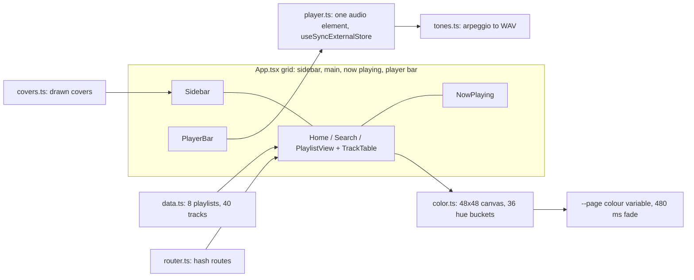

# Wavelet (music player) · phase 1 of 4 · planned
> A web music player that rebuilds the layout and behaviour of the Spotify desktop app, with its own name, violet look, drawn covers and synthesized songs. Made for learning.

> **This plan is ready to build.** File and folder names below are the layout of the new app; nothing here depends on any other project's files. Build from this plan alone.

| who reads | what | where |
|---|---|---|
| **Audience (users)** | Someone learning how a music app is built, or who needs a believable player to demo or extend, with zero legal risk: no logo, icon, font, cover art, audio or brand text is copied. | this page: What is it, What you get, Look, Motion |
| **Stakeholders** | decide scope, answer questions | Decisions and open questions, Phases at a glance |
| **Builders (dev)** | stack: React 18 + TypeScript + Vite, one `<audio>` element, hash routing, lucide-react; no server; pnpm only | `PHASES.md` and the grey DEV blocks (switch to Dev) |

## Build recipe
1. **Where:** build in `run_test/wavelet` (React 18 + TypeScript + Vite, hash routing, one `<audio>`, `lucide-react`; **pnpm only**: `pnpm create vite wavelet --template react-ts`, then `pnpm add lucide-react`). No source code is given: the plan, `wireframes/layout.html` and `build_inputs/01_content.md` are everything.
2. **Order (PHASES.md):** Foundations (`data.ts` from `build_inputs/01_content.md`, `covers.ts`, `tones.ts`, tokens in `styles.css`), then Engine (`player.ts`, `color.ts`), then Screens (Sidebar, Home, Search, PlaylistView + TrackTable, NowPlaying, PlayerBar), then a check.
3. **Owners (no file owned twice):** builder A = `src/data.ts`, `src/covers.ts`, `src/tones.ts`; builder B = `src/player.ts`, `src/color.ts`, `src/router.ts`; builder C = `src/components/*`, `src/App.tsx`, `src/styles.css`. The lead owns `package.json` and `index.html`.
4. **Verify (the lead runs it, no review agent):** `pnpm build` and `pnpm exec tsc --noEmit` pass; open the preview and check every row of the *Behaviour rules* table; `grep -ri spotify src` is empty; 0 console errors. Say what could not be checked (real audio, the 480 ms fade).

## What is it
Wavelet plays music in the browser. **Left:** a 300 px sidebar with Home, Search and your 8 playlists. **Middle:** Home (quick tiles and playlist cards), Search results, or one playlist with a track table. **Right (optional, 320 px):** a Now Playing panel. **Bottom (88 px):** the player bar. When you open a playlist or play a song, the page colour fades to a colour taken from that cover. There is no server and no accounts: 8 made-up playlists with 40 made-up tracks; each track is a 16-30 s arpeggio synthesized in code and rendered to WAV the first time you play it.

**For:** Someone learning how a music app is built, or who needs a believable player to demo or extend, with zero legal risk: no logo, icon, font, cover art, audio or brand text is copied.

## Picture (rough sketch)

## What you get (feature catalog)
| id | feature | what you see or do | phase | status |
|---|---|---|---|---|
| F1 | Player bar | play/pause, previous (restarts if you are more than 3 s in), next, shuffle, repeat (off, all, one), seek, volume and mute | [2. Engine](PHASES.md) | planned |
| F2 | Colour from the cover | the main view fades to a colour found in the cover; white text on it is always readable (4.7:1) | [2. Engine](PHASES.md) | planned |
| F3 | Drawn covers and synthesized songs | covers drawn in code, songs rendered to WAV on first play, no media files | [1. Foundations](PHASES.md) | planned |
| F4 | Home | title, quick tiles, playlist cards (route `/`) | [3. Screens](PHASES.md) | planned |
| F5 | Search | type to filter the 40 tracks (route `/search/:query`) | [3. Screens](PHASES.md) | planned |
| F6 | Playlist page | cover, title, owner, track table; double-click a row or hover and press play (route `/playlist/:id`) | [3. Screens](PHASES.md) | planned |
| F7 | Sidebar library | brand, Home, Search, 8 playlists with the playing one in accent colour | [3. Screens](PHASES.md) | planned |
| F8 | Now Playing panel | large cover and current song; takes the same page colour | [3. Screens](PHASES.md) | planned |
| F9 | Keyboard and sliders | Space = play/pause (ignored while typing); sliders work by click, drag or arrow keys | [3. Screens](PHASES.md) | planned |
| F10 | Remembers volume | volume kept in `localStorage` | [2. Engine](PHASES.md) | planned |
| F11 | Test hooks | `data-testid` names mirror the original (`control-button-playpause` style; full list below) | [4. Verify](PHASES.md) | planned |

## Parts and how they connect

## Look and feel
- **Name and mood:** Wavelet, dark ink with a violet accent. Fonts: **Outfit** (text) and **DM Mono** (numbers). Icons: lucide-react.
- **Colours (tokens):** `--bg #0c0b10` · `--panel #16151c` · `--panel-2 #1f1e27` · `--hover #2a2933` · `--text #f4f2f8` · `--muted #b2aebd` · `--faint #7d7989` · `--accent #b69cff` with `--accent-ink #16121f` · `--page` (the cover colour, starts `#2b2a33`).
- **Shape:** radius 10 px; panels have 8 px gaps; sidebar 300 px, Now Playing 320 px, player bar 88 px; body text 15 px / 1.4, titles 30 px / 800.
- **Colour wash:** the top 520 px of the main view is a gradient from `--page` into the panel colour.
- **Below 900 px wide** the layout changes (a narrower arrangement; see `@media (max-width: 900px)` in the original CSS).

## Motion and animation
| what | how | time |
|---|---|---|
| page colour changes between playlists | `--page` is a registered colour (`@property`), so the gradient itself animates; the old colour stays until the new one is ready (no flash) | **480 ms ease** (measured 452 ms) |
| hover on rows, cards, nav | background or colour change | 150 ms |
| play button on cards and tiles | fades in and rises 8 px on hover or keyboard focus | 150 ms |
| round buttons | grow to 1.05 (icon buttons 1.06) and brighten on hover | short |
| focus | 2 px accent outline, offset 2 px | instant |
| **reduced motion** | `prefers-reduced-motion: reduce` switches the transitions off | rule |

No looping or decorative animation.

## Behaviour rules (each row is a test)
| id | when | then |
|---|---|---|
| W-01 | you press Space | play/pause, except while you are typing in a field |
| W-02 | you press previous | restarts the song if more than 3 s in, else goes to the previous song |
| W-03 | you press repeat | cycles off, all, one |
| W-04 | you click, drag or use arrow keys on the seek or volume slider | the value changes accordingly |
| W-05 | you double-click a track row (or hover and press its play button) | that track plays |
| W-06 | you open another playlist | the page colour fades to that cover's colour in 500 ms or less |
| W-07 | you reload | the volume is still what you left |
| W-08 | the colour is chosen | white text on it is at least 4.7:1 (WCAG AA asks 4.5:1) |

**How the colour is chosen (`color.ts`):** draw the cover on a 48x48 canvas; skip near-black, near-white and grey pixels; group the rest into 36 hue buckets weighted by saturation and mid-lightness; the heaviest bucket's average is the raw colour; keep the hue and darken until white text reaches 4.7:1.

## Content (made up)
Playlists: Morning Static · Neon Commute · Low Tide · Paper Planets · Afterglow Club · Quiet Machines · Citrus Drive · Night Garden (8 playlists, 40 tracks, owner 'You').

## Test ids (mirror the original player)
`control-playpause` · `control-previous` · `control-next` · `control-shuffle` · `control-repeat` (with `data-repeat`) · `control-mute` · `player-bar` · `player-controls` · `now-playing` · `now-playing-widget` · `main-view` · `playlist-view` (with `data-playlist`) · `card-<id>` · `library-<id>` · `track-<id>` · `search-input` · `search-count` · `pb-title` · `playback-position` · `playback-duration` · progress and volume bars.

- **Captured / invented:** what comes from the reference project is marked *real*; everything else (names, colours, sizes, wording) is *invented* by this plan or by you. Never present an invented value as taken from the reference.

## Not built (on purpose)
Real accounts, streaming, lyrics, queue editing, likes, podcasts, Connect devices.

## Team: who does what
| who | does | tasks |
|---|---|---|
| builder | writes the code of its own files only (no file is owned twice) | T01, T02a, T02b, T03, T04, T05, T06, T07, T08 |
| qa-reviewer | checks every phase in a real browser or build; writes pass/fail, never builds | T09 |

You (the owner) answer the open questions and judge each phase; Claude edits this plan when you ask (see Share and change).

## Quality bar (what 'professional' means here)
- Text contrast at least 4.7:1 on every playlist colour
- The colour fade settles in 500 ms or less (record the real number)
- 0 console errors; no brand strings (`grep -ri spotify src` finds only an analysis comment)
- Everything works by keyboard (Space, arrow keys on sliders, visible focus ring)
- Reduced-motion users get no transitions
- No media files: covers and songs come from code

## Real or guessed
**Learned from the reference app (layout, route shapes, the 6 player verbs, test ids).** **Own design:** name, violet palette, Outfit + DM Mono, lucide icons, drawn covers, synthesized WAV songs. The reference desktop app was checked read-only: it is CEF (Chromium Embedded Framework), not Electron, and gets the page colour from its server; Wavelet has no server so it computes the colour in the browser. A real working copy of this app exists as the project fixture (see Test).

## Test cases (not the product)
- `pp_wavelet` in `test_prompt_planning` builds the app from THIS plan only (no source code given). The 8 playlists and 40 tracks are in `build_inputs/01_content.md`.

## Research
research: none (reverse-planned from one finished reference project; every layout, route, colour and rule below was read from it, so there was no outside product to look up)

## Decisions and open questions
| id | what | answer / default | state |
|---|---|---|---|
| D-01 | Colour source | computed in the browser from the cover (reference uses the server) | agreed |
| D-02 | Accounts, streaming, real music | none: made-up data, synthesized sound | agreed |
| D-03 | Routing | hash routes, no router library | agreed |
| Q1 | More playlists or real song names? | keep the 8 / 40 made-up ones in `build_inputs/01_content.md` | agreed |

## Phases at a glance
**1. Foundations** (planned), **2. Engine** (planned), **3. Screens** (planned), **4. Verify** (planned) → [full phase page](PHASES.md)

## Share and change
- **Share:** press *Copy link* in the plan viewer; one link = one page.
- **Change something:** press *Ask Claude* on the page and write your wish. Claude edits THIS file (and the phase page if scope moves), so `git diff docs/` shows what the plan changed.
- Status words: planning = still being written or missing facts · planned = split into tasks, **nothing built yet** · in progress · review · done.
