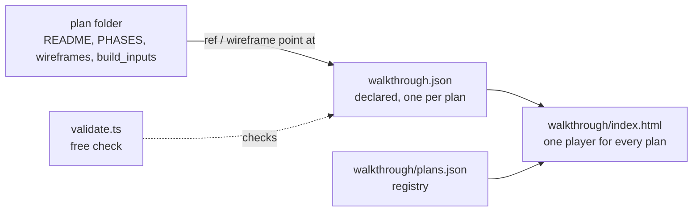

# Plan walkthrough: one declared file per plan, one player for all

A plan folder already holds the **truth** (README, PHASES, `build_inputs/`). The walkthrough is the **guided tour of it**: short steps a stakeholder clicks through, with pictures, flows and expandable detail. It never repeats the plan text; it **points** at it (`ref` blocks load the source file on open).



## Two pages, kept apart
| page | question | steps (typical) |
|---|---|---|
| **Plan** | what do I get, how does it look, how does it flow, what must I decide? | at a glance · the visit/journey · screens and wireframes · parts and data · behaviour · what you get · decisions and risks · done |
| **Phases & tasks** | in what order is it delivered, who builds what, how is each phase accepted? | roadmap · one step per phase (checks + tasks) · team and file owners |

The plan page is what most people need first, so it stands alone. Tasks never appear on it.

## Use it
1. Serve the repo root (`python3 -m http.server`) and open `/docs/dev_exp/walkthrough/`. (Static; the player `fetch`es the plan files.)
2. Pick a plan, click **Next** or press `←` `→`. A step changes with a slide animation and its blocks fade in one after another. The URL (`#<plan>/<plan|work>/<step>`) is a share link.
3. **Stakeholder / Builder** switch (top right): Builder also shows blocks marked `"dev": true` and the `<!-- dev -->` parts of `ref` files.
4. Check (free): `bun docs/dev_exp/walkthrough/validate.ts`.

## Add a plan
1. Create `walkthrough.json` in the plan folder (copy `aistudio_eiffel_tower_3d/walkthrough.json`, the reference).
2. Add one line to `walkthrough/plans.json` (`id`, `title`, `tagline`, `status`, `base` = path from `plans.json` to the plan folder).
3. Run the validator.

## File shape
```json
{ "version": 1, "title": "...", "tagline": "...", "status": "phase 1 of 3 · planned",
  "plan": { "label": "Plan",            "steps": [ Step ] },
  "work": { "label": "Phases & tasks",  "steps": [ Step ] } }

Step  = { "id", "title", "goal": "what this step lets the reader decide or check (md, one line)", "blocks": [ Block ] }
Block = { "type", "title"?, "dev"?: true, ... }   // dev: only in Builder mode
```

| type | fields | how it behaves |
|---|---|---|
| `text` | `md` | prose |
| `facts` | `items:[{k,v}]` | small fact tiles |
| `table` | `head`, `rows`, `caption?` | rows highlight on hover |
| `cards` | `items:[{tag,title,text,detail?,files?}]` | **click to expand** the detail; `files` shows file-name chips |
| `flow` | `steps:[{title,text,see?,files?}]` | **click-through**: numbered rail, Back/Next, the detail panel swaps with an animation; use for a user journey or "what happens when" |
| `mermaid` | `code`, `caption?` | rendered diagram; *enlarge* and *source* buttons |
| `wireframe` | `src`, `title?`, `height?` | the plan's `wireframes/*.html` in a frame, desktop or 390 px width |
| `checks` | `items` | tick-able acceptance list (a reviewer ticks as they verify) |
| `decisions` | `items:[{id,q,state,default,ifNo?}]` | click a row for default and what changes if you say no; `open` is amber |
| `tasks` | `items:[{id,what,owner?,needs?,files?,reads?,detail?}]` | expandable task rows with file chips |
| `who` | `items:[{name,does,tasks?}]` | owner tiles (who owns which files) |
| `files` | `items:[name or {name,note}]` | file-name chips |
| `ref` | `file`, `heading?`, `open?`, `title?` | **points** at a source file (or one `## heading` of it); loads only when opened, so long text stays folded and is never copied |

## Rules (what makes a walkthrough good)
1. **Goal line first.** Every step says what the reader can decide or check there (see PLAN_STANDARD rule 1).
2. **Point, do not repeat.** Long text lives in the plan file; the step shows a `ref`. A table of 12 stops is fine; the 12 stops' full text is a `ref`.
3. **At most about 5 blocks per step**, most expandable. A step that needs more is two steps.
4. **A journey is a `flow`, a layout is a `wireframe`, structure is a `mermaid`.** (PLAN_STANDARD diagram kit.)
5. **User words in the Plan page.** File names, task ids and tools go to `files` chips, `tasks`, or `dev: true`.
6. **Honest labels:** keep *real / guessed / invented* wherever the plan has it.
7. Motion respects `prefers-reduced-motion` (the player turns every animation off).

## Not done yet (v1)
- Not opened in a browser by the author of this page (the sandbox refused to start a server and headless browser). Run it once and report what looks wrong.
- No in-page "Ask Claude" button; change requests are still "edit the plan file". No per-reviewer saved ticks.
- Only 4 plans are declared (Eiffel Tower 3D, AgentDeck, Wavelet, PingHarbor); the other 8 still use the markdown viewer in `plan_viewer/`.
