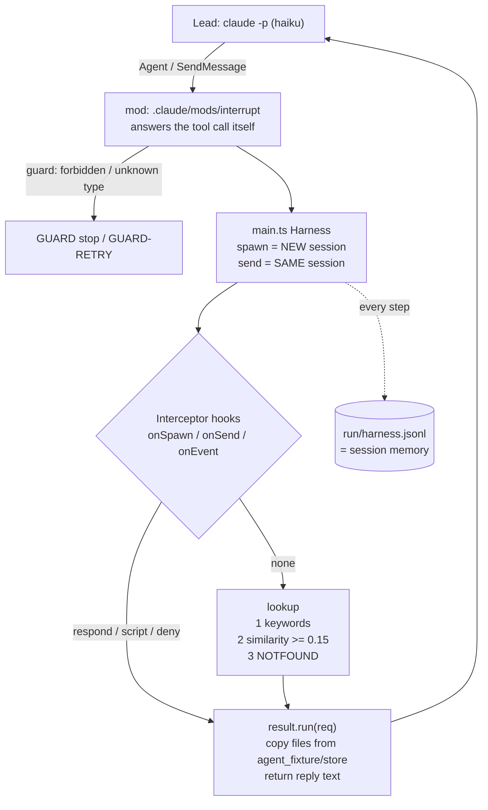
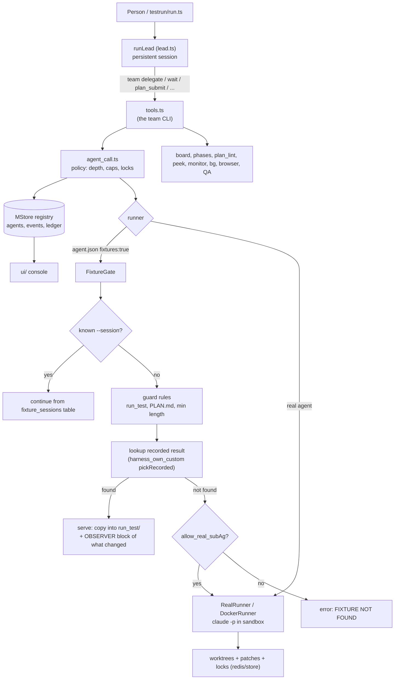
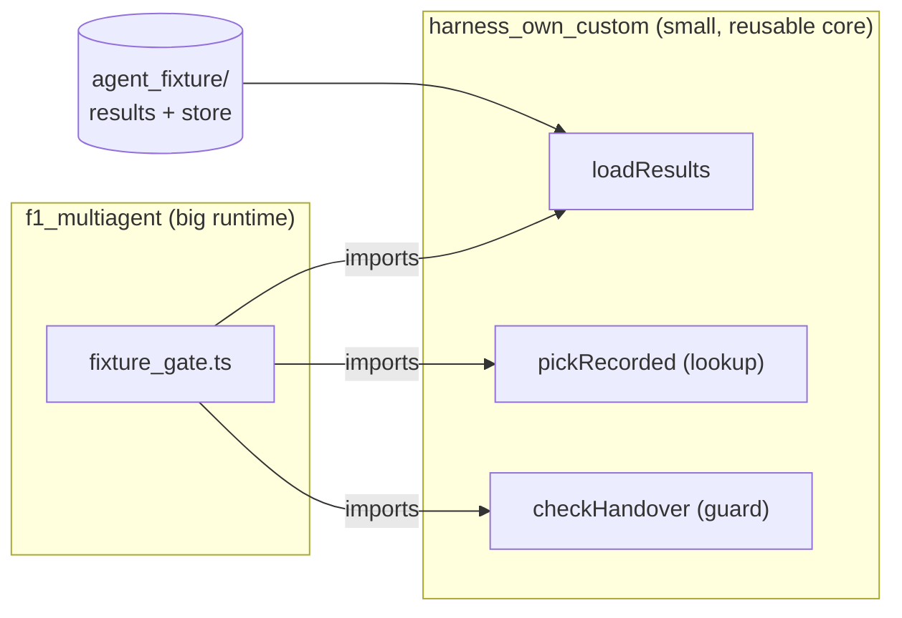
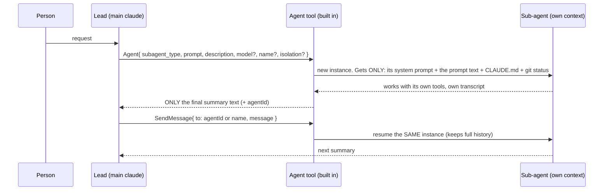
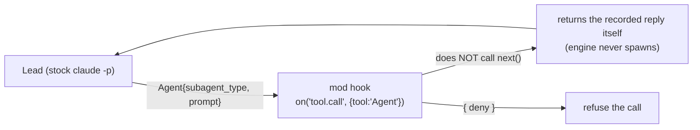
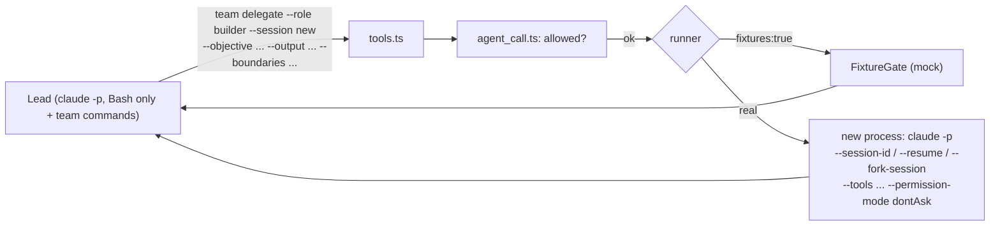

# f1_multiagent vs harness_own_custom

Both let a **real lead model** (haiku/sonnet) delegate to **mocked sub-agents** that answer from recorded fixtures.
They solve different layers. They are **not alternatives**: f1 already imports pieces of harness_own_custom.

## 1. One-line summary

| | harness_own_custom | f1_multiagent |
|---|---|---|
| What it is | A tiny **stand-in for sub-agents** (a "fake Agent tool") | A full **multi-agent runtime**: lead, registry, locks, worktrees, board, phases, UI |
| Size | 16 files, ~450 lines | ~500 files, `tools.ts` alone is 549 lines |
| The lead | Plain `claude -p` with a mod that intercepts `Agent` / `SendMessage` | Lead is an agent defined in `agents/lead/` and runs through the `team <cmd>` CLI |
| How the lead delegates | Claude's own `Agent{subagent_type,prompt}` tool, answered by the mod | `team delegate --role ... --objective ... --output ... --boundaries ...` |
| Sub-agent can be real? | Only via `--real` (a different, thin path) | Yes: Docker sandbox runner, real `claude -p`, async, nested, worktrees |
| Judging | None: prints EXPECTED next to ACTUAL, a person judges | `testrun/cases.ts` judges shared cases, `self_test/` has 169 own checks |

## 2. Architecture: harness_own_custom

Key traits:
- **Stateless process per call**: each call is a one-shot `bun main.ts spawn|send`; sessions are rebuilt from the event log.
- **Rules R1-R4**: spawn = new session, send = same session only, sessions isolated, every step is an event.
- **Follow-up answers are a template** over the history, not a model.
- **No assertions**: a person (or Claude) reads EXPECTED vs ACTUAL.
- `capabilities.ts` + `skip_test.ts` declare what it can't do (nested, background, worktree, compaction ...).

## 3. Architecture: f1_multiagent

Key traits:
- **Persistent store** (`MStore`): agents, sessions, events, budget; many `tools.ts` processes share it.
- **Gate order**: known session -> fixture lookup -> real call (if allowed) -> error. Capped by `max_agent_calls` (default 2).
- **Observer**: hashes `run_test/` before/after a served call and appends what actually changed, so the lead can't be fooled by a boastful fixture.
- **Rich lead toolbox**: wait/async, plans with phase gates, locks, worktrees, patches, peek, bug reports, cost, QA.
- **Two engines**: current lead engine, plus a legacy stage loop (planner > builder > reviewer) kept only for `advance_test`.

## 4. Side by side

| Topic | harness_own_custom | f1_multiagent |
|---|---|---|
| Hook point into the lead | Claude Code **mod** (`--plugin-dir`) intercepts built-in `Agent` tool | f1 owns the lead's tool surface (`team` commands); no mod needed |
| Session ids | `s<random>` per spawn, log-based | Registry rows + `fixture_sessions` table + real Claude session ids |
| Follow-up answer | Template string from history | From the table (history + files now); a new `fix` result can be served; real if allowed |
| Guard | `core/guard.ts`: forbidden agent, unknown type, role rules | Same `checkHandover` (imported) + `*_rules.json` |
| Lookup | keywords, then bag-of-words similarity (0.15) | Same `pickRecorded` (imported), but similarity is **strict** (only results of that agent) |
| Real sub-agent | `--real` thin path, don't mix numbers | `allow_real_subAg` -> one-shot real call with history in prompt; Docker sandbox |
| Parallel | Separate one-shot CLI calls, not truly tested | `--async` + `wait`, `par.ts --jobs`, `HARNESS_MAX_LEADS` |
| Nested agents | No | Yes (`maxDepth`, `max_children`) |
| Files / workspace | Written by the recorded `run(req)` only | Shared workspace + per-writer worktrees, patches, locks |
| Cost control | Zero sub-agent cost by design | Same goal, plus `max_cost_usd` / `HARNESS_CASE_CAP_USD` per case |
| Observability | `harness.jsonl` event log | Store events, board, peek, UI console, admin issue log |
| Own tests | `harness.test.ts` (R1-R4 offline) | `self_test/multi.ts` (169 checks) + shared suites |
| Failure injection | Recorded ERROR text or NOTFOUND only | Rework cases (bad fixture then `_fix`), real failures with real agents |

## 5. How they relate (this is the important part)

`f1_multiagent/harness/core/fixture_gate.ts` imports `loadResults`, `pickRecorded` and `checkHandover` from `harness_own_custom`. So:
- harness_own_custom is the **fixture lookup + guard library** (and a standalone mini harness).
- f1 wraps the same lookup in its own gate and adds sessions, observer, real fallback, call cap.

## 6. Things to check or correct (my observations, please confirm)

1. **README vs reality in harness_own_custom.** README says `core/` holds `main.ts`, `interface.ts`, `.claude/mods/interrupt` and `test/` holds the tests. In the folder, `main.ts`, `interface.ts`, `harness.test.ts`, `capabilities.ts`, `skip_test.ts`, `make_report.ts`, `judgements.json` sit at the **top level**, `core/` only has `guard.ts` and prompts, and `harness.test.ts`/`make_report.ts` exist in **both** top level and `test/`. A half-finished move?
2. **Mod missing.** README's `.claude/mods/interrupt` (the thing that makes the lead think it calls sub-agents) is not in `harness_own_custom/core/`. Either it moved elsewhere or the standalone "mod mode" can no longer run from this folder.
3. **Dependency direction is backwards for a "core".** f1 imports from `harness_own_custom/main.ts` and `core/guard.ts` by relative path. If you rename or restructure harness_own_custom (item 1), f1's gate breaks. Option: move `loadResults`/`pickRecorded`/`checkHandover` into a shared module (e.g. `test_harness/core/fixture_lookup/`) that both use.
4. **Two different follow-up behaviours.** own_custom fakes the follow-up with a template; f1 answers from a table and can serve a `fix` result. Same word "session", different semantics. Decide which is the reference.
5. **Two different lookups.** same function, but f1 passes `strict = true`; own_custom does not (can return a near-miss from another agent's result).
6. **Overlap in guard/limits.** own_custom guard (forbidden / unknown type) is mod-specific; f1 enforces via `agent.json` allowed `agents` list and `max_agent_calls`. Probably no need to keep both once f1 is the main runner.

## 7. Which to pick

| If you want to test... | Use |
|---|---|
| Only "does the lead choose the right sub-agent and write a good hand-over", with stock Claude `Agent` tool | harness_own_custom (smallest, cheapest) |
| Hand-over **plus** sessions, rework, locks, phases, real sub-agent fallback, QA, UI | f1_multiagent |
| Shared cases in `TestCases/test_folders` (current project default per CLAUDE.md) | f1_multiagent (`testrun/run.ts`) |

Recommendation: keep f1 as the runner, and turn harness_own_custom into a clearly-named shared library (fix items 1-3) so there is one lookup and one guard.

---

# Part 2: the real Claude way vs the two harnesses

Sources: [official subagent docs](https://code.claude.com/docs/en/sub-agents), the mods API of this Claude Code build (2.1.327, `claude-code.d.ts`), and the f1 code (`launch.ts`, `runner.ts`, `agent_call.ts`, `tools.ts`, `hooks/guard.ts`).
Where I am inferring something (not stated in code or docs) it is marked **(inference)**.

## 8. The exact core Claude way of calling a sub-agent

### 8.1 Real Claude Code (what a stock lead does)

| Piece | Real Claude Code behaviour |
|---|---|
| Tool name | `Agent` (formerly `Task`; old name still accepted) |
| Parameters | `subagent_type` (required unless a `general-purpose` agent exists), `prompt`, `description`, `model`, `effort`, `name`, `isolation: "worktree"` |
| Hand-over | **Only the `prompt` string.** The sub-agent never sees the parent conversation (except a *fork*) |
| Definitions | Markdown + YAML frontmatter (`name`, `description`, `tools`, `model`, `hooks`, ...) in `.claude/agents/`, `~/.claude/agents/`, plugin `agents/`, or session-only `claude --agents '{json}'` |
| Which agents the lead may call | `tools: Agent(worker, researcher)` or `permissions.deny: ["Agent(Explore)"]` |
| Follow-up | `SendMessage{ to }`. Each `Agent` call is a new instance; only SendMessage continues one. Explore/Plan are one-shot |
| Nesting | up to 3 layers by default (`CLAUDE_CODE_MAX_SUBAGENT_SPAWN_DEPTH`) |
| Parallel | up to 20 at once (`CLAUDE_CODE_MAX_CONCURRENT_SUBAGENTS`) |
| Hooks | `SubagentStart` / `SubagentStop` (matcher = agent name); `PreToolUse` also fires inside sub-agents |
| What returns | the sub-agent's final summary only |

Caveat: several GitHub issues report that `SendMessage` is documented in the Agent tool text but not always available in a given build ([example](https://claudeissues.com/issue/35973-bug-cannot-continue-previously-spawned-subagent-sendmessage-referenced-but-unava), [another](https://claudeissues.com/issue/61248-sendmessage-for-continuing-spawned-sub-agents-is-documented-but-not-callable)); one says it needs `CLAUDE_CODE_EXPERIMENTAL_AGENT_TEAMS`. Check on your installed version before relying on it.

### 8.2 harness_own_custom: the same call, intercepted

The lead is stock. It calls the **real** `Agent` / `SendMessage` tools. A **mod** (plugin) answers the call instead of the engine starting a sub-agent.

### 8.3 f1_multiagent: a different call entirely

The lead does **not** use the `Agent` tool. It runs a shell command, and f1's own code does the delegation.

So the **core difference**: harness_own_custom keeps Claude's native call shape (`Agent{subagent_type,prompt}`), f1 replaces it with `team delegate` (a structured hand-over: objective, output, boundaries, writes, session).

## 9. What are "mods", and what do they offer

A mod is a Claude Code **plugin** that hooks the engine's event pipeline. A hook is `($, e, next)`: `e` = the event, `next(e)` = run everything below, including the engine. A hook can:
- **answer for itself** (return without `next`): this is what `interrupt` does to fake a sub-agent;
- **rewrite** the call (`next({...e, prompt})`);
- **deny** (`{ deny: "reason" }`);
- **observe** (`await next(e)`, then act on the result).

Relevant events/APIs found in this build's types:

| Mod feature | Use for multi-agent testing |
|---|---|
| `on('tool.call', { tool: 'Agent' })` | intercept every sub-agent call: **inspect the hand-over, answer from fixture, deny** |
| `agent.spawn` event and `$.agent.spawn()` | see/rewrite/spawn real sub-agents; engine enforces a depth cap |
| `agent.offer` | hide an agent type from the lead (e.g. `isOffered:false`) |
| `$.agent.list()` | list live sub-agents (status, type, parent) |
| `prompt.compose` | change the lead's system prompt per run |
| `$.tool.register` | add custom tools (this is how plugin tools like `scan_secrets` appear) |
| `$.process.run`, `$.fs` | call out to `bun main.ts` (what `interrupt` does) |

How it is loaded: `claude -p --plugin-dir <folder>` (so no global install, per run).

Strength: **zero changes to the lead**; you test the lead exactly as a real user would run it. Weakness: **tied to the plugin API of one Claude Code build**. README itself lists "an update can break the mod's reply shape", and I did not find the `interrupt` mod folder in `harness_own_custom/core/` (see section 6).

## 10. How f1 handles each concern

| Concern | f1's mechanism | Real-Claude equivalent |
|---|---|---|
| **Tool hand-over** | `team delegate --role --session new\|<id>\|fork:<id> --objective --output --boundaries [--writes] [--async] [--model]`; guard rules (`*_rules.json`) check the hand-over text (must name `run_test`, `PLAN.md`, min length) | `Agent{prompt}` free text, no checks |
| **Tool interruption** | `hooks/guard.ts` is a `PreToolUse` hook: before every Write/Edit/Bash it asks the lock service and **denies** if no lock (fails closed). Also `agent_call.ts` can deny a call (kill switch, budget, depth, caller not live). In test mode `FixtureGate` is the "interrupt": it stands in front of the real runner | A mod `tool.call` hook, or a settings `PreToolUse` hook |
| **Agent lookup** | two layers: (1) *which agent*: `agents/<role>/agent.json` (`agents[]` = who may be called, `max_children`, `tiers`), loaded by `loadAgents`; the lead's prompt lists the allowed roles; (2) *which fixture*: `pickRecorded` keywords then similarity | `.claude/agents/*.md`, `--agents`, `Agent(x,y)` allow list |
| **Management** | `MStore` registry (agents, calls, events, reports, cost), `agents_list`, `agent_update`, `agent_peek`, `agent_stop`, board, monitor (nudge at 6 min, auto-stop at 10 min idle), UI console, `report_bug` | none built in (only `$.agent.list()` in mods, `/agents`) |
| **Sub-agent calling** | `delegate` -> `agentCall` (policy) -> runner. Real = new `claude -p` process per agent with `--session-id` or `--resume` / `--fork-session`; `--async` + `wait` for parallel; `plan_submit/plan_run` for phased work | `Agent` + `SendMessage`, max 20 concurrent |
| **Depth / fan-out** | `HARD_MAX_DEPTH` 4, `taskMaxAgents` 24, `maxInstancesPerRole` 4; the delegate tool is **removed** at the last level | `CLAUDE_CODE_MAX_SUBAGENT_SPAWN_DEPTH` (3), concurrency 20 |
| **Writes** | one lock per file/resource (all-or-none, FIFO, leased, Redis or store), per-writer worktrees, patches applied by `apply_patches` | `isolation: "worktree"` only; no cross-agent locks |
| **Budget / safety** | project budget (`budget_exceeded`), kill switch, spend pause, watchdog | none |
| **Test mode** | `fixtures:true` agents never start a model; call cap `max_agent_calls`; `allow_real_subAg` for real | n/a |

Important: f1 also has a second, **native** backend. `launch.ts` has `nativeAgentsJson()` which emits the same agent declarations as a `claude --agents` JSON and `nativeEnv()` which sets `CLAUDE_CODE_MAX_SUBAGENT_SPAWN_DEPTH` and `MAX_CONCURRENT`. It is labelled "Backend N", with the process-per-agent path as "Backend P". I only saw it defined; I did not verify it is used by the current runner.

## 11. Why f1 chose its own way, and what it uses now

I could not find a written R&D conclusion in the repo (`docs/`, `dependency.md`, `README.md`), so this part is **(inference)** from what the code builds. Please correct it with your R&D notes.

Things f1 needs that the stock `Agent` tool does not give:
1. **Cross-agent write locks, worktrees and patches** (stock only has `isolation: worktree` per agent).
2. **Structured hand-over with validation** (objective / output / boundaries / writes). Stock is a free-text `prompt`.
3. **A shared registry** with cost, budget, kill switch, watchdog, stop/peek of a running agent, UI.
4. **Persistent named sessions, fork, async + wait, phased plans with gates.**
5. **Not depending on one Claude Code build's plugin API.** f1 uses only the plain CLI (`claude -p`, `--resume`, `--session-id`, `--tools`, hooks). The mod route depends on an engine-specific plugin API that can change per release.

Current status:
- **Current f1 engine** = Backend P: lead + `team` CLI + one `claude -p` process per agent. Mocks come from `FixtureGate`.
- **harness_own_custom** survives inside f1 only as the lookup and guard library.

## 12. Recommendation and why

1. **Keep f1 as the main runner** for the shared cases. Why: it tests the orchestration you actually ship (hand-over fields, sessions, locks, rework), at the same near-zero sub-agent cost, and it does not depend on a plugin API.
2. **Do not delete the idea behind harness_own_custom; keep it as one small, separate test mode "stock lead"**, only if you still want to know "does a plain Claude lead call the native `Agent` tool well". That is the one thing f1 cannot answer.
3. **Turn the shared parts into a neutral library** (`loadResults`, `pickRecorded`, `checkHandover`) so f1 stops importing from a folder that is half-moved (section 6).
4. **If you want f1's lead to also be usable with real native sub-agents**, finish and test Backend N (`--agents` JSON + env depth/concurrency). It would let you compare "f1 `team delegate`" against "native `Agent`" on the same cases, which answers your R&D question with data.
5. **Verify before trusting**: `SendMessage` availability on your Claude Code version, and that the `interrupt` mod still loads (`claude plugin validate`).

Decision for you: is the goal (a) test only f1's lead, or (b) also compare against a stock Claude lead? (a) means retire the mod part; (b) means repair it and keep both.

---

# Corrections (found after deeper research; see f3_multiagent/docs/06)

- // ERROR: sections 2, 8.2 and 9 present the `interrupt` mod as the current mechanism of harness_own_custom. The mod source is NOT in this repo or its git history (copies only under `/home/gr/projects/loopferry/.idea/Test_agent_3/`). `test_harness/core/claude.ts:36` says it is not available any more and `run.ts` forces `mod:false`; today a PreToolUse hook on `Agent|SendMessage|Task` (`test_harness/core/orchistraitor/harness_own_custom/runner/interpose.ts`) plus thin real haiku sub-agents runs instead.
- // ERROR: section 10 says Backend N "may be used". It is defined (`launch.ts:63-75`) and unit-tested only; nothing launches `claude` with `--agents`.
- // ERROR: `lead: "solo"` does not exist in the repo; the solo switch is `router: false` (`testrun/cases.ts:17,35`).
- The written reason f1 uses its own CLI is in the Loopferry plan (`/home/gr/projects/loopferry/handbook/PLANS/20261105_ARCHITECTURE_PLAN.md:500-502, 606-616, 1364-1365`), not in f1's docs.
- Planned restructure: `f3_multiagent/` (docs only so far).
