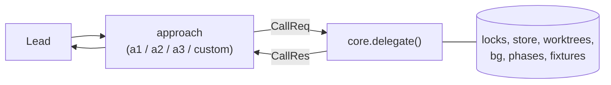

# f3_multiagent

A multi-agent test harness with **one shared core** and **swappable approaches**.

- **Core**: store, locks, worktrees, patches, background processes, phases, monitor, fixtures, runners. Identical for every approach.
- **Approach**: only *how the lead delegates to a sub-agent* (shell command, intercepted Agent tool, native Agent tool).
- **Custom**: drop a file at the same path under `approaches/custom/` to override a default.

Status: **approach 1 (`a1_team_cli`) started.** `harness/`, `testrun/`, `self_test/` are a copy of f1 (same layout, so every relative path still works); `approaches/` is new. a2 and a3 are not built. Nothing decided beyond that (see `docs/10_OPEN_DECISIONS.md`). `f1_multiagent/` and `harness_own_custom/` are untouched.

Current engine / approach / run-data version: one file, `../engine.ts` (`stateVersion` is `v3`, so run data is in `test_harness/.state/v3/`). Env `STATE_VERSION`, `APPROACH` or `--approach=` override for one run.

Check: `bun self_test/multi.ts` (free, offline) gives 230/234, the same 4 failures as f1 (L4, NP2, PK10, MS4), which fail in f1 too and are not caused by the copy.

Stack: TypeScript on Bun, pnpm for packages.

## Claude profile
- **Docker** (real sub-agents, `HARNESS_SANDBOX=docker`): ALWAYS `~/.claude-personal`. `test_harness/infra/docker-compose.yml` mounts it as the container's Claude config dir (`/claude`); it does not follow your shell's `CLAUDE_CONFIG_DIR` (`CLAUDE_PROFILE_DIR` overrides it).
- **Local** (the lead and any `claude -p` the harness starts on the host): whatever profile your shell uses. `~/.claude-personal` is recommended (`export CLAUDE_CONFIG_DIR=$HOME/.claude-personal`); using the normal `~/.claude` by accident is fine for now. Nothing in the code enforces it.
- A session is resumed in whichever profile holds it (`runner.ts` `profileOfSession`).

## How it will work



Switch approach: edit the default in `approaches/index.ts`, or run with `--approach=<name>`.

| Approach | Lead delegates by | State |
|---|---|---|
| `a1_team_cli` | shell command `team delegate ...` (today's f1) | working in f1 |
| `a2_mod` | stock `Agent` / `SendMessage`, intercepted by a Claude mod | // ERROR: mod not in repo |
| `a3_native` | stock `Agent` with `--agents` JSON | // TODO: defined only |

## Layout (built: harness/, approaches/, testrun/, self_test/; planned: core/ split)

```
f3_multiagent/
├─ core/                 shared; core/delegate.ts is the single entry
├─ approaches/
│  ├─ index.ts           picks the approach
│  ├─ approach_port.ts   the interface an approach implements
│  ├─ a1_team_cli/
│  ├─ a2_mod/
│  ├─ a3_native/
│  └─ custom/            overrides, same relative paths
├─ testrun/              runner (+ --approach)
├─ self_test/            core tests + one contract test per approach
└─ docs/                 the planning set
```

## Docs (read in order)

| File | Topic |
|---|---|
| `docs/00_INDEX.md` | index and glossary |
| `docs/01_FLOW_CLAUDE_vs_OURS.md` | real Claude flow vs each approach |
| `docs/02_ARCHITECTURE.md` | layers and the one rule that makes the core shareable |
| `docs/03_CORE_INVENTORY.md` | which f1 file is shared, coupled, test-only, legacy |
| `docs/04_APPROACH_PORT.md` | the interface (pseudo code) |
| `docs/05_OVERRIDE_AND_INDEX.md` | selection and override (pseudo code) |
| `docs/06_CONS_OF_APPROACHES.md` | problems of each approach, with evidence |
| `docs/07_PROMPTS_REVIEW.md` | lead prompts compared |
| `docs/08_MIGRATION_STEPS.md` | ordered steps and files to fix |
| `docs/09_RISKS_AND_STATE.md` | clashes when running approaches side by side |
| `docs/10_OPEN_DECISIONS.md` | questions, none answered |
