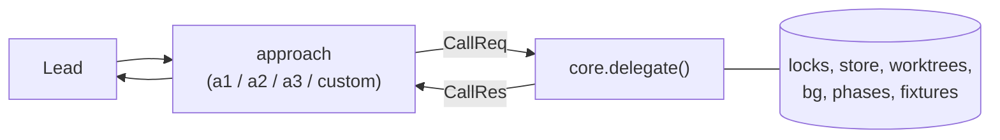

# f3_multiagent

A multi-agent test harness with **one shared core** and **swappable approaches**.

- **Core**: store, locks, worktrees, patches, background processes, phases, monitor, fixtures, runners. Identical for every approach.
- **Approach**: only *how the lead delegates to a sub-agent* (shell command, intercepted Agent tool, native Agent tool).
- **Custom**: drop a file at the same path under `approaches/custom/` to override a default.

Status: **approach 1 (`a1_team_cli`) started.** `harness/`, `testrun/`, `self_test/` are a copy of f1 (same layout, so every relative path still works); `approaches/` is new. a2 and a3 are not built. Nothing decided beyond that (see `docs/10_OPEN_DECISIONS.md`). `f1_multiagent/` and `harness_own_custom/` are untouched.

Current engine / approach / run-data version: one file, `test_harness/core/config.ts` (`stateVersion` is `v3`, so run data is in `test_harness/.state/v3/`). Env `STATE_VERSION`, `APPROACH` or `--approach=` override for one run.

Layout of the tools: `harness/tools.ts` (entry) -> `harness/tools/index.ts` (the index) -> one file per command group; `harness/bin/` has the executables on the agents' PATH (`team`, `browser`, `proto`, `tab`, ...). Check: `bun self_test/multi.ts` (free, offline), see `docs/RUN_FINDINGS.md` item 10 for the current result.

Stack: TypeScript on Bun, pnpm for packages.

## Claude profile
- **Docker** (real sub-agents, `HARNESS_SANDBOX=docker`): ALWAYS `~/.claude-personal`. `test_harness/infra/docker-compose.yml` mounts it as the container's Claude config dir (`/claude`); it does not follow your shell's `CLAUDE_CONFIG_DIR` (`CLAUDE_PROFILE_DIR` overrides it).
- **Local** (the lead and any `claude -p` the harness starts on the host): ALWAYS `~/.claude-personal` too. The harness sets `CLAUDE_CONFIG_DIR` itself on every `claude` it starts (`claudeEnv()` in `harness/core/base/runner.ts`), whatever the shell or the UI server has; it prints a warning when the shell has another one. Run your own shell with `CLAUDE_CONFIG_DIR="$HOME/.claude-personal" claude` as well. `HARNESS_CLAUDE_PROFILE` is the only override. Old sessions in `~/.claude` are still READ (history) and resumed in the profile that holds them; nothing new is written there.
- A session is resumed in whichever profile holds it (`runner.ts` `profileOfSession`).

## How it will work



Switch approach: edit the default in `approaches/index.ts`, or run with `--approach=<name>`.

| Approach | Lead delegates by | State |
|---|---|---|
| `a1_team_cli` | shell command `team delegate ...` (today's f1) | working in f1 |
| `a2_mod` | stock `Agent` / `SendMessage`, intercepted by a Claude mod | // ERROR: mod not in repo |
| `a3_native` | stock `Agent` with `--agents` JSON | // TODO: defined only |

## Layout (built: harness/, approaches/, testrun/, self_test/; planned: core/ split)

```
f3_multiagent/
├─ core/                 shared; core/delegate.ts is the single entry
├─ approaches/
│  ├─ index.ts           picks the approach
│  ├─ approach_port.ts   the interface an approach implements
│  ├─ a1_team_cli/
│  ├─ a2_mod/
│  ├─ a3_native/
│  └─ custom/            overrides, same relative paths
├─ testrun/              runner (+ --approach)
├─ self_test/            core tests + one contract test per approach
└─ docs/                 the planning set
```

## Docs (read in order)

| File | Topic |
|---|---|
| `docs/00_INDEX.md` | index and glossary |
| `docs/01_FLOW_CLAUDE_vs_OURS.md` | real Claude flow vs each approach |
| `docs/02_ARCHITECTURE.md` | layers and the one rule that makes the core shareable |
| `docs/03_CORE_INVENTORY.md` | which f1 file is shared, coupled, test-only, legacy |
| `docs/04_APPROACH_PORT.md` | the interface (pseudo code) |
| `docs/05_OVERRIDE_AND_INDEX.md` | selection and override (pseudo code) |
| `docs/06_CONS_OF_APPROACHES.md` | problems of each approach, with evidence |
| `docs/07_PROMPTS_REVIEW.md` | lead prompts compared |
| `docs/08_MIGRATION_STEPS.md` | ordered steps and files to fix |
| `docs/09_RISKS_AND_STATE.md` | clashes when running approaches side by side |
| `docs/10_OPEN_DECISIONS.md` | questions, none answered |

## Direction: a2 becomes the standard, a1 becomes an override (PLAN, not built yet; written 2026-11-20)

Why: a2 uses Claude Code's own `Agent` / `SendMessage` tools and its hook events, which is the shape of the real product. a1 (shell `team agent ...`) stays as a second approach for comparison.

### Capability check BEFORE the refactor (read from the code, nothing run; the status section below is current)

| Power | a1 (Bash `team`) | a2 intercept (hook + MCP) | Gap in a2 |
|---|---|---|---|
| Start / continue a sub-agent | `team agent <role>` | `Agent{subagent_type}` / `SendMessage`, hook turns it into `delegate` | none |
| Mock sub-agent (fixtures) | FixtureGate in `runCall` | same: the hook calls `tools.ts delegate`, so the same FixtureGate answers | none |
| Locks, worktrees, patches, budget, depth, fan-out | `agentCall` + `runCallee` | same code | none |
| Background start and wait | `--async`, `agent wait` | `run_in_background:true` and `mcp__team__wait` | none |
| Every other team command | `team <cmd>` | typed MCP tools, the rest through `team_tool{command, flags}`; every `ROUTE` command is reachable | small: `agent_stop`, `agent_info`, `inbox` only via `team_tool` |
| See sub-agents and bg tasks | `team agent list / peek`, `bg list` | `agents_list`, `agent_peek`, `bg_list`, `bg_log`, `board_status` | none |
| Lead request block | conversation so far + `THE TEAM RIGHT NOW` digest + project memory (`.loopsAI`) | conversation so far only | add digest and `memoryBlock` |
| Lead file reads | `team ls / read_file / grep`, jailed to `run_test/` | native `Read` / `Glob` / `Grep`, NOT jailed | add a jail in the hook or use the team tools |
| Lead path-escape guard (`..`) | `hooks/guard.ts` | none | add |
| Notes and user messages mid-run | `activity.ts` (PostToolUse) and `wait` ending early | neither lead gets `activity.ts` in a2 (lead.ts does not pass `hookArgs` either, so check a1 too) | verify, then add |
| Block a long call | n/a (a call is a shell command) | the hook waits up to 30 min but no `timeout` is set in the hook settings | set `timeout`, check Claude Code's default |
| Native follow-up (`SendMessage`) | `--session <agent_id>` | hook maps it, offline-tested only | one real run |

### Hook events a2 can use that a1 cannot
`PreToolUse` and `PostToolUse` (used now), `SubagentStop` (observe mode only), plus `UserPromptSubmit` (inject the team digest and unread notes before each turn), `Stop` (refuse to end while a background agent still runs, or run a "before answer" check) and `SessionStart` (inject the request block once). The last three are NOT used yet. Confirm event names and payloads against the installed Claude Code version before relying on them.

### Target structure
- `harness/` stays common: tools, core, hooks, bin. Nothing in it names an approach.
- `harness/core/lead_common.ts` (new): run record, lead row, env block, request block, `personReply`. `harness/core/delegate_docs.ts` (moved out of `a1_team_cli/`): how a SUB-agent calls others, the same in every approach.
- `approaches/approach_port.ts`: `interface Approach` plus `abstract class BaseApproach` with one `runLead` (template method). A subclass overrides only `leadLaunch()` (prompt text, tools, extra args, `--agents`, MCP), `leadRequest(first)`, `hooks(mode)` and `afterRun()`.
- `a2_native_hook/` is written first and defines the shape. `a1_team_cli/` is one `adapter.ts` (its command list is `leadkit/common.ts teamCommands("cli")`) and overrides only what differs. `harness/lead.ts` is removed (2026-11-20): callers use `currentApproach().runLead(...)`.
- Outside code asks the approach (`orchestrator.ts` exports `leadLaunch(name)`), so `prompt_test.ts` and `launch_sizes.ts` follow the chosen approach instead of importing a2 directly.
- Custom overrides stay in `approaches/custom/<approach>/` or `custom/_all/`; `resolve()` already maps `agents/` paths.

### Steps
1. Baseline, free: `check_fixtures.ts`, `self_test/multi.ts` (230/234, same 4 failures), `self_test/approach_a2.ts`.
2. Extract `lead_common.ts`, move `delegate_docs.ts`, delete `lead.ts` (done); re-run the baseline.
3. Add `BaseApproach`; port a2 onto it and close the gaps in the table above (request block, jail, guard, `activity.ts`, hook `timeout`).
4. Port a1 onto it by moving its command list into `a1_team_cli/lead_prompt.ts`; check its launch text is unchanged.
5. Add `self_test/approach_contract.ts`: the same offline scenario through both approaches must give the same call rows, the same fixture served and the same refusals.
6. Read `testrun/cases.ts` for anything that treats Bash `team` calls and `Agent` calls differently (case field `tools: ["Agent"]`).
7. Set `CONFIG.approach` to `a2_native_hook`; re-run all free checks.
8. Paid check only when asked: one haiku run of `web_vue_setup` (`test_web_setup`) and one follow-up case on a2.
9. Update this README and `docs/04` with what was built.

### Status 2026-11-20: built (offline-tested only, no real run yet)
- `approaches/approach_port.ts` holds the `ApproachSpec` (data) and `BaseApproach` (one `runLead`); a1 and a2 are classes that override `describeLaunch()` / `request()` (`a1_team_cli/adapter.ts`, `a2_native_hook/adapter.ts`). `harness/lead.ts` is gone: `testrun/run.ts` and `testrun/chat.ts` call `currentApproach().runLead(...)`; the a1 self tests pin `currentApproach("a1_team_cli")`.
- `harness/leadkit/`: `common.ts` (run start, env, request pieces, the `team` command list for `cli` and `native`, `personReply`), `guard.ts` (lite guard), `delegate_docs.ts` (the sub-agent protocol, same in every approach).
- a2 lead = `Agent` + `SendMessage` + the lead's own `.claude/settings.json` rules (Bash(team *), Read ...) + Glob/Grep. MCP typed tools are OFF (`USE_MCP` in the adapter, phase 3); `team_mcp.ts` is kept and tested.
- a2 hooks, all in `hook.ts`: lite guard (Read/Glob/Grep/Bash), Agent/SendMessage -> delegate (1800 s timeout set), UserPromptSubmit (unread notes), Stop (written, OFF), SubagentStop (observe). `activity.ts` runs after every tool of the lead.
- `orchestrator.ts` exports `describeLead()`; `prompt_test.ts` and `launch_sizes.ts` follow the chosen approach.
- Agents (`agent.json` + `.claude/{CLAUDE.md,settings.json,skills,plugins}`) stay in ONE place, `core/agents/`; an approach never copies them. Override per approach through `approaches/custom/<approach>/agents/<name>/...` (resolve.ts).
- `CONFIG.approach` is now `a2_native_hook`. Back to a1: set it to `"a1_team_cli"` or run with `--approach=a1_team_cli`.
- Not done: guard for the a1 lead and for sub-agents, a real a2 run, `SendMessage` follow-up on a real run, grouping the 70 files of `harness/core/` into folders.

### Powers: a1 vs a2 now (read from the code; offline-tested, no real a2 run yet)

| Power | a1 | a2 | Note |
|---|---|---|---|
| Start a sub-agent (new / continue) | `team agent <role> --session new|<id>` | `Agent{subagent_type,prompt}` / `SendMessage{to}` | same `delegate` path, same FixtureGate |
| Background start + wait | `--async`, `team agent wait` | `run_in_background:true`, `team agent wait` | same |
| Many at once | `team agent all` | `team agent all` or several background `Agent` calls | same |
| Plans, phases, patches, bg, browser, bug, say, peek, cost, chapter, ls/read_file/grep | `team <cmd>` in Bash | the same `team <cmd>` in Bash (same list, same `tools.ts`) | MCP typed tools OFF (phase 3) |
| Locks, worktrees, budget, depth, fan-out, QA guard, site guard | core | core | shared |
| Request block (conversation, team digest, project memory) | yes | yes (same `requestPieces`) | |
| Lead guard (.env, outside workspace, no `team agent <role>` in a shell) | none | lite guard hook | a1 lead has no guard yet |
| Notes / the person's messages mid-run | `wait` ends early | `activity.ts` after each tool + `UserPromptSubmit` | |
| Block the end of a turn while agents run | no | `Stop` hook written, OFF | |
| **Gaps in a2** | | | |
| `--session fork:<id>` for ONE call | yes | no (only `team agent all --from <id>`) | |
| `--mode ask`, `--output`, `--boundaries`, `--title` (custom agent name), `--model` | all flags | `Agent` has no such fields: the hook fills output/boundaries with a generic text, only `model` sonnet|haiku is passed | put them in the prompt |
| Sub-agent answer shape | one JSON line | `AGENT RESULT ...` text as the hook's deny reason | not Claude's own tool result |

So a2 has the powers of a1 except those four rows; none of them is needed by the current cases, but a case that uses a custom agent name (`--title`) or `fork:` works on a1 only.

### Where a2 is defined (there is no "mod" folder yet)
- Hook wiring: `approaches/a2_native_hook/adapter.ts`, `describeLaunch()` builds the `--settings` JSON (matchers, 1800 s timeout) and `--agents` JSON; `USE_MCP` is the switch for MCP.
- Hook code, one function per event: `approaches/a2_native_hook/hook.ts` (observe mode: `observe.ts`).
- Guard rule and policy: `harness/leadkit/guard.ts` (`DEFAULT_GUARD`); a2 adds `denyDelegateCommand` in the adapter and passes it as env `HARNESS_GUARD`.
- Lead prompt: `approaches/a2_native_hook/prompts/lead.md` (+ the lead's shared `.claude/CLAUDE.md`).
- Agents, tools, skills: `core/agents/<group>/<name>/` (`agent.json` + `.claude/{CLAUDE.md,settings.json,skills,plugins}`), shared by every approach.
- A Loopferry-style mod (a plugin folder with `.claude-plugin/plugin.json`, `hooks/hooks.json`, e.g. `loopferry/.idea/.claude/dev-plugins/plugins/guard-rails`) is NOT used: the lost `.claude/mods/interrupt` mod is replaced by these hooks, which a stock `claude -p` runs without any plugin API. TODO (optional): ship the same hooks as a plugin folder `approaches/a2_native_hook/plugin/` and load it with `--plugin-dir` (the harness already does that for the LSP plugin, `harness/plugins/ts-lsp`), so the hooks live in a `hooks.json` instead of the adapter.

### Skills on the fly (2026-11-20)
One declaration, `core/agents/skills.json`: `{ skills: ["expo-*"], agents: ["builder","expo-go"], when: "<regex on the hand-over>" }`. For each call `harness/core/skills.ts` copies only the matching skills into a throwaway plugin folder and the agent starts with `--plugin-dir` (the way the LSP plugin loads); `runCall` records an event `skills.mounted`. An agent not listed, or a hand-over that does not match `when`, sees no skill. The library is every `<agent>/.claude/skills/*` plus `core/agents/skills/*` (the builder's vendored expo skills stay where they are; that folder is git-ignored). Before this nothing mounted an agent's `.claude/skills` and the builder prompt pointed at a path that does not exist in the workspace. Free check: `bun self_test/skills.ts` (7/7). VERIFIED live (haiku, $0.002): a real `claude -p --setting-sources "" --plugin-dir <mounted>` shows the 17 expo skills (named `team-skills:expo-go` ...) for an Expo hand-over and none of ours for a plain one (the account's own skills still appear in both).

### First real run on a2 (2026-11-20, test_web_setup / web_vue_setup)
PASS. The lead (the only model call, $0.17) asked for name and options first, then called `web-setup` once; the recorded fixture was served (`fixture.call` verdict `served`, then one free `extra` verify), the real `bun create vue` generator ran in Docker, `run_test/shop-ui` exists. No real sub-agent ran. The call went through the a2 hook (no `guard.denied`, so no `team agent` shell attempt); `activity.ts` logged the lead's 4 Bash calls. Not exercised: the guard denying something, `UserPromptSubmit`, `Stop`, `SendMessage` as the follow-up (the second call is a continuation of `web-setup#1`; check `calls` to see which tool made it).
Note: the a2 lead prompt is 12.6k chars (the team command list moved from the request into the system prompt); it is only a size WARNING, shorten the lead `CLAUDE.md` or its chapters when convenient.

### Hooks (a2) vs what a1 did vs Loopferry mods (read from the code and from `loopferry/.idea/.claude`, 2026-11-20)

| | a1 (before) | a2 (now) | Loopferry mod / plugin |
|---|---|---|---|
| How the lead delegates | a Bash command `team agent ...`: the command IS the control point, no hook needed | native `Agent` / `SendMessage`, caught by a PreToolUse hook and sent to the same `delegate` | n/a (the mod can do either) |
| Hooks on the LEAD | none: `lead.ts` passed only env. Its only limits were the allow rules in `settings.json` (`Bash(team *)`, `../store` commands). `hooks/guard.ts` has a lead branch (no `..` paths) but the a1 lead launch never loaded it | PreToolUse (guard + delegate), PostToolUse (`activity.ts`), UserPromptSubmit, Stop (off), SubagentStop (observe) | any hook event, as plugin `hooks/hooks.json` |
| Hooks on SUB-agents | `guard.ts` (locks) + `activity.ts` through `hookArgs` | the same (shared `runCall`) | |
| Lead file guard (.env, outside workspace) | no | yes, lite guard | `guard-rails` mod: blocks git push, PR creation, commits on main, secret printing |
| Stalled-agent checks | monitor ticks inside `team agent wait` / `plan status` | the same, and ALSO during a plain foreground `Agent` call: the hook runs one monitor tick (`tools.ts _tick`) every 15 s while it waits, so the 6-min nudge and the 10-min silent auto-stop work there too (self_test a2.41) | `agent-monitor` mod |
| Changes the INTERFACE (status line, bottom bar, phase band, panels, toasts, slash commands, themes) | no | no | yes: `statusLine`, `bottom_bar`, `phase-band`, `agent-flow` ... |
| Needs | nothing special | stock `claude -p`, hooks passed with `--settings` | the mod runtime of Claude Code itself (CORRECTED 2026-11-20: it is in the installed CLI, 2.1.328, not only the Loopferry build): `.claude-plugin/plugin.json` + `hooks/hooks.json` with `modules: ["./register.ts"]`, loaded with `--plugin-dir`; under `claude -p` nobody can be asked to enable it, so `--plugin-dir <mod folder>` is the way to start with it loaded (NOT tried yet) |

What stock hooks (our a2 way) can do: allow or deny a tool call and say why, run our code before or after any tool, add context to a turn, refuse the end of a turn, answer a tool call themselves (as the deny reason). What a MOD can do on top (from the mod docs of this CLI build, `plugin-authoring`; not used by us yet): hooks that sit in a chain (`next(e)` rewrites the input the rest sees, wraps the result, or answers with a real result, no deny-reason trick), `prompt.compose` (change the system prompt), `prompt.submit`, register our own TOOLS the model calls (`$.tool`: the team commands as typed tools) and SUBAGENT types (`$.agent`), model calls, files and processes (`$.fs`, `$.process`), a timer (`$.clock`), slash commands, state kept across sessions (`$.store`), and the UI (panes, bands above the prompt, toasts, status line, themes, tool-row cards, context menu), with `claude plugin validate` / `claude plugin test`. So the gap is not only UI.
Not verified: whether a stock `claude -p --plugin-dir` runs a plugin's `hooks/hooks.json` (the LSP plugin proves `--plugin-dir` works for `lspServers`); so shipping the a2 hooks as a plugin folder stays a TODO.

### How a2 calls agents (short)
The lead uses Claude's own `Agent` / `SendMessage` tools, but they never reach Claude's sub-agent engine: the PreToolUse hook (`hook.ts`) turns each call into the shared `bun harness/tools.ts delegate ...` (the same CLI path a1 types by hand), the core checks it (`agent_call.ts`), serves a fixture or starts the callee as its own `claude -p`, and the answer goes back to the lead as the hook's `AGENT RESULT ...` reply. So: native tool on the lead's side, shared CLI/core underneath. Only `a2_native_observe` lets Claude's own engine run the sub-agents (no fixtures, no locks). While a foreground call waits, the hook also runs the monitor tick and ends with `AGENT STOPPED` if the harness or the person stopped the agent.

### a3_native_mod and the build folder (2026-11-20)
New approach `a3_native_mod` (see `approaches/README.md`): the lead's `.claude` (a plugin folder with a mod) is built on the fly into `test_harness/core/.build/` (git-ignored) by `harness/leadkit/build.ts`; sub-agent skills use the same builder. Probe + first real run done, offline check `self_test/approach_a3.ts` 5/5. `orchistraitor/` cleanup analysis: `f1_multiagent` (189 files), `f2_stages` and `loop_ferry_f_1` are imported by no live code (only docs mention them); `harness_own_custom` is still imported (`TestCases/types.ts`, `core/types.ts`, `paths.ts`, `fixtures.ts`, `fixture_gate.ts`), keep it. Nothing was deleted: moving the three unused folders to a legacy place is waiting for the person's yes (CLAUDE.md calls f1 frozen).

## Mods: what we use, what the engine offers, the gaps (study 2026-11-20, `CONFIG.approach` = a3_native_mod)
Source: the mod API of the installed Claude Code 2.1.328 (`plugin-authoring` skill: `reference.md`, `types/claude-code.d.ts`). A web search was NOT done: the declaration file of the build we run is the authority, and the API is marked "early access, moves between releases" (regenerate the types after an update). Evidence of what works: `self_test/mod_probe/`, `self_test/approach_a3.ts`, `test_web_setup` (both cases PASS on a3).

### Do we still need the `team` tools?
Yes, but only as the CONTROL SURFACE OF OUR CORE, not as an interface the lead must type. The `team` commands (`harness/tools/*`) are how anything reaches the store, locks, worktrees, patches, plans and phases, background tasks, the browser, cost, fixtures and notes. A mod runs inside Claude Code and cannot see our store: it can only call the CLI (`$.process`). So the CLI/core stays. What the mod changes is HOW the lead reaches it:
| | a1 | a2 | a3 now | a3 next |
|---|---|---|---|---|
| start / continue a sub-agent | Bash `team agent ...` | `Agent` + hook | `Agent` / `SendMessage` + mod, real result | same |
| wait, plans, phases, patches, bg, browser, bug, say, peek, cost, ls/read_file/grep | Bash `team ...` + a 3 KB command list in every turn | the same | the same (Bash `team ...`) | typed tools registered by the mod (`$.tool.register`, served by `tool.run` through the same CLI): no Bash for the lead, no command list per turn (schemas load on demand), no shell quoting |
So "team tools" shrink to a thin, typed layer over the same CLI; they do not disappear. Sub-agents are still `claude -p` with Bash `team` (the planner calls researcher / lookup / ux-designer that way); they could get their own built plugin (typed tools, guard, skills) the same way.

### What the engine gives a mod, and where we stand
| Power (event / noun) | Used by a3 now | Use for |
|---|---|---|
| `tool.call` (rewrite input, answer with a real result, deny) | YES: Agent, SendMessage, Read/Glob/Grep/Bash guard | done |
| `$.process.run` / `spawn` (stream), `$.env`, `$.clock.every` | YES: delegate stream, monitor tick, HARNESS_CWD | done |
| `.catch` gates (refuse when the mod fails) | YES on Agent / SendMessage / guard | done |
| `$.tool.register` + `tool.run` (typed tools the model calls) | no | the `team` commands as tools (see above) |
| `tool.offer` / `tool.list` (what tools the model sees) | no | hide Bash / Read from the lead, offer only the team tools; stronger than a deny |
| `prompt.compose` (system prompt sections) | no | move the 3 KB command list and the agent list out of the static prompt, one section per approach, with cache boundaries |
| `prompt.context` (blocks on the first user message), `prompt.submit` (rewrite every prompt) | no | inject, on EVERY turn, the team digest, running sub-agents (ids, role, what each does, silent for how long), background tasks (`bg list`), unread notes and the person's new messages; a1/a2 give the digest only on the first turn |
| `turn.start` / `turn.step` / `turn.complete` | no | interrupts (stop a turn when a note arrives), a per-step budget, a Stop-like check that background agents are done |
| `$.prompt.submit` | no | wake a quiet lead when a background agent finishes (instead of the lead polling `wait`) |
| `session.start` / `session.end` / `session.stop` | no | register tools once, load state, tidy up the build folder, stop the sub-agents when the lead stops |
| `$.agent.list()` (native agents with ids, status, parent) and `agent.spawn` / `agent.offer` events | no | show our agents next to native ones; refuse a native spawn (`agent.spawn`), so a failure of the mod never starts a real sub-agent (today the `.catch` gate does it) |
| `$.session`, `$.store` (kept across sessions), `$.state` (per session) | no | remember the task id / plan id across a resume, session create / continue / fork |
| `$.model.complete` / `fork` | no | a cheap side check (is the sub-agent stuck?) without a turn of the lead |
| `$.command.register` (slash commands), `$.ui.*` (status line, panes, toast) | no | `/status`, `/peek`, a team pane; only useful in an interactive session, not in `claude -p` |
| `$.skill` / plugin `skills/`, `agents/*.md`, `commands/` (loaded by the engine from the plugin folder) | sub-agent skills only (`core/agents/skills.json` -> `core/.build/skills-<agent>`) | the lead's own skills, native agent files |
| `claude plugin validate` / `claude plugin test` | validate in `self_test/approach_a3.ts` | add `*.test.ts` for the mod (no model call) |

### Gaps, in the order I would close them
1. Per-turn context (digest, running sub-agents, bg, notes) through `prompt.submit` / `prompt.context`: the biggest quality gain, cheap.
2. The `team` commands as typed tools + `tool.offer` to take Bash away from the lead: the biggest context and safety gain, medium.
3. `prompt.compose` for the lead prompt (lead.md + the shared CLAUDE.md become sections).
4. Interrupt and wake-up: `turn.step`, `$.prompt.submit`, the Stop-like check; today `Stop` exists only in the a2 hook and is off.
5. One built plugin per sub-agent (skills, guard, typed tools) in `core/.build`, so sub-agents stop using Bash `team agent ...` for the planner's calls.
6. Mod tests (`claude plugin test`) so a change is checked without a model call.
Not possible / not wanted: running the real sub-agents inside Claude's own engine (`next(e)` on `Agent`) while keeping fixtures, locks and budget: those live in our core (a2_native_observe is that mode, without them).

### Status 2026-11-20 (late): a3 is the default
`CONFIG.approach` = `a3_native_mod`. Passing on a3 with fixture sub-agents (the lead is the only model call): `test_basic` 3/3, `test_basic_2` 4/4, `test_web_setup` 2/2. Not re-run on a3 yet: `test_handover` (a2: 8/9, `ho_5` failed), `test_expo_*` chains (a2: `expo_p1_plan` failed, the rest skipped). Back to a2: `"a2_native_hook"` in `test_harness/core/config.ts`, or `APPROACH=a2_native_hook` / `--approach=` for one run.

### a3 gaps closed (2026-11-20, late): the mod is professional now, custom logic stays in the core
Layout (one file, one job): `approaches/a3_native_mod/mod/hooks/` = `register.ts` (wiring only), `delegate.ts` (Agent / SendMessage), `team.ts` (typed tools), `context.ts` (per-turn context), `wake.ts` (wake-up / interrupt), `compose.ts` (system prompt section), `cli.ts` (the one way into the core), `register.test.ts` (mod tests); built into `core/.build/team-lead.<hash>/` with `config.ts` (generated) and copies of the shared pure files `leadkit/guard.ts`, `leadkit/team_tools.ts`. The complex logic is NOT in the mod: the core computes (`harness/core/turn_context.ts`, the commands `_context`, `_pending`, `_tick`, `delegate`), the mod only injects and relays. The mod is ~150 lines of typed engine calls.
| Gap | Done | How |
|---|---|---|
| 1 per-turn context | yes | `prompt.submit` prepends `_context`: unread notes and the person's messages (marked read), sub-agents running now (id, time, silence), background tasks, the team digest on the first turn |
| 2 typed `team` tools, no Bash for the lead | yes | `session.start` registers the 15 core tools (`mcp__team__*`, one shared list `leadkit/team_tools.ts`, also used by the a2 MCP server) and `tool.run` serves them through the same CLI; every other command via `team_tool`; the a3 lead's allow list has no Bash (checked live with a haiku probe: the tool ran, the CLI answered) |
| 3 `prompt.compose` | yes (the agent list) | the list of agent types is a system prompt section (`team:agents`, from `config.ts`), no longer text in the prompt file (checked live: the model quoted it); the rest of the lead prompt still comes from `--append-system-prompt-file` (moving it too would only change where text sits) |
| 4 interrupt and wake-up | written, OFF | `wake.ts`: with `A3_WAKE=1` a timer asks `_pending` (unread notes, sub-agents finished) and queues a prompt with `$.prompt.submit`; off by default because an extra lead turn costs a model call and the cases judge calls. The monitor tick while a call blocks is on. `Stop` is not needed: `wait` / the wake-up cover it |
| 5 plugin per sub-agent | yes (guard + skills) | `harness/core/skills.ts` builds ONE plugin per sub-agent call in `core/.build/agent-<name>.<hash>/`: the secrets guard (`leadkit/agent_mod/`) plus the skills declared for it in `core/agents/skills.json`; real runs only; the sub-agent keeps Bash `team` (typed tools for sub-agents are not done: their prompts are written for shell commands) |
| 6 mod tests without a model | yes | `register.test.ts`, run by `claude plugin test <built folder>` (inside `self_test/approach_a3.ts`, 7 free checks) |
Rules the engine enforced while building this (also in the memory file): one unmatched `session.start` hook per mod; `.catch` handlers declared at the top of the file; `tool.register` tools are `mcp__<plugin>__<name>` and are allowed by the rule `mcp__team`, not listed in `--tools`; a test registers its `on` stand-ins before the first `$` call; `.env.example` / `.sample` / `.template` are not secrets for the guard.
Still open: typed tools for sub-agents; moving the whole lead prompt into `prompt.compose`; `tool.offer` is not needed (the lead has no Bash because the CLI does not list it); a live check of `_context` in a multi-turn run with a running sub-agent and a background task.

### Settings > Team (dashboard page, 2026-11-20)
`test_harness/ui` -> Settings -> **Team** (`src/pages/settings/TeamSection.vue`; routes `GET /api/team`, `/team/mod`, `/team/prompt?agent=`, `/team/tools?agent=`, `POST /team/skills`, `/team/skills/mount`, `/team/skills/unmount`; all logic in `harness/core/team_view.ts`, the server is a thin wrapper, exported through `core/orchestrator.ts` as `teamView`). Three tabs:
- **Agents**: the tree of who may call whom; per agent the buttons **Prompt** (what the model really gets; the lead: of the chosen approach plus the `team:agents` section the mod adds), **Tools** (allow rules and, for the a3 lead, the 15 typed team tools), **Branches** (can call / called by, click to jump), **Skills** (mounted, and who declared each mount).
- **Skills**: the library (17 vendored + yours), where each is mounted, mount / unmount for an agent with an optional `when` regex, and a **New skill** form. Your skills and mounts live in `<home>/team/` (`skills.json`, `skills/<name>/SKILL.md`) and are read by real runs only when `HARNESS_USER_HOME=1` (the dashboard sets it; tests never see them). The repo's `core/agents/skills.json` is never written; unmounting a repo mount is refused with the file to change.
- **Mod: hooks & context**: the hook files with their events (scanned from `approaches/a3_native_mod/mod/hooks/*.ts`), when each piece of context is added (startup / every turn / after every tool / while a call blocks / on a tool call / on a timer: `approaches/a3_native_mod/info.ts`) and the plugin features done / off / to do. Free check: `self_test/approach_a3.ts` a3.8. No polling: every load is one request on a click.

### Final state 2026-11-20: a3 is the standard (follow it from now on)
Live results on a3 (the lead is the only model call where sub-agents are fixtures): `test_basic` 3/3, `test_basic_2` 4/4, `test_web_setup` 2/2, `test_handover` 9/9 (a2 had 8/9). NOT passing and NOT an a3 problem: `expo_p1_plan` (the lead classifies the task as small and calls the builder, the same on a2; its sub-agents are REAL there, so every run spends about $0.2 on the builder: do not loop it) and so `test_expo_sub_agent` stays skipped. It needs a lead prompt change (classification rule) with a prompt test, not mod work.
UI: `vue-tsc` and the server `tsc` are clean. Seven unused old Flow / mock-runtime files moved to `ui/src/deprecated/` (kept, excluded from the type check, README there); `CaseRow` no longer passes a stale argument; two core type errors fixed (`browse.ts`, `help.ts`). (Update below: the `runs.ts` polling is fixed.)
Where to change what (a3): a tool for the lead = one entry in `harness/leadkit/team_tools.ts` (+ the command in `harness/tools/`, route in `route.ts`); what the lead sees each turn = `harness/core/turn_context.ts`; a hook = a file in `approaches/a3_native_mod/mod/hooks/` (register it in `register.ts`, one unmatched hook per event, `.catch` gates at the top of the file); the agent list / skills / tools of an agent = `core/agents/` (`agent.json`, `.claude/settings.json`, `skills.json`); look at all of it in the dashboard: Settings > Team. Check without a model call: `bun self_test/approach_a3.ts` (8), `bun self_test/skills.ts` (7), `claude plugin test <core/.build/team-lead.*>`.
Still open (features): typed tools for sub-agents, the whole lead prompt as `prompt.compose` sections, slash commands / a team pane, session create / continue / fork from the mod, `A3_WAKE` on by default; the Expo chain needs a lead prompt fix.

### Multi-agent build on a3: `pp_site` (site_clone_pingharbor), 2026-11-20 — PASS
`bun testrun/run.ts test_prompt_planning pp_site --real --no-planning` with the default approach a3: the lead read the frozen plan with `ls` / `read_file` / `chapter`, called ONE `fork_all`, three real builders (Home + Blog, Features + Article, Download) all started in the same second and finished at different times, then one `wait`, `site_audit` through `team_tool`, and a site of 16 files with an audit score of 98/100 (the first run in 2026-11 scored 72/100 and cost $1.39; this one cost $1.07, lead $0.17, builders $0.89). No lock was left, no guard or monitor event fired, the lead used only `mcp__team__*` tools (no Bash). This case uses REAL sub-agents: run it on purpose.
UI: the run list, the open run's log and the selected case's runs now arrive over the socket (hub topic `runs`, `live.runsWatch`), `ui/src/store/runs.ts` no longer polls; verified with a real WebSocket client (one push, then only on change). A one-page flow of a3 (sequence diagram, split-work steps, what the lead sees and when): `approaches/a3_native_mod/README.md`.

### Decision 2026-11-20: the lead's task-size rule stays as it is
The owner looked at the lead's behaviour (including `expo_p1_plan`, where it sends a small Expo app straight to the builder) and said it is working and more than enough. No prompt change is planned; `expo_p1_plan` and the cases chained after it (`test_expo_sub_agent`) are known to differ from their expected calls and are not a defect to fix. Their sub-agents are real (about $0.2 per run), so they are not part of routine runs.
