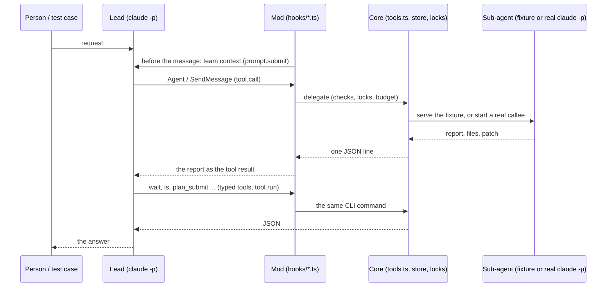

# a3_native_mod: how it works, on one page

The lead is a stock `claude -p`. A **mod** (Claude Code's own plugin runtime) gives it its tools and context; everything that decides, stores or runs lives in our **core** (the `team` CLI, `tools.ts`). The mod only relays.

## 1. One request, end to end

## 2. Many builders at once (split work)

1. The lead reads the plan, then starts several builders **in the same message**: `Agent{run_in_background: true}` each with its own `WRITES: run_test/<project>/<files>` line (or one `fork_all`).
2. For each, the mod runs `delegate --async`: the core checks the call, takes the write locks for exactly those paths (disjoint paths run together, a shared path queues), starts the callee in its own process and answers `AGENT STARTED` at once.
3. The lead continues, then calls `wait` (typed tool). While it waits, the core's monitor nudges an agent after 6 minutes and stops one that is silent for 10; `wait` returns early when one finishes, so the lead can check that builder and fix it while the others keep working.
4. When the writers are done, `apply_patches` puts their files into the project (patches apply in order, a patch that no longer fits is rejected with the reason).

## 3. What the lead sees, and when

| When | What | Where it comes from |
|---|---|---|
| startup | lead rules, the shared lead prompt, the agent list (system prompt section `team:agents`), the typed `mcp__team__*` tools | `prompts/lead.md`, `compose.ts`, `team.ts` |
| every turn | unread notes and the person's messages, sub-agents running (time, silence), background tasks, the team digest on the first turn | `context.ts` -> core `_context` (`harness/core/turn_context.ts`) |
| after every tool | live activity, lease renewal | `harness/hooks/activity.ts` |
| a call that blocks | a monitor tick every 15 s | `delegate.ts` -> core `_tick` |
| a tool call | `Agent` / `SendMessage` go to the core; `Read` / `Glob` / `Grep` / `Bash` pass the guard (no secrets, stay in the workspace) | `delegate.ts`, `register.ts`, `leadkit/guard.ts` |

The dashboard shows all of this: **Settings > Team** (agents, prompts, tools, branches, skills, the mod's hooks and context).

## 4. Files, one job each

| File | Job |
|---|---|
| `adapter.ts` | builds the lead's launch: the plugin folder, the tool list (no Bash), `--agents`, the prompt |
| `mod/hooks/register.ts` | wiring only |
| `mod/hooks/delegate.ts` | `Agent` / `SendMessage` through the core; `.catch` refuses if the mod itself fails |
| `mod/hooks/team.ts` | the `team` commands as typed tools |
| `mod/hooks/context.ts` | per-turn context |
| `mod/hooks/compose.ts` | the agent list as a system prompt section |
| `mod/hooks/wake.ts` | wake-up timer (off unless `A3_WAKE=1`) |
| `mod/hooks/cli.ts` | the one way into the core |
| `mod/hooks/register.test.ts` | mod tests, no model call |
| `info.ts` | the dashboard's context and feature lists |

Built into `test_harness/core/.build/team-lead.<hash>/` by `harness/leadkit/build.ts`. Sub-agents get their own plugin there (`agent-<name>.<hash>`: the secrets guard + the skills declared in `core/agents/skills.json`).

## 5. Rules the engine enforced (learned the hard way)
One unmatched `session.start` hook per mod. A `.catch` handler must be a top-level function. `tool.register` tools are `mcp__<plugin>__<name>` and are allowed with the rule `mcp__team`, not listed in `--tools`. `$.clock.every` returns a timer (`.cancel()`). Import plugin files without the `.ts` suffix. If the mod fails to load, Claude's own engine would run `Agent` itself: the `.catch` gates refuse instead. Debug with `claude -p ... --debug-file <file>`.

## 6. Check it (no model call)
`bun self_test/approach_a3.ts` (8 checks, includes `claude plugin validate` and `claude plugin test`), `bun self_test/skills.ts`.
