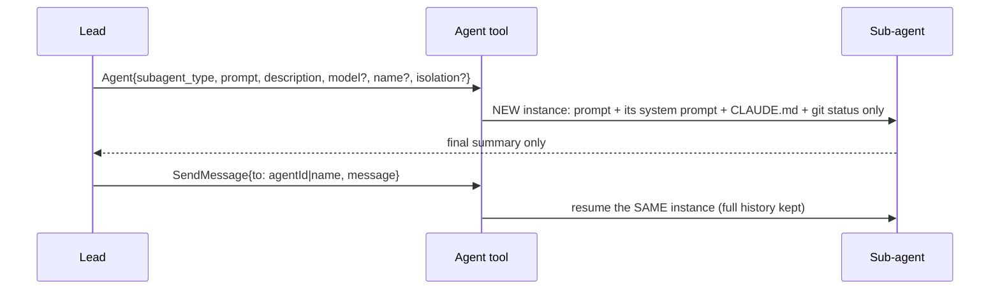

# 01 Flow: real Claude vs our approaches

## Real Claude Code (reference: https://code.claude.com/docs/en/sub-agents)

Facts: tool `Agent` (old name `Task`); definitions in `.claude/agents/*.md`, `--agents` JSON, plugin `agents/`; allow-list `Agent(a,b)`; depth 3 (`CLAUDE_CODE_MAX_SUBAGENT_SPAWN_DEPTH`); 20 concurrent (`CLAUDE_CODE_MAX_CONCURRENT_SUBAGENTS`); hooks `SubagentStart/Stop`; `PreToolUse` also fires inside sub-agents.

`// ImprovementsNeeded:` verify on the installed version that `SendMessage` is callable. Open GitHub issues say it is documented but not always available (claudeissues.com 35973, 61248); one says it needs `CLAUDE_CODE_EXPERIMENTAL_AGENT_TEAMS`.

## Side by side
| Step | Real Claude | A1 team CLI (f1) | A2 mod (harness_own_custom) | A3 native (half-built) |
|---|---|---|---|---|
| Lead intent | `Agent{...}` | `team delegate --role --session --objective --output --boundaries` via Bash | stock `Agent{...}` | stock `Agent{...}` |
| Who answers | engine spawns sub-agent | `tools.ts` -> `agentCall` -> runner or FixtureGate | mod hook on `tool.call` answers itself (no `next`) | engine, with `--agents` JSON |
| Hand-over | free `prompt` | structured fields + guard rules | free text + `guard.ts` rules | free text |
| Follow-up | `SendMessage{to}` | `--session <id>` / `fork:<id>` | `SendMessage` -> mod -> `Harness.send` | `SendMessage` |
| Parallel | several Agent calls | `--async` + `wait --any` | // NOT_POSSIBLE: not tested | engine, max 20 |
| Writes | `isolation: worktree` | locks + per-writer worktree + patches | harness writes files from the fixture | nothing from our core |
| Budget / kill | none | `agent_call` policy, watchdog | none | env caps only |
| Lead tools | any | Bash limited to `team ...`, no edit tools | any, plus mod | any |

refs: A1 `f1_multiagent/harness/lead.ts:14-47`, `harness/tools.ts`, `harness/core/agent_call.ts`, `harness/core/base/runner.ts:74-81`; A2 `harness_own_custom/main.ts`, `interface.ts`; A3 `f1_multiagent/harness/core/launch.ts:63-75`.
