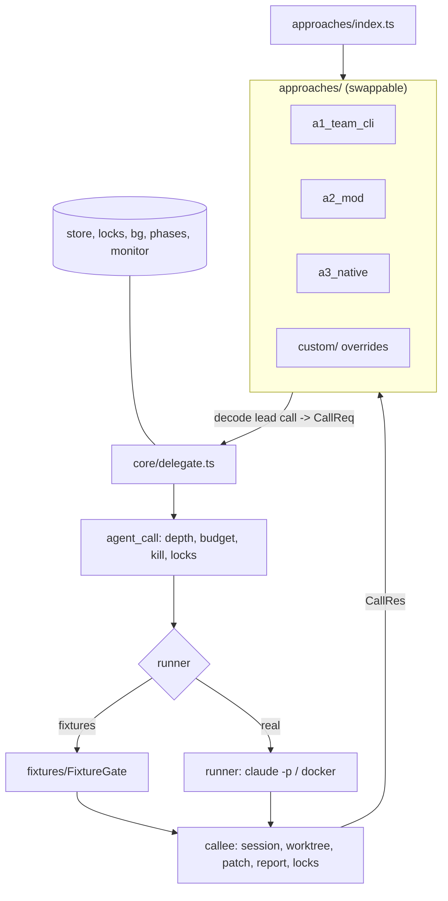

# 02 Architecture

**Rule:** every approach turns "the lead wants a sub-agent" into the same `CallReq`, calls the same `core.delegate`, and turns the `CallRes` back into the shape that lead understands. Everything else (locks, worktrees, bg, phases, monitor, fixtures, budget) is core and identical.



## What an approach owns (and ONLY this)
1. how the lead is launched (flags, tools, env, plugin dir)
2. the lead prompt files
3. decode: lead call -> `CallReq`
4. encode: `CallRes` -> lead reply
5. its `capabilities` (what extras it supports)

## What core owns
store/registry, locks (file + Redis), worktrees + patches, bg processes, plans + phase gates, monitor/watchdog/peek, runners (`claude -p`, Docker, slots, sessions), fixtures (gate, sessions, observer, lookup, guard rules), budget, hooks (`guard.ts`, `activity.ts`).

## Layers
```
tests / testrun        (--approach flag)
approaches/            (port implementations + custom overrides)
core/delegate.ts       (single entry)
core/*                 (everything else)
```
